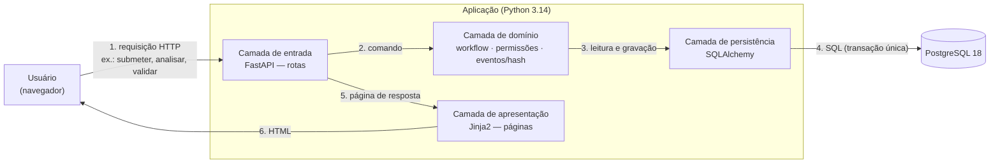
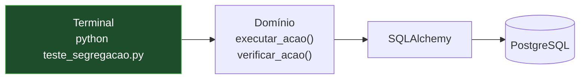
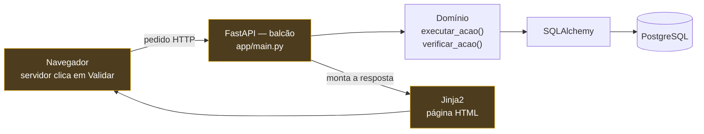
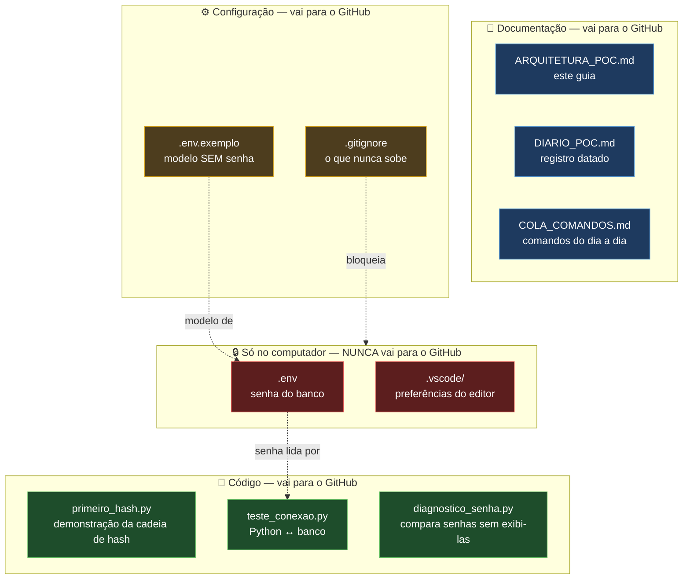

# Arquitetura da PoC nuclear — visão em camadas

Guia de orientação para quem lê ou mantém o código da PoC do Sistema de Governança Municipal LGPD
(Prefeitura Municipal de Hortolândia). Referências: SAD 09 REV10 (escopo) e SAD 10, DA-28 (stack).

## 1. O caminho de uma requisição

O caminho é o mesmo para qualquer pedido e para qualquer Instrumento (FORM 1 a 4). Na PoC nuclear existe apenas o FORM 1 simplificado; os demais chegam na PoC ampliada sem mudar as camadas.

## 1A. Onde entra o FastAPI — hoje e depois

**Analogia:** o FastAPI é o **balcão de protocolo** da Prefeitura. Ele recebe o pedido de quem chega, confere quem é a pessoa e encaminha ao setor que decide. O balcão não decide nada: quem decide é o domínio (`permissoes.py`, `eventos.py`).

**Hoje (sem FastAPI):** quem "chega ao balcão" é um script que nós rodamos no terminal.

**Depois (com FastAPI):** quem chega é o servidor, pelo navegador. O domínio é **o mesmo**, sem mudar uma linha.

**Legenda:** verde = o que existe hoje · amarelo = o que o FastAPI e o Jinja2 acrescentam.

O que muda é **só a porta de entrada**. É por isso que estamos construindo e testando o domínio primeiro: quando o balcão chegar, as regras já estarão provadas.

Quando: etapa de telas mínimas da PoC nuclear (depois do ciclo de vida e dos testes). O FastAPI ainda não está instalado nem no `requirements.txt`.

## 2. Responsabilidade de cada camada

| Camada | Tecnologia | O que faz | O que NÃO faz | SAD de referência | Arquivo(s) previsto(s) |
|---|---|---|---|---|---|
| Interface | Navegador | Exibe formulários e resultados | Não decide regras | SAD 02 | — |
| Entrada | FastAPI | Recebe a requisição, identifica o usuário, chama o domínio, devolve a resposta | Não contém regra de negócio | SAD 06 | `app/main.py` |
| Domínio | Python puro | Aplica as regras: transições de estado, segregação de funções (por pessoa), cadeia de eventos com hash | Não sabe nada de HTTP nem de SQL | SAD 03, SAD 04, SAD 08, DA-26, DA-27 | `app/workflow.py`, `app/permissoes.py`, `app/eventos.py` |
| Persistência | SQLAlchemy | Traduz objetos em tabelas e grava tudo na mesma transação | Não decide regras | SAD 05 | `app/modelos.py`, `app/banco.py` |
| Banco | PostgreSQL | Guarda os dados e garante a consistência (índices únicos, transações) | — | SAD 05, DA-28 | — |
| Apresentação | Jinja2 | Monta as páginas HTML | Não acessa o banco diretamente | SAD 02 | `app/paginas/` |
| Testes | pytest | Executa os cenários de aceite (POC-TS) pela interface HTTP e pelas regras | — | SAD 09 | `testes/` |

## 3. Princípios que a divisão garante

1. **As regras ficam num só lugar (domínio).** Trocar a tela ou o banco não muda as regras.
2. **Portabilidade.** Os testes de aceite falam com o sistema pela interface HTTP; uma reimplementação em outra linguagem pode ser conferida com os mesmos testes (SAD 09, seção 37).
3. **Transação única.** Um comando grava o evento de domínio, a auditoria e a projeção juntos, ou nada (DA-26).
4. **Integridade verificável.** Cada evento guarda o hash do anterior; qualquer alteração quebra a cadeia (DA-27). Demonstração: `primeiro_hash.py`.

## 4. Mapa da pasta (o que é cada arquivo)

**Legenda:** azul = documentação · verde = código · amarelo = configuração pública · vermelho = segredo local.

## 5. Status

- 2026-10-09: ambiente preparado; demonstração da cadeia de hash (`primeiro_hash.py`). Camadas ainda não implementadas.
- 2026-10-11: cofre de configuração (`.env`, `.gitignore`, `.env.exemplo`) e conexão Python → PostgreSQL validada com o usuário `lgpd_poc_app`.
