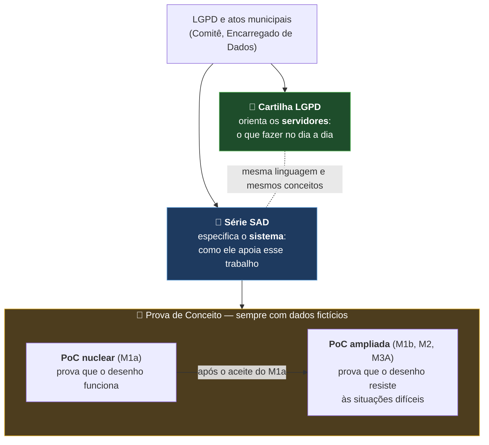
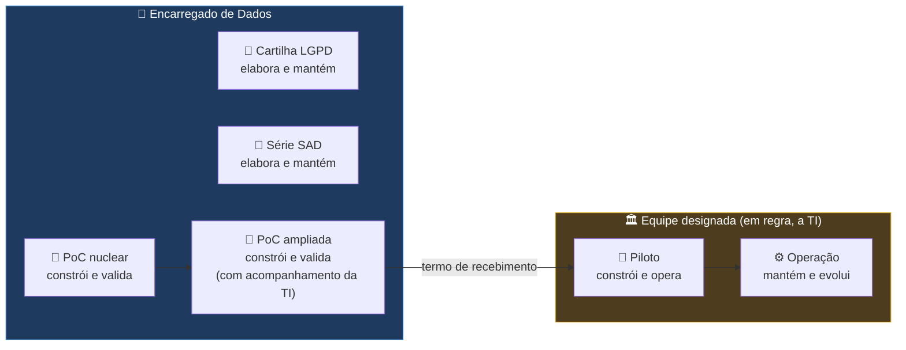
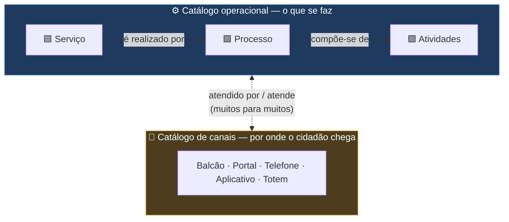
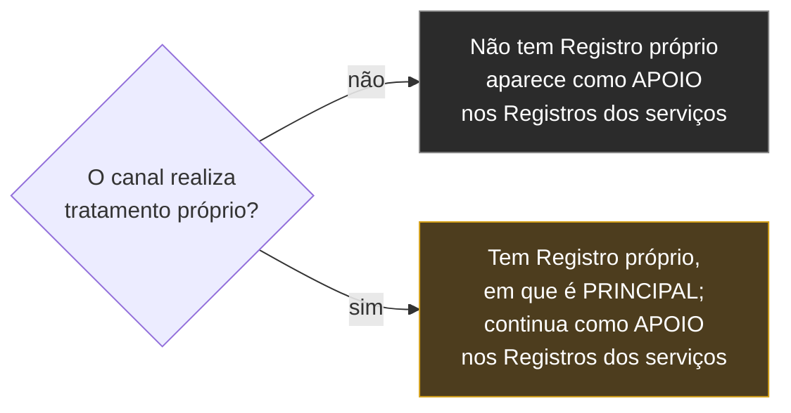
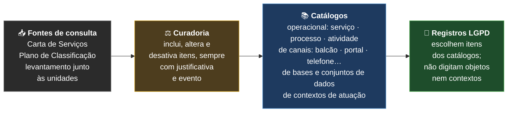
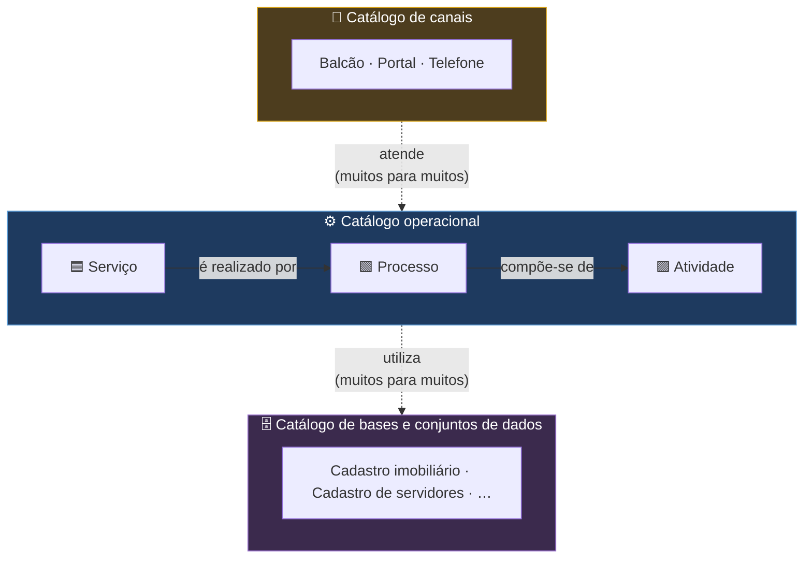
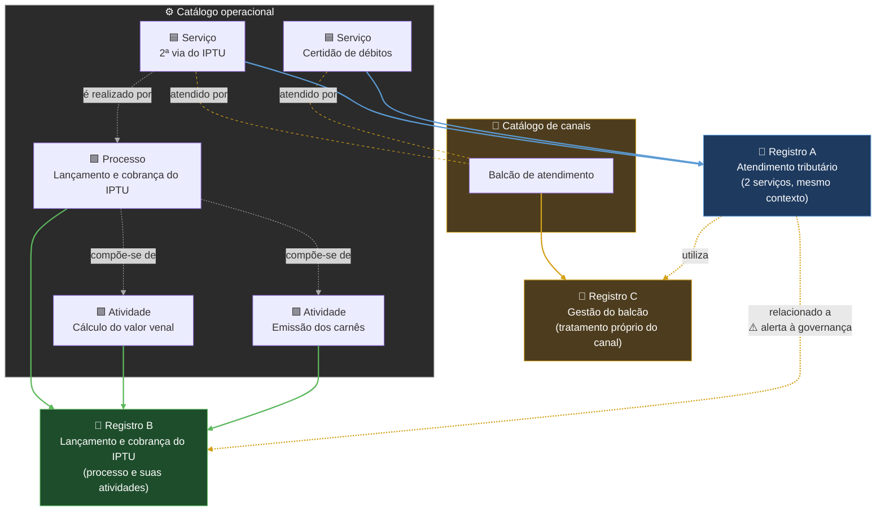
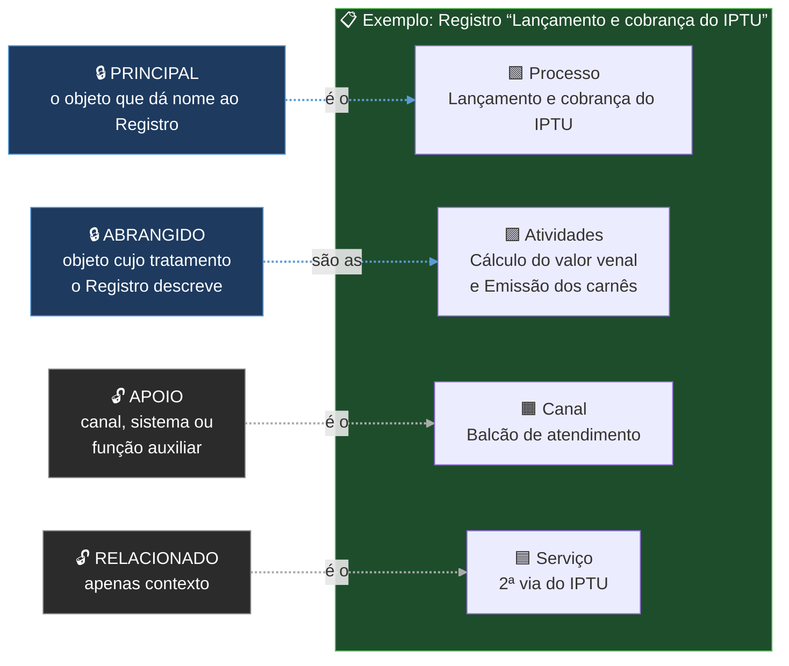
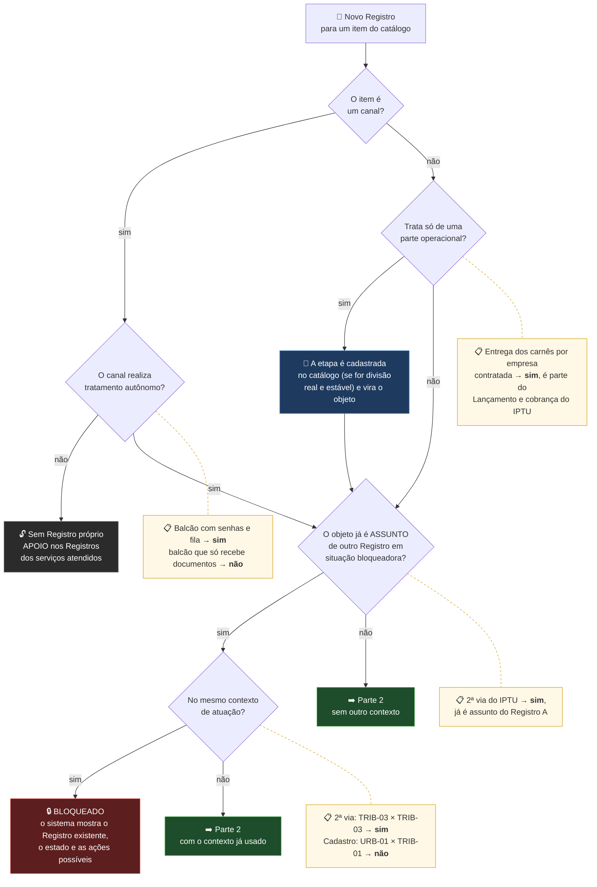
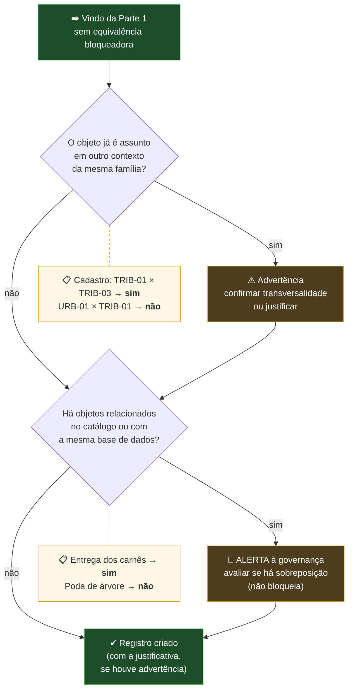

# Sistema de Governança Municipal LGPD — Prova de Conceito

**Prefeitura Municipal de Hortolândia** · PoC nuclear (em construção) e PoC ampliada (planejada) · repositório privado

> ⚠️ **Somente dados fictícios.** Nenhum dado pessoal real, CPF, matrícula, senha ou token entra neste repositório, no código, nos testes ou nos logs.

## Por onde começar

| Se você quer… | Vá para |
|---|---|
| Entender o que é o sistema e de onde vem | as seções logo abaixo ("De onde vem", "O que é") |
| Ver, em 5 minutos, como um Registro anda no M1a | [Mapa do M1a](docs/arquitetura/MAPA_M1a.md) |
| Saber o que já funciona e o que falta | [O que já funciona](#o-que-já-funciona) e [Próximos passos](#próximos-passos) |
| Montar o ambiente e rodar os testes | [Instalação e execução](docs/operacao/INSTALACAO.md) |
| Entender as camadas do código | [Arquitetura](docs/arquitetura/ARQUITETURA_POC.md) |


## De onde vem este sistema

O sistema nasce do programa de proteção de dados pessoais da Prefeitura. Dois conjuntos de documentos o sustentam, cada um com um papel:



- **Cartilha LGPD** — orienta os servidores sobre o tratamento de dados pessoais: conceitos, responsabilidades, a quem recorrer. É o ponto de partida para entender o *porquê* do sistema.
- **Série SAD** — especifica o sistema que apoia esse trabalho: requisitos, papéis, workflow, dados, segurança e decisões de arquitetura.
- **PoC nuclear e PoC ampliada** — verificam, sempre com dados fictícios, se o desenho dos SADs funciona (nuclear, marco M1a) e se resiste às situações difíceis da administração (ampliada, marcos M1b, M2 e M3A). A ampliada só começa depois do aceite da nuclear.

A Cartilha e os SADs serão publicados neste repositório na próxima etapa.

## Quem faz o quê



| Etapa | Responsável | Papel do Encarregado |
|---|---|---|
| Cartilha LGPD e série SAD | Encarregado de Dados | Elabora e mantém |
| PoC nuclear | Encarregado de Dados (operador da PoC) | Constrói e valida |
| PoC ampliada | Encarregado de Dados, com acompanhamento da TI | Constrói e valida |
| Piloto | Equipe formalmente designada (em regra, a TI) | Governança de proteção de dados |
| Operação | Equipe designada e unidades usuárias | Orientação e acompanhamento (atribuições legais do Encarregado) |

A passagem do bastão é formalizada por **termo de recebimento**, com o Relatório de Encerramento e Transferência Técnica (SAD 09, seção 37). A equipe do Piloto pode adotar outra tecnologia, desde que a nova implementação seja aprovada nos testes de aceite da PoC.

## O que é

Prova de conceito do sistema que vai apoiar a gestão de processos, atividades e serviços da Prefeitura que tratam dados pessoais, em conformidade com a LGPD. A arquitetura está descrita na série de documentos **SAD** (Solution Architecture Document); esta PoC verifica se o desenho funciona na prática.

A validação acontece em três camadas (SAD 09):


**Hoje, este repositório está na PoC nuclear (M1a).** Este documento descreve também a PoC ampliada, que reaproveita o mesmo código e começa depois do aceite do M1a.

#### PoC nuclear × PoC ampliada

As duas camadas usam dados fictícios e são construídas pelo Encarregado de Dados; a diferença está no que cada uma precisa provar (SAD 09, seção 4A):

| | PoC nuclear | PoC ampliada |
|---|---|---|
| Pergunta | O desenho funciona? | O desenho resiste às situações difíceis? |
| Marcos (SAD 09) | M1a | M1b, M2 e M3A, cada um iniciado após o aceite do anterior |
| Escopo | Registro, FORM 1 sintético simplificado, versão, submissão, análise com segregação de funções, devolução com pendência, validação, conclusão, pendência intersecretarial, livro de atos com cadeia de hash e reconstrução da trilha | Suspensão e retomada, cancelamento com efeito nas pendências, reabertura com novo ciclo, continuidade institucional (ausência, saída, troca de chefia), participação por unidade, backup e restauração; FORM 1 real de ponta a ponta, segundo Instrumento, Dossiê e compartilhamento |
| Cenários do SAD 04 | Cerca de 15 (A1 a A4, A9 a A12, A14, A15, A28 a A30) | Cerca de 16 novos, mais a reexecução de todos os da nuclear com o FORM 1 real |
| Dependências externas | Nenhuma além da autorização para implementar | Contrato integral do FORM 1 e envelope de ingestão (SAD09-05 e 01); decisão SAD09-10 |
| Entregáveis | Código, testes de aceite, evidências e diário | Também o relatório de validação e o Relatório de Encerramento e Transferência Técnica (SAD 09, seção 37) |
| Participação da TI | Recebe informação | Acompanha a construção |

A PoC ampliada exige mais trabalho: são três marcos em sequência, as situações difíceis mexem em várias peças ao mesmo tempo, e parte das condições depende de decisões institucionais. Em compensação, ela não começa do zero: reaproveita o chassi da nuclear (livro de atos, pedido idempotente, barreiras e auditoria), e cada ato novo segue o mesmo molde.

## Como os Registros são organizados

Cada **Registro LGPD** documenta um **tratamento de dados pessoais**. Serviços, processos e atividades são os **objetos** que os Registros descrevem; os **canais** de atendimento formam uma dimensão à parte (veja adiante):

| Objeto | O que é | Pergunta-teste | Exemplo |
|---|---|---|---|
| 🟦 **Serviço** | O que o cidadão recebe | "O cidadão pede isso?" | 2ª via do IPTU |
| 🟩 **Processo** | A sequência de etapas que produz um resultado, muitas vezes passando por várias unidades | "Tem começo, meio e fim?" | Lançamento e cobrança do IPTU |
| 🟪 **Atividade** | Uma etapa dentro de um processo | "É um pedaço de algo maior?" | Cálculo do valor venal |

### Canais: uma dimensão transversal

Serviços, processos e atividades formam a **estrutura operacional**: os serviços **são realizados por** processos (um serviço pode ser realizado por vários processos, e um processo pode realizar vários serviços), e os processos são compostos por atividades. A expressão "depende de" fica reservada para dependência efetiva (técnica, organizacional, informacional ou operacional). Os **canais** constituem uma **dimensão transversal de atendimento** e se relacionam com os serviços em associação muitos para muitos (o serviço *é atendido pelo* canal; o canal *atende* o serviço — é uma única relação, vista dos dois lados). O canal somente possui Registro LGPD próprio quando realiza tratamento autônomo. Caso funcione apenas como meio de acesso ou encaminhamento, aparece como APOIO nos Registros dos serviços atendidos.



#### Quando o canal ganha Registro próprio



São exemplos de tratamento próprio do canal: gestão de senhas e filas; agendamento; cadastro prévio; gravação de chamadas; videomonitoramento; identificação do atendente e do cidadão; armazenamento temporário em sistema próprio; geração de protocolo transversal. **O simples recebimento e encaminhamento de documentos do serviço não caracteriza, por si só, tratamento autônomo do canal.**

#### Exemplo: separar o que é do canal e o que é do serviço

| | Registro C — Gestão do balcão | Registro A — Atendimento tributário (2ª via do IPTU) |
|---|---|---|
| Descreve | Só o tratamento comum e autônomo do canal | O tratamento do serviço |
| Finalidade | Organizar o atendimento | Emitir a segunda via |
| Dados | Nome, senha, horário e guichê | Inscrição imobiliária e dados do contribuinte |
| Retenção | Histórico da fila por determinado período | Conforme o serviço |
| Sistema | Gerenciador de atendimento | Sistema tributário |
| Balcão de atendimento | **PRINCIPAL** | **APOIO** (canal utilizado) |

Mesmo que o servidor do balcão visualize os dados do IPTU, esse tratamento pertence ao serviço: o Registro do canal contém apenas o que o próprio canal faz com os dados.

### O que é o catálogo

O **catálogo operacional** é a lista oficial dos serviços, processos e atividades da Prefeitura que tratam, ou podem tratar, dados pessoais; o **catálogo de canais** lista as portas de atendimento. Cada item tem um **identificador canônico**: é por ele, e não pelo nome digitado, que o sistema sabe se dois Registros falam da mesma coisa. Ao lado deles existem o **catálogo de contextos de atuação**, para que o contexto também seja escolhido, e não digitado, e o **catálogo de bases e conjuntos de dados** (veja adiante).



| Cada item do catálogo operacional tem | Exemplo (fictício) |
|---|---|
| Identificador canônico | `OBJ-SRV-001` |
| Tipo | serviço, processo ou atividade |
| Nome oficial | 2ª via do IPTU |
| Relações com outros itens | é realizado por *Lançamento e cobrança do IPTU*; atendido por *Balcão de atendimento* |
| Referência oficial, quando houver | item da Carta de Serviços ou classe do Plano de Classificação |
| Situação | ativo ou desativado — um item nunca é apagado |

**O que o catálogo não é:** não é uma cópia importada da Carta de Serviços (que continua sendo referência de consulta, SAD 05, 13.4); não é preenchido pelo elaborador na hora de criar o Registro; e não contém dados pessoais.

**Em aberto (O-80):** quem exerce a curadoria; como será a carga inicial; e a lista inicial de contextos de atuação. Na PoC, os catálogos são fictícios.

### Contexto de atuação e finalidade: duas coisas diferentes

Na LGPD, **finalidade** tem sentido preciso: "realização do tratamento para propósitos legítimos, específicos, explícitos e informados ao titular" (art. 6º, I). Para não confundir, o sistema usa outro nome para a classificação que serve à prevenção de duplicidade: **contexto de atuação**.

| | Contexto de atuação | Finalidade (LGPD) |
|---|---|---|
| O que é | Classificação cadastral do recorte administrativo e funcional em que o tratamento é descrito | O propósito específico do tratamento, informado ao titular |
| Onde fica | Catálogo de contextos de atuação (escolhido, nunca digitado) | FORM 1, com versões e validação |
| Para que serve | Distinguir tratamentos do mesmo objeto e evitar Registros duplicados | Cumprir o art. 6º, I, e orientar o titular |
| Exemplo | CTX-TRIB-03 — Arrecadação e cobrança tributária | Emitir a 2ª via do carnê para que o contribuinte pague o IPTU do exercício |

A finalidade é sempre declarada **dentro** de um contexto de atuação.

**Definição.** Contexto de atuação é a classificação cadastral que identifica o recorte administrativo e funcional no qual o tratamento associado a um objeto é descrito pelo Registro LGPD. É utilizado para distinguir tratamentos autônomos envolvendo o mesmo objeto e para prevenir Registros duplicados. Não substitui a finalidade do tratamento exigida pela LGPD, não representa a hipótese legal e não corresponde necessariamente a uma Secretaria ou unidade organizacional.

**Pergunta-teste:** *Em qual frente concreta de atuação administrativa este objeto está sendo utilizado ou executado neste Registro?*

A combinação usada na equivalência é: **objeto + contexto de atuação**.

> **A escolha de contextos diferentes permite a análise separada, mas não prova, por si só, que existem tratamentos autônomos.** Quem decide se há um ou dois tratamentos é a análise do tratamento (finalidade, dados, titulares, hipótese legal, riscos — SAD 02, RF-PRC-15), não o código do contexto.

**Não confundir com:**

| Confusão comum | Exemplo do erro | O que é de fato |
|---|---|---|
| Hipótese legal | "Cumprimento de obrigação legal" | A base que autoriza o tratamento (LGPD, art. 7º), registrada no FORM |
| Operação de tratamento | "Coleta e armazenamento" | O que se faz com o dado |
| Nome do serviço | "2ª via do IPTU" | O objeto do catálogo |
| Justificativa genérica | "Cumprir a LGPD" | Não diz em que frente se atua |

#### Exemplos de contextos de atuação (fictícios)

| Código | Contexto de atuação | Descrição |
|---|---|---|
| CTX-TRIB-01 | Gestão cadastral tributária | Manutenção de cadastros utilizados na constituição e administração de tributos municipais |
| CTX-TRIB-02 | Lançamento tributário | Apuração e constituição de créditos tributários municipais |
| CTX-TRIB-03 | Arrecadação e cobrança tributária | Emissão de guias, pagamentos, parcelamentos e cobrança administrativa de tributos |
| CTX-URB-01 | Planejamento territorial | Uso de informações para planejamento urbano, territorial e definição de políticas de ocupação |
| CTX-URB-02 | Licenciamento de obras | Análise, autorização e acompanhamento de obras e edificações |
| CTX-URB-03 | Regularização fundiária | Identificação e regularização jurídica, urbanística e social de imóveis e ocupações |
| CTX-ATD-01 | Gestão do atendimento ao cidadão | Organização de filas, senhas, agendamentos, protocolos e histórico do atendimento |
| CTX-ATD-02 | Gestão de manifestações | Recebimento e tratamento de reclamações, sugestões, elogios, denúncias e solicitações |
| CTX-TRA-01 | Transparência e acesso à informação | Atendimento de pedidos de acesso à informação e acompanhamento de respostas |
| CTX-RH-01 | Administração funcional | Gestão de vínculos, lotações, frequência, férias, remuneração e demais informações funcionais |
| CTX-RH-02 | Saúde ocupacional | Acompanhamento da saúde, segurança e aptidão laboral dos agentes públicos |
| CTX-EDU-01 | Gestão da vida escolar | Matrícula, frequência, avaliação, transferência e histórico de estudantes |
| CTX-SAU-01 | Assistência à saúde | Prestação e acompanhamento de atendimentos e cuidados de saúde |
| CTX-SOC-01 | Proteção e assistência social | Atendimento, acompanhamento e concessão de benefícios socioassistenciais |
| CTX-FIS-01 | Fiscalização administrativa | Planejamento, execução e registro de ações de fiscalização municipal |
| CTX-COM-01 | Contratações públicas | Planejamento, seleção de fornecedores, contratação e gestão contratual |
| CTX-MOB-01 | Mobilidade e trânsito | Gestão da circulação, transporte, fiscalização e segurança viária |
| CTX-AMB-01 | Gestão e fiscalização ambiental | Licenciamento, monitoramento e fiscalização de atividades com impacto ambiental |
| CTX-SEG-01 | Segurança patrimonial | Controle de acesso, vigilância e proteção de instalações e bens municipais |
| CTX-JUR-01 | Representação e defesa jurídica | Gestão de processos judiciais, administrativos e atividades de representação do Município |

O prefixo do código (TRIB, URB, ATD, RH…) forma uma **família**. O mesmo objeto em dois contextos da **mesma família** gera **advertência**, não erro: *"Este objeto está associado a mais de um contexto da mesma família. Confirme se ele é transversal ou escolha um contexto principal."* Pode ser classificação equivocada, duplicação ou objeto legitimamente transversal. A advertência se resolve definindo um contexto principal e os demais como secundários, marcando o objeto como transversal, registrando justificativa curta ou removendo a associação feita por engano. Entre famílias diferentes (ex.: TRIB e URB) não há advertência, pois a transversalidade entre áreas é legítima. Só famílias configuradas como mutuamente exclusivas impedem duas classificações simultâneas.

#### Mesmo objeto em contextos diferentes

**Processo de gestão de servidores**
- Gestão de servidores + Administração funcional
- Gestão de servidores + Saúde ocupacional
- Gestão de servidores + Representação e defesa jurídica

A existência de mais de um Registro dependerá de os tratamentos serem efetivamente autônomos.

**Balcão de atendimento** + Gestão do atendimento ao cidadão: aplica-se quando o balcão tem tratamento próprio (emissão de senhas, agendamento, identificação do cidadão, registro de horário e guichê, sistema próprio). Quando o balcão apenas recebe e encaminha documentos, ele aparece como APOIO no Registro do serviço e não precisa de combinação própria.

#### Exemplos inadequados

- **Contextos amplos demais:** Administração · Prefeitura · Interesse público · Gestão municipal · Atendimento · Cumprimento legal.
- **Nomes de unidades:** Secretaria de Finanças · Departamento de Recursos Humanos · Gabinete · Secretaria de Educação.

### Bases e conjuntos de dados: o terceiro eixo

Uma base de dados como o **Cadastro imobiliário** não é serviço, processo nem atividade: é um **ativo informacional transversal**, usado por várias atividades, cada uma com a sua finalidade. **A base ou conjunto de dados, enquanto ativo informacional, não é assunto de Registro. As atividades que criam, mantêm ou utilizam a base podem constituir tratamentos documentados em Registros.** Por isso fica num catálogo próprio, o **catálogo de bases e conjuntos de dados**. O nome cobre banco de dados, planilha, arquivo físico ou sistema, porque a LGPD protege os dados pessoais onde quer que estejam.



| Elemento | Exemplo | Papel no modelo |
|---|---|---|
| 🗄️ Base ou conjunto de dados | Cadastro imobiliário | Ativo informacional: não é assunto de Registro e não entra na trava |
| ⚙️ Atividade que cria e mantém a base | Gerir e manter o Cadastro imobiliário | Pode constituir tratamento documentado em Registro: coleta, correção, atualização e conservação dos dados |
| ⚙️ Atividades que utilizam a base | Tributação imobiliária, planejamento urbano, regularização fundiária, fiscalização, atendimento | Podem constituir tratamentos documentados em Registros, cada uma com finalidade própria, ligada à base por "utiliza" |

A atividade de tratamento continua sendo o elemento central para finalidade, hipótese legal, titulares, compartilhamentos e retenção; a base funciona como ativo associado a essas atividades. *🧪 DA-38, item 7 (SAD 10 REV15).*

### Exemplo: objetos do catálogo e seus Registros



*Exemplos ilustrativos.* Linhas cinzas: a hierarquia entre os objetos. Linhas tracejadas laranja: o serviço é atendido pelo canal. Linhas coloridas: a qual Registro cada objeto pertence. Linhas amarelas: relações entre Registros; a relação entre A e B gera um alerta para a governança avaliar se há sobreposição de tratamentos.

Cada regra abaixo traz duas informações separadas: a **situação normativa** (de onde a regra vem e quanto ela já vale) e a **situação na PoC** (o que o código já faz).

| Símbolo | Situação normativa |
|---|---|
| 📘 | **Requisito vigente**: está escrito num SAD em vigor |
| 🔎 | **Interpretação** de um SAD: decorre do texto, mas não está escrita com essas palavras |
| 🧪 | **Decisão provisória da PoC** (SAD 10, DA-36 a DA-39): já vale para a PoC; os SADs afetados serão ajustados na revisão pós-PoC |
| 📝 | **Decisão do Encarregado ainda não registrada no SAD 10**: será levada a uma nova ficha DA (nenhuma no momento) |

#### Organização dos Registros

| Regra | Situação normativa | Na PoC |
|---|---|---|
| O mesmo objeto prestado por várias Secretarias é **um só** Registro, com uma unidade principal e as demais como participantes, **quando se tratar do mesmo objeto, no mesmo contexto de atuação e sem tratamentos materialmente autônomos** | 📘 SAD 02, RF-PRC-06 | Unidade principal ✔; participantes a fazer |
| Vários serviços com as mesmas operações e finalidade podem integrar **um único** Registro (A) | 📘 SAD 02, RF-PRC-13 | ✔ Um Registro com vários objetos |
| Um processo e as suas atividades ficam, em regra, no **mesmo** Registro (B); uma atividade só ganha Registro próprio se tiver tratamento autônomo (ex.: terceirizada, com operador e base próprios) | 🔎 SAD 02, RF-PRC-15 — granularidade a confirmar | ✔ Permitido pelo modelo |
| A hierarquia (serviço realizado por processo; processo composto de atividades) **não** torna os objetos equivalentes: os Registros se ligam por relação | 🔎 SAD 05, 13.1 | Relações no catálogo a fazer |
| Um canal só tem Registro **próprio** quando realiza tratamento autônomo; nele é PRINCIPAL (C) e, nos Registros dos serviços, APOIO. Receber e encaminhar não basta | 📘 SAD 02, RF-PRC-14 + 🧪 DA-36, item 6 | ✔ Catálogo de canais; papéis a fazer |
| Um ou dois Registros? Decide o **tratamento autônomo** (finalidade, dados, titulares, hipótese legal, riscos), não o rótulo serviço, processo ou atividade | 📘 SAD 02, RF-PRC-15 | — (decisão humana) |

#### Prevenção de duplicidade

| Regra | Situação normativa | Na PoC |
|---|---|---|
| **Bloqueio** (determinístico): não pode haver dois Registros em situação bloqueadora nos quais o mesmo objeto, no mesmo contexto de atuação, apareça como PRINCIPAL ou ABRANGIDO — trava no próprio banco de dados | 🧪 DA-36, itens 1 e 7 + DA-38, item 3 (contexto de atuação no lugar de "finalidade") | ✔ Trava por objeto + contexto no próprio banco, inclusive para pedidos simultâneos |
| **Contexto distinto não basta**: permite a análise separada, mas não prova, por si só, que os tratamentos são autônomos | 🧪 DA-38, item 4 | — (decisão humana) |
| **Sem atalhos**: a etapa só vira item próprio do catálogo quando for divisão real e estável do processo; o contexto é escolhido de catálogo, nunca digitado | 🧪 DA-36, itens 4 e 5 + DA-38, item 1 | ✔ Catálogo fictício de contextos (20) |
| **Advertência de família**: mesmo objeto em dois contextos da **mesma família** (ex.: CTX-TRIB-01 e CTX-TRIB-03) exige resolução; famílias diferentes não geram aviso; só famílias configuradas como mutuamente exclusivas impedem | 🧪 DA-38, item 6 + DA-39, item 2 (correção do pedido, justificativa específica ou transversalidade declarada pela governança) | ✔ Implementada e testada (Etapa 2d) |
| **Alerta** (análise humana), em dois momentos: na **criação**, por objetos relacionados no catálogo ou base de dados comum; na **submissão do FORM 1**, por mesma finalidade, titulares, categorias de dados ou compartilhamentos. O sistema não funde nem bloqueia sozinho | 📘 SAD 05, 5.3 + 🧪 DA-36, item 7 + DA-39, item 4 (dois momentos) | ⚙️ Parcial: base comum; relações do catálogo e verificação na submissão a fazer |

### Assunto ou citado: o papel de cada objeto no Registro

Os objetos ligados a um Registro têm um de quatro papéis. Os dois primeiros são o **assunto** do Registro e entram na trava contra duplicidade (🔒); os dois últimos são apenas **citados** e podem aparecer em vários Registros (🔓). À direita, um exemplo:



*No exemplo, ninguém mais pode abrir um Registro cujo assunto seja o Lançamento e cobrança do IPTU ou as suas atividades, no mesmo contexto de atuação. Já o Balcão e a 2ª via podem ser citados em outros Registros, e o Balcão continua livre para ter o seu próprio Registro, em que será PRINCIPAL.*

### Situação bloqueadora

| Estado do Registro equivalente | Resultado |
|---|---|
| Em andamento | 🔒 Bloqueia |
| Em validação | 🔒 Bloqueia |
| Em execução | 🔒 Bloqueia |
| Suspenso | 🔒 Bloqueia e orienta retomada ou cancelamento |
| Concluído | 🔒 Bloqueia nova criação e orienta reabertura (G10) |
| Cancelado | ✔ Permite novo Registro, com vínculo ao anterior |

*🧪 DA-36, item 2 (SAD 10 REV13). O SAD 04 exige, no G1, a inexistência de Registro equivalente **ativo**. Incluir Suspenso e Concluído vai além dessa expressão literal, mas é coerente com a preservação do mesmo Registro e de seus ciclos. Exige ajuste do SAD 04.*

#### Questão arquitetural: cancelar a partir de Suspenso ou Concluído (G11)

O G11 do SAD 04 só permite cancelar a partir de estado **ativo** (Em andamento, Em validação, Em execução). Isso impedia cancelar um Registro duplicado que já estivesse Suspenso ou Concluído, a não ser por caminhos artificiais (retomar só para cancelar, ou reabrir criando um ciclo novo só para cancelar), que distorceriam a trilha.

| Situação | Onde está |
|---|---|
| 🧪 Decisão provisória: o G11 passa a valer a partir de qualquer estado diferente de Cancelado; motivo escolhido de catálogo; competência reforçada para cancelar Registro Concluído, sem novo ciclo e sem apagar a conclusão histórica | DA-37 (SAD 10 REV14) |
| Consolidação documental | SAD 04 (G11, Figura 2, seção 6.4, pendências e cenários), na revisão pós-PoC (O-82). Não impede a PoC |
| Na PoC | O cenário 8 (duplicidade descoberta depois) depende da implementação dos atos de suspender, concluir e cancelar, já regulados pela DA-37 |

### Como o sistema evita Registros duplicados

**Ordem de verificação (precedência).** Antes de tudo, a triagem define qual é o objeto (um canal sem tratamento próprio não tem Registro; uma parte operacional vira atividade do catálogo). Depois, as verificações seguem sempre esta ordem:

| Ordem | Verificação | Se a resposta for "sim" | Natureza |
|---|---|---|---|
| 1 | **Equivalência bloqueadora**: o objeto já é PRINCIPAL ou ABRANGIDO de outro Registro em situação bloqueadora, no mesmo contexto de atuação? | 🔒 Bloqueia; as etapas seguintes não se aplicam | Determinística (banco de dados) |
| 2 | **Família de contexto**: o objeto já é assunto de Registro em outro contexto da mesma família? | ⚠️ Advertência: exige justificativa | Confirmação humana |
| 3 | **Objetos relacionados** (triagem estrutural): há objetos relacionados no catálogo ou que usam a mesma base de dados? A semelhança material (finalidade, titulares, dados) é verificada depois, na submissão do FORM 1 | 🔔 Alerta à governança | Análise humana posterior |
| 4 | **Resultado** | **Bloquear**, **criar com justificativa** (após 2) ou **criar** (com ou sem alerta) | — |

O fluxograma está dividido em duas partes. As caixas amarelas (📋) mostram como os exemplos da tabela adiante respondem.

#### Parte 1 — Triagem e bloqueio por equivalência (verificação 1)



#### Parte 2 — Advertências e alertas (verificações 2 e 3)



#### Exemplos (fictícios), cada um percorrendo as duas partes do fluxograma

| Ex. | Pedido | Caminho no fluxograma | Resultado |
|---|---|---|---|
| 1 | Criar um Registro chamado "IPTU" para o serviço **2ª via do IPTU**, contexto *Arrecadação e cobrança tributária* (CTX-TRIB-03) | O objeto já é assunto do Registro A, no mesmo contexto | 🔒 **Bloqueado.** O sistema mostra o Registro A, o estado e as ações possíveis (abrir, solicitar acesso) |
| 2 | Registrar a atividade **Gerir e manter o Cadastro imobiliário** no contexto *Planejamento territorial* (CTX-URB-01), quando ela já tem Registro em *Gestão cadastral tributária* (CTX-TRIB-01) | Já é assunto de outro Registro, mas em contexto distinto e de outra família: sem advertência. O contexto distinto permite a análise separada, mas a autonomia dos tratamentos é confirmada na análise do Registro | ✔ **Criado** |
| 3 | Registrar só a **entrega dos carnês por empresa contratada** | É parte operacional: vira atividade no catálogo e a verificação recomeça. Não é assunto de outro Registro, mas está relacionada ao Lançamento e cobrança do IPTU | 🔔 **Alerta** à governança e ✔ **criado** |
| 4 | Criar um Registro para o serviço **Poda de árvore** | Não é assunto de outro Registro e não tem objetos relacionados | ✔ **Criado** |
| 5 | Registrar a mesma atividade de cadastro em *Arrecadação e cobrança tributária* (CTX-TRIB-03), quando já existe em CTX-TRIB-01 | Contexto distinto, mas da mesma família TRIB: pode ser o mesmo tratamento fatiado | ⚠️ **Advertência**, com justificativa, e ✔ **criado** |

*Proposta em teste na PoC (DA-36 e DA-38), em revisão na Etapa 2d. A PoC já executa os exemplos 1, 2, 4 e 5 e o alerta por base de dados comum; o alerta por relações hierárquicas do catálogo (exemplo 3) depende da curadoria (O-80).*

## O que já funciona

| Item | Situação |
|---|---|
| Conexão Python ↔ PostgreSQL, com senha fora do código | ✔ |
| Livro de atos do domínio e livro de auditoria mensal, com cadeia de hash (DA-26, DA-27) | ✔ três tipos de fraude detectados em simulação |
| Pedido idempotente estrito: chave obrigatória, mesmo resultado na repetição, chave reutilizada com outro conteúdo recusada (DA-26; DA-39, item 5) | ✔ |
| Numeração anual LGPD-AAAA-NNNNN, no fuso de São Paulo (DA-39, item 3) | ✔ |
| Base da PoC `lgpd_poc_v2`, migrações versionadas e base própria de testes | ✔ |
| Pessoas, contas, unidades e designações de papéis | ✔ dados fictícios |
| Segregação de funções, comparando a pessoa e nunca a conta (O-66) | ✔ cenários a, b, c, e, f ¹ |
| Criação do Registro pelo G1, com ciclo 1 e FORM 1 Não iniciado | ✔ ² |
| Catálogo operacional e catálogo de canais, com a relação "atendido por" (DA-36, item 6) | ✔ fictícios |
| **Prevenção de duplicidade** (geral) | ✔ Etapa 2d concluída ³ |
| ↳ Catálogos fictícios de contextos (com famílias) e de bases e conjuntos de dados, com a relação "utiliza" | ✔ Implementado |
| ↳ Trava determinística objeto + contexto, no próprio banco | ✔ Implementada |
| ↳ Exatamente um PRINCIPAL por Registro, no próprio banco | ✔ Implementado |
| ↳ Advertência de família, com três resoluções (DA-39, item 2) | ✔ Implementada |
| ↳ Declaração de transversalidade, só pela governança (DA-39, item 2) | ✔ Implementada |
| ↳ Alerta estrutural | ⚙️ Parcial: base de dados comum ✔; relações do catálogo a fazer (O-80) |
| ↳ Semelhança por finalidade, titulares e dados | A fazer, na submissão do FORM 1 (DA-39, item 4) |
| ↳ Testes automatizados (pytest, base própria) | ✔ 54 aprovados |
| Checkpoint externo da cadeia (SAD 08) | a fazer |
| Rascunho do FORM 1: I1 iniciar preenchimento e I2 salvar, com controle otimista | ✔ |
| Versão, submissão, análise, pendência e demais atos do workflow | a fazer |
| Telas (FastAPI + Jinja2) e testes de aceite do M1a (POC-TS-001 a 009) | a fazer |

¹ Tentativas negadas ficam registradas na auditoria. O cenário d (substituição) está a fazer.
² O início do preenchimento do FORM 1 será um comando posterior ao G1, como no cenário A1 do SAD 04.
³ Trava determinística por objeto e contexto e exatamente um PRINCIPAL, no próprio banco; um contexto por Registro garantido por chave composta (DA-39, item 1); advertência de família e transversalidade (DA-39, item 2); recusas do banco tratadas pelo nome da regra. A suíte chegou a 54 testes automatizados aprovados em 16/10/2026, inclusive pedidos simultâneos. Os cenários de Suspenso, Concluído e Cancelado são testados como regra do banco até a chegada dos atos do M1b.1.

## Marcos e critérios de saída

> 🗺️ **Para entender o percurso de um Registro no M1a em cinco minutos, veja o [Mapa do M1a](docs/arquitetura/MAPA_M1a.md)**: estados, percursos (sem medidas, com devolução, com medidas, pendência para outra Secretaria) e regras comuns. O mapa só ilustra; prevalecem o SAD 04 (REV12), o SAD 09 e a DA-39.

Cada marco tem as suas condições de entrada e de saída (SAD 09, seções 4A, 4C e 30). Cada critério de aceite (POC-CA) gera uma evidência de mesmo número (POC-EV): POC-CA-001 → POC-EV-001, e assim por diante. Uma camada só é aceita quando os seus cenários, testes e critérios forem verificados.

**Regras comuns a todos os marcos** (📘 SAD 09, seção 30):

- **Quem aprova:** o operador da PoC executa os testes; o **Encarregado de Dados** aceita o marco e eventuais exceções.
- **Como se encerra:** aceite registrado em ata da PoC (pasta do SAD 09), referenciado no SAD 10; evidências preservadas até o fim do Piloto.
- **O que impede:** nenhum defeito **crítico** (impede a finalidade do marco ou compromete integridade, segregação ou dados) ou **alto** (falha de requisito obrigatório sem contorno) pode estar aberto. O marco é reaberto se um desses defeitos aparecer depois do aceite.

*Na PoC nuclear, operador e aceitante são a mesma pessoa. Por isso as evidências são automatizadas e reproduzíveis: qualquer terceiro, inclusive a TI, pode reexecutá-las.*

| | M1a · PoC nuclear | M1b · PoC ampliada |
|---|---|---|
| Condições de entrada | SAD 09 aprovado e instrução "IMPLEMENTAR PoC" (seção 35); SAD09-02, 04, 06, 07, 08 e 09 resolvidas (DA-28, DA-34); SAD09-03 provisória | M1a aceito |
| Critérios de aceite | POC-CA-001 a 006, 009, 011, 014 e 015; cenários A1 a A4, A9 a A12, A14, A15, A28 a A30; testes POC-TS-001 a 009 | POC-CA-010, 012 e 013; cenários A5 a A7, A13, A16, A18, A19, A24, A31 a A33, A35, A36; testes POC-TS-010, 011, 013 a 017 |
| Evidências exigidas | POC-EV-001 a 006, 009, 011, 014 e 015 | POC-EV-010, 012 e 013 |
| Autoridade que aprova | Encarregado de Dados | Encarregado de Dados |
| Condição de encerramento | Critérios aprovados, cadeia de eventos verificada e ata do aceite | Critérios aprovados, cenários do M1a reexecutados e ata do aceite |
| Pendências que impedem avançar | Defeito crítico ou alto aberto; regra usada pelo código ainda sem registro no SAD 10 (hoje, nenhuma) | Defeito crítico ou alto aberto; G11 conforme DA-37 sem implementar; competência para cancelar Registro Concluído (DA-37, item 4) em aberto |

| | M2 · PoC ampliada | M3A · PoC ampliada |
|---|---|---|
| Condições de entrada | M1b aceito; contrato integral do FORM 1 aprovado (SAD09-05) e envelope de ingestão definido (SAD09-01) | M2 aceito; decisão SAD09-10 definida antes do encerramento da PoC |
| Critérios de aceite | POC-CA-007 e 008; cenários A17 e A34; teste POC-TS-012 | POC-CA-012, 016 e 017, com verificação final de todos os demais; reexecução dos cenários anteriores com o FORM 1 real |
| Evidências exigidas | POC-EV-007 e 008 | POC-EV-012, 016 e 017, mais as evidências reexecutadas |
| Autoridade que aprova | Encarregado de Dados | Encarregado de Dados |
| Condição de encerramento | Critérios aprovados e ata do aceite | Critérios aprovados, ata do aceite e Relatório de Encerramento e Transferência Técnica (SAD 09, seção 37): encerra a PoC |
| Pendências que impedem avançar | SAD09-01 ou SAD09-05 em aberto; cópias fictícias equivalentes aos formulários reais não preparadas | SAD09-10 em aberto; relatório não elaborado. O Piloto exige autorização própria (SAD 09, 4A.7) |

## Pacotes de implementação do M1b

O workflow é **um só**, definido no SAD 04. O escopo, os marcos e os testes de aceite estão no SAD 09. Os pacotes abaixo só **organizam o trabalho** dentro do M1b: não redefinem regras. A situação de cada pacote é *pendente*, *em execução* ou *concluído* (com testes). O **aceite formal**, com ata, é do M1b inteiro (SAD 09, seção 30).

```
M1a — PoC nuclear
M1b — Fluxos de controle
  M1b.1 — Autorizações, suspensão, retomada e cancelamento
          (inclui o P10 mínimo necessário ao cancelamento em cascata)
  M1b.2 — Reabertura e novos ciclos
  M1b.3 — Pendências completas, participação e continuidade
          (inclui P5 a P9 e a integração completa do P10; AB-02 decidida antes do aceite final)
  M1b.4 — Backup, restauração, integridade e adaptadores
```

| Pacote | Escopo principal | Cenários (SAD 04) | Testes | Critérios específicos | Situação |
|---|---|---|---|---|---|
| M1b.1 | Matriz provisória de autorizações; suspensão; retomada; cancelamento; P10 mínimo para o efeito em cascata | A5, A6, A35 | POC-TS-011, 016, 017 | Cenários aprovados | Pendente |
| M1b.2 | Reabertura; novo ciclo; preservação dos ciclos; ações e pendências pós-conclusão | A7, A13, A32, A33 | — | Cenários aprovados | Pendente |
| M1b.3 | P5 a P9; participação por unidade; continuidade institucional; reatribuições; integração do P10 ao fluxo completo | A16, A18, A19, A24, A31, A36 | — | POC-CA-010 | Pendente |
| M1b.4 | Backup; restauração; evidências; verificação das cadeias; adaptadores simulados | — | POC-TS-010, 013, 014, 015 | POC-CA-012 e 013 | Pendente |

*Fora do M1b:* A17, A34, POC-TS-012 e POC-CA-007 e 008 pertencem ao **M2** (ingestão, mapeamento e reprocessamento). Cada cenário, teste e critério do M1b aparece em exatamente um pacote.

**Dependências explícitas** (o pacote só começa quando estiverem cumpridas):

| Pacote | Dependências |
|---|---|
| M1b.1 | M1a aceito; matriz provisória de autorizações; **regras de prazo decididas** (O-84); calendário da PoC definido; P10 mínimo para o cancelamento em cascata |
| M1b.2 | M1a aceito; **percurso com medidas e G6 comprovados no M1a**, com a ação obrigatória sintética disponível (usada no A32); regras de ciclo e de preservação das ações definidas |
| M1b.3 | M1b.1 concluído; P1 a P4 disponíveis; regras de substituição e reatribuição definidas; **AB-02 decidida antes do aceite final** (não impede o início do pacote; se não virar situação autônoma, registra-se qual dos quatro casos absorve o comportamento) |
| M1b.4 | Pacotes funcionais anteriores concluídos; conteúdo do backup definido; ambiente limpo de restauração; contrato dos adaptadores e verificação das cadeias disponíveis |

**Critérios gerais**, reaplicados como verificação em cada pacote: POC-CA-001 (requisitos obrigatórios implementados), 002 (todos com método de verificação), 003 (cenários críticos executados), 014 (ausência de dados reais) e 015 (nenhum defeito crítico ou alto aberto).

## Próximos passos

| Ordem | Passo | O que inclui | Marco |
|---|---|---|---|
| 1 | Etapa 2d: testes automatizados | Converter os cenários atuais em testes (pytest), num banco de teste próprio | M1a |
| 2 | Etapa 2d: correções | Idempotência estrita, tratamento específico das recusas do banco, papéis explícitos no pedido, numeração anual (D4), um contexto por Registro (D1) | M1a |
| 3 | Etapa 2d: advertência e transversalidade | Resolução da advertência de família e declaração de transversalidade (D2) | M1a |
| 4 | Concluir o núcleo do workflow | Rascunho, versão, submissão (com a verificação material), retirada da submissão antes da análise (I4, cenário A11), análise com segregação e reatribuição da análise (I14, cenário A14), devolução com pendência (P1 a P4, e P5/P6 no percurso da devolução), validação, conclusão e pendência intersecretarial; ação obrigatória sintética mínima e percurso com medidas (I5 → G4 → Em execução → G6) | M1a |
| 5 | Automatizar os testes de aceite do M1a | Cenários POC-TS-001 a 009, gerando as evidências POC-EV do marco | M1a |
| 6 | Fechar as decisões normativas pendentes | Competência do item 4 da DA-37 (quadro abaixo) | M1a → M1b |
| 7 | Executar o M1b em quatro pacotes | M1b.1 a M1b.4, cada um só depois de cumpridas as suas dependências (quadro "Pacotes de implementação do M1b") | M1b |

## Pendências normativas consolidadas

| Item | Assunto | Natureza | Quem decide | O que bloqueia | Onde será registrado |
|---|---|---|---|---|---|
| O-80 | Curadoria e carga dos catálogos | ⏳ Decisão pendente | A definir | Catálogo definitivo (na PoC, os catálogos são fictícios) | SAD correspondente (SAD 05 e SAD 03) |
| O-82 | Consolidação documental da decisão do G11 no SAD 04 | 📄 Consolidação (decidido na DA-37) | Encarregado | Nada na PoC | SAD 04, na revisão pós-PoC |
| O-83 | Consolidação documental de contextos, bases e famílias | 📄 Consolidação (decidido na DA-38) | Encarregado | Nada na PoC | SADs 02, 04, 05, 08 e 09, na revisão pós-PoC |
| D1, D2, D4 e devolução | Um contexto por Registro; advertência e transversalidade; numeração anual; devolução com congelamento por hash e P5/P6 | 📄 Consolidação (decidido na DA-39, SAD 10 REV16) | Encarregado | Nada na PoC | SADs 02, 03, 05 e 08, na revisão pós-PoC |
| DA-37, item 4 | Papel competente para cancelar Registro Concluído | ⏳ Decisão pendente | Encarregado | Cancelamento de Registro Concluído (M1b) | SAD 03 |
| AB-02 | Saída não programada como quinta situação de continuidade | ⏳ Decisão pendente | Encarregado | Aceite final do M1b.3 (não impede o início) | SAD 04 e SAD 02 |
| Prazos (O-84) | Regras de prazo na suspensão: contagem por tipo de prazo, retomada, prazos pausáveis, alteração da data, histórico, calendário | ⏳ Decisão de entrada do M1b.1 (proposta registrada no O-84) | Encarregado | Início do M1b.1 | SAD 04 (14) e SAD 10 |
| SAD09-01, 05 e 10 | Envelope de ingestão, contrato integral do FORM 1, decisão de encerramento | ⏳ Decisão pendente | Conforme SAD 09, seção 33 | Entrada do M2 e encerramento do M3A | SAD 09 e SAD 10 |

## Tecnologias (DA-28)

Python 3.14 · PostgreSQL 18 · SQLAlchemy · psycopg · python-dotenv · pytest · (a seguir: FastAPI, Jinja2)

## Instalação e execução

O passo a passo para montar o ambiente (Python, PostgreSQL, `.env`) e rodar a PoC — instalação, migrações, carga fictícia, demonstrações e testes automatizados — está em **[docs/operacao/INSTALACAO.md](docs/operacao/INSTALACAO.md)**.

Resumo, numa base já configurada:
```
python -m instalacao.criar_tabelas
python -m carga_ficticia
python -m pytest
```

## Documentos deste repositório

| Documento | Para que serve |
|---|---|
| [docs/arquitetura/MAPA_M1a.md](docs/arquitetura/MAPA_M1a.md) | O percurso de um Registro no M1a, em diagramas (ilustrativo; prevalecem os SADs) |
| [docs/arquitetura/ARQUITETURA_POC.md](docs/arquitetura/ARQUITETURA_POC.md) | Camadas do sistema, responsabilidades e mapa das pastas |
| [docs/operacao/INSTALACAO.md](docs/operacao/INSTALACAO.md) | Montar o ambiente e rodar a PoC |
| [docs/diario/DIARIO_POC.md](docs/diario/DIARIO_POC.md) | Registro datado de tudo o que foi feito |
| [docs/revisoes/](docs/revisoes/) | Revisões técnicas de etapas (ex.: Etapa 2c) |

**Organização das pastas:** pasta na raiz = código (`app`, `instalacao`, `migracoes`, `carga_ficticia`, `demonstracoes`, `scripts`, `testes`); `docs/` = texto.

## Autoria

Elaboração: **Ailton Vendramini** — Encarregado de Dados da Prefeitura Municipal de Hortolândia (Decreto Municipal nº 5.200/2023).
