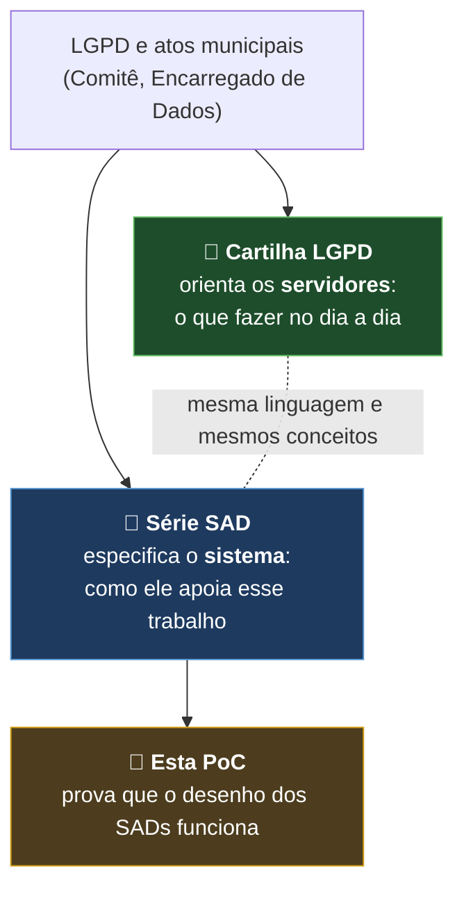
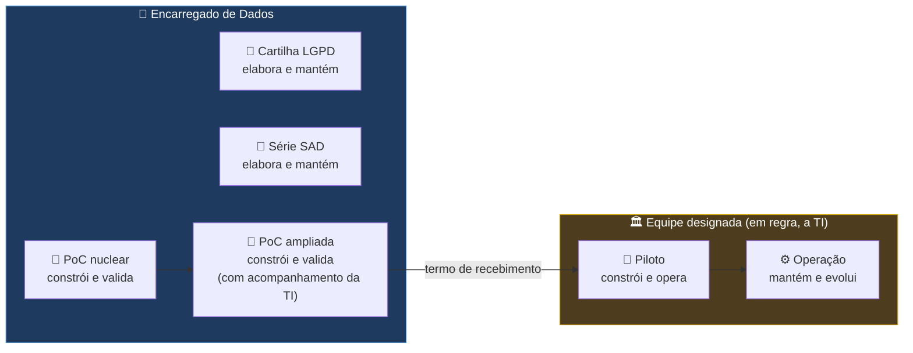
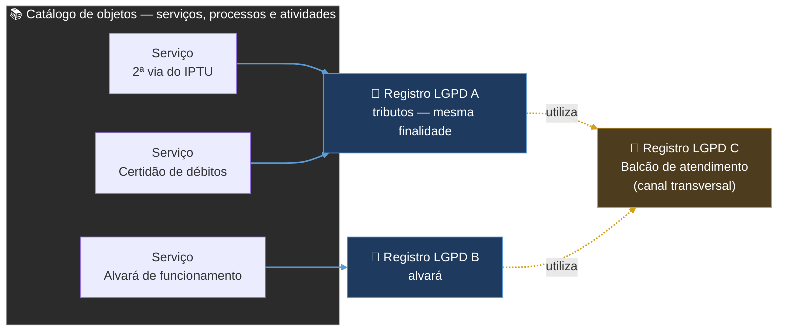

# Sistema de Governança Municipal LGPD — PoC nuclear

**Prefeitura Municipal de Hortolândia** · Prova de Conceito (PoC) · repositório privado · em construção

> ⚠️ **Somente dados fictícios.** Nenhum dado pessoal real, CPF, matrícula, senha ou token entra neste repositório, no código, nos testes ou nos logs.

## De onde vem este sistema

O sistema nasce do programa de proteção de dados pessoais da Prefeitura. Dois conjuntos de documentos o sustentam, cada um com um papel:



- **Cartilha LGPD** — orienta os servidores sobre o tratamento de dados pessoais: conceitos, responsabilidades, a quem recorrer. É o ponto de partida para entender o *porquê* do sistema.
- **Série SAD** — especifica o sistema que apoia esse trabalho: requisitos, papéis, workflow, dados, segurança e decisões de arquitetura.
- **Esta PoC** — verifica, com dados fictícios, se o desenho dos SADs funciona na prática.

A Cartilha e os SADs serão publicados neste repositório na próxima etapa.

## Quem faz o quê



| Etapa | Responsável | Papel do Encarregado |
|---|---|---|
| Cartilha LGPD e série SAD | Encarregado de Dados | Elabora e mantém |
| PoC nuclear | Encarregado de Dados (operador da PoC) | Constrói e valida |
| PoC ampliada | Encarregado de Dados, com acompanhamento da TI | Constrói e valida |
| Piloto | Equipe formalmente designada (em regra, a TI) | Governança de proteção de dados |
| Operação | Equipe designada e unidades usuárias | Orientação e acompanhamento (atribuições legais do Encarregado) |

A passagem do bastão é formalizada por **termo de recebimento**, com o Relatório de Encerramento e Transferência Técnica (SAD 09, seção 37). A equipe do Piloto pode adotar outra tecnologia, desde que a nova implementação seja aprovada nos testes de aceite da PoC.

## O que é

Prova de conceito do sistema que vai apoiar a gestão de processos, atividades e serviços da Prefeitura que tratam dados pessoais, em conformidade com a LGPD. A arquitetura está descrita na série de documentos **SAD** (Solution Architecture Document); esta PoC verifica se o desenho funciona na prática.

A validação acontece em três camadas (SAD 09):


**Este repositório está na PoC nuclear.**

## Como os Registros são organizados

Cada **Registro LGPD** documenta um **tratamento de dados pessoais**. Serviços, processos e atividades são os objetos que o Registro descreve. O que define se há um ou dois Registros é o tratamento, não o rótulo do objeto.



*Exemplos ilustrativos.*

| Regra | Referência |
|---|---|
| Um objeto tem **um** Registro, com uma unidade principal; as demais Secretarias participam do mesmo Registro | SAD 02, RF-PRC-06 |
| Vários serviços com as mesmas operações e finalidade podem integrar **um único** Registro (A) | SAD 02, RF-PRC-13 |
| Canais e serviços de apoio que tratam dados por conta própria (ex.: 156, Ouvidoria, e-SIC, protocolo, balcão de atendimento) têm Registro **próprio** (C); os demais Registros apontam para ele | SAD 02, RF-PRC-14; SAD 05, 13.1 |
| Um ou dois Registros? Decide o **tratamento autônomo** (finalidade, dados, titulares, hipótese legal, riscos), não o rótulo serviço, processo ou atividade | SAD 02, RF-PRC-15 |
| Contra duplicidade: cada item do catálogo só pode estar ligado a **um** Registro não cancelado, com trava no próprio banco de dados | proposta em teste na PoC (O-80) |

## O que já funciona

| Item | Situação |
|---|---|
| Conexão Python ↔ PostgreSQL, com senha fora do código | ✔ |
| Livro de atos do domínio (`evento`) e livro de auditoria mensal (`evento_auditoria`), com cadeia de hash, texto lacrado guardado, ator tipado e versões — DA-26, DA-27 | ✔ gravando e verificando no banco; três tipos de fraude detectados em simulação |
| Pedido idempotente (`comando`): o mesmo pedido repetido não grava de novo — DA-26 | ✔ |
| Pessoas, contas, unidades e designações de papéis (base da segregação de funções) | ✔ estrutura e dados fictícios |
| Regra de segregação de funções (O-66), comparando a pessoa e nunca a conta | ✔ cenários a, b, c, e, f; tentativas negadas registradas na auditoria. Cenário d (substituição) a fazer |
| Checkpoint externo da cadeia (proteção contra reescrita da corrente inteira) — SAD 08 | a fazer |
| Registro, versão, análise, pendência, workflow | a fazer |
| Telas (FastAPI + Jinja2) e testes de aceite (pytest) | a fazer |

## Tecnologias (DA-28)

Python 3.14 · PostgreSQL 18 · SQLAlchemy · psycopg · python-dotenv · (a seguir: FastAPI, Jinja2, pytest)

## Como montar o ambiente

1. **Python** — criar e ativar o ambiente:
   ```
   conda create -n lgpd-poc python=3.14
   conda activate lgpd-poc
   python -m pip install -r requirements.txt
   ```
2. **Banco** — no `psql`, como administrador, criar o usuário da aplicação (sem privilégios de administrador) e a base:
   ```sql
   CREATE ROLE lgpd_poc_app LOGIN PASSWORD 'escolha_uma_senha';
   CREATE DATABASE lgpd_poc OWNER lgpd_poc_app;
   ```
3. **Configuração** — copiar o modelo e preencher a senha (o `.env` nunca vai para o GitHub):
   ```
   copy .env.exemplo .env
   ```
4. **Conferir** — `python teste_conexao.py` deve responder "Conexão estabelecida!".

## Como rodar a PoC (até aqui)

```
python criar_tabelas.py         (cria as tabelas)
python semear_pessoas.py        (pessoas e contas fictícias)
python semear_designacoes.py    (unidades e papéis fictícios)
python demo_eventos.py          (grava eventos e verifica a cadeia de hash)
python teste_segregacao.py      (cenários de segregação de funções, O-66)
```

## Documentos deste repositório

| Documento | Para que serve |
|---|---|
| [ARQUITETURA_POC.md](ARQUITETURA_POC.md) | Camadas do sistema, responsabilidades e mapa da pasta |
| [DIARIO_POC.md](DIARIO_POC.md) | Registro datado de tudo o que foi feito |
| [COLA_COMANDOS.md](COLA_COMANDOS.md) | Comandos do dia a dia |

## Autoria

Elaboração: **Ailton Vendramini** — Encarregado de Dados da Prefeitura Municipal de Hortolândia (Decreto Municipal nº 5.200/2023).
