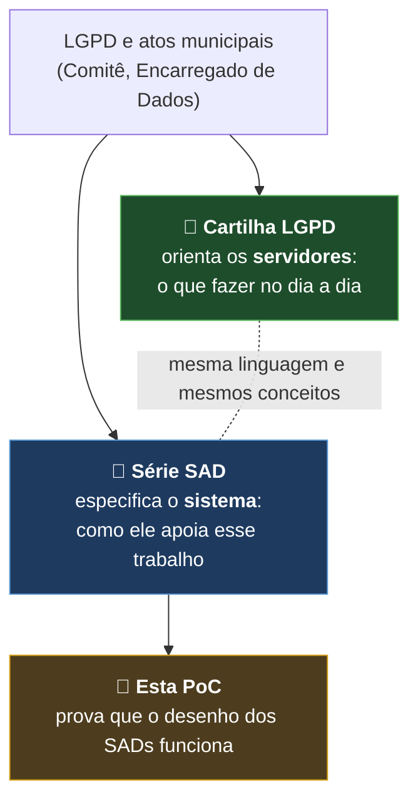
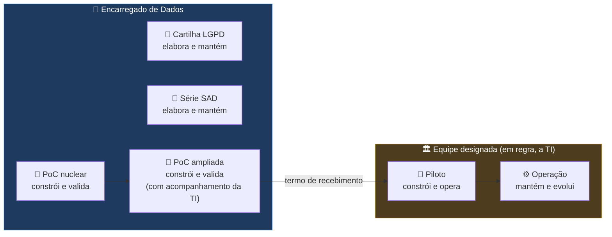
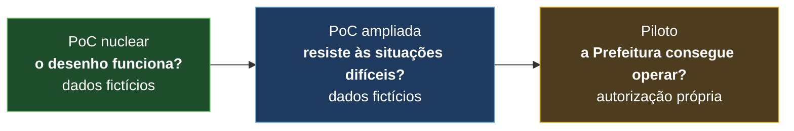
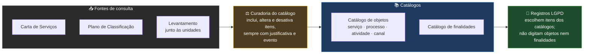
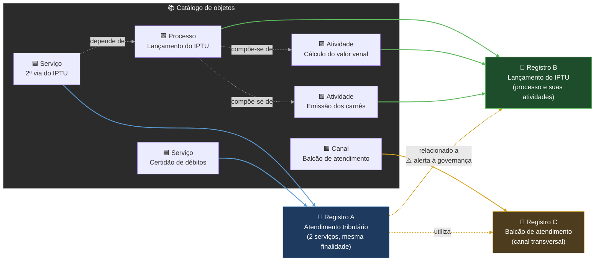
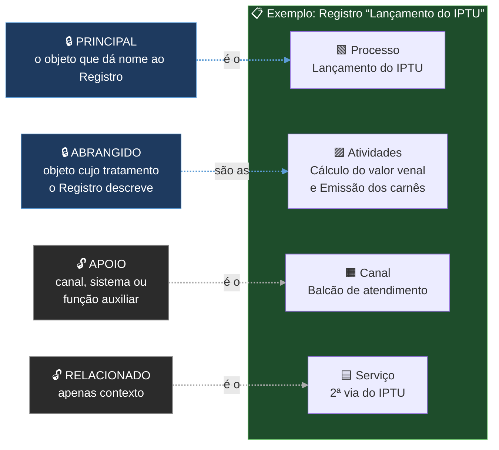
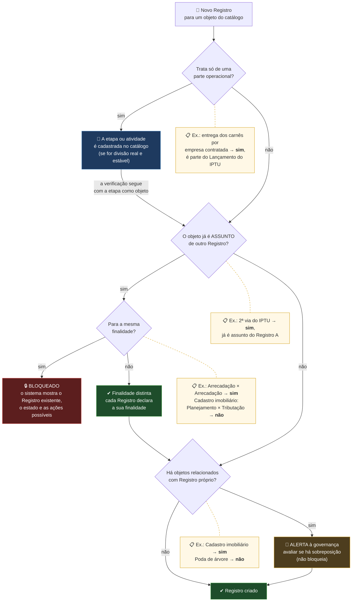

# Sistema de Governança Municipal LGPD — PoC nuclear

**Prefeitura Municipal de Hortolândia** · Prova de Conceito (PoC) · repositório privado · em construção

> ⚠️ **Somente dados fictícios.** Nenhum dado pessoal real, CPF, matrícula, senha ou token entra neste repositório, no código, nos testes ou nos logs.

## De onde vem este sistema

O sistema nasce do programa de proteção de dados pessoais da Prefeitura. Dois conjuntos de documentos o sustentam, cada um com um papel:



- **Cartilha LGPD** — orienta os servidores sobre o tratamento de dados pessoais: conceitos, responsabilidades, a quem recorrer. É o ponto de partida para entender o *porquê* do sistema.
- **Série SAD** — especifica o sistema que apoia esse trabalho: requisitos, papéis, workflow, dados, segurança e decisões de arquitetura.
- **Esta PoC** — verifica, com dados fictícios, se o desenho dos SADs funciona na prática.

A Cartilha e os SADs serão publicados neste repositório na próxima etapa.

## Quem faz o quê



| Etapa | Responsável | Papel do Encarregado |
|---|---|---|
| Cartilha LGPD e série SAD | Encarregado de Dados | Elabora e mantém |
| PoC nuclear | Encarregado de Dados (operador da PoC) | Constrói e valida |
| PoC ampliada | Encarregado de Dados, com acompanhamento da TI | Constrói e valida |
| Piloto | Equipe formalmente designada (em regra, a TI) | Governança de proteção de dados |
| Operação | Equipe designada e unidades usuárias | Orientação e acompanhamento (atribuições legais do Encarregado) |

A passagem do bastão é formalizada por **termo de recebimento**, com o Relatório de Encerramento e Transferência Técnica (SAD 09, seção 37). A equipe do Piloto pode adotar outra tecnologia, desde que a nova implementação seja aprovada nos testes de aceite da PoC.

## O que é

Prova de conceito do sistema que vai apoiar a gestão de processos, atividades e serviços da Prefeitura que tratam dados pessoais, em conformidade com a LGPD. A arquitetura está descrita na série de documentos **SAD** (Solution Architecture Document); esta PoC verifica se o desenho funciona na prática.

A validação acontece em três camadas (SAD 09):



**Este repositório está na PoC nuclear.**

## Como os Registros são organizados

Cada **Registro LGPD** documenta um **tratamento de dados pessoais**. Serviços, processos e atividades — e, conforme o SAD 02 (RF-PRC-14), canais que realizem tratamento próprio — são os **objetos** que os Registros podem descrever. O tipo **Canal** é uma extensão proposta (O-80), ainda não prevista no SAD 04:

| Objeto | O que é | Pergunta-teste | Exemplo |
|---|---|---|---|
| 🟦 **Serviço** | O que o cidadão recebe | "O cidadão pede isso?" | 2ª via do IPTU |
| 🟩 **Processo** | A sequência de etapas que produz um resultado, muitas vezes passando por várias unidades | "Tem começo, meio e fim?" | Lançamento do IPTU |
| 🟪 **Atividade** | Uma etapa dentro de um processo | "É um pedaço de algo maior?" | Cálculo do valor venal |
| 🟧 **Canal** | A porta por onde o cidadão chega aos serviços | "Por onde o pedido entra?" | Balcão de atendimento |

### O que é o catálogo

O **catálogo de objetos** é a lista oficial dos serviços, processos, atividades e canais da Prefeitura que tratam, ou podem tratar, dados pessoais. Cada item tem um **identificador canônico**: é por ele, e não pelo nome digitado, que o sistema sabe se dois Registros falam da mesma coisa. Ao lado dele existe o **catálogo de finalidades**, para que a finalidade também seja escolhida, e não digitada.



| Cada item do catálogo de objetos tem | Exemplo (fictício) |
|---|---|
| Identificador canônico | `OBJ-SRV-001` |
| Tipo | serviço, processo, atividade ou canal |
| Nome oficial | 2ª via do IPTU |
| Relações com outros itens | depende de *Lançamento do IPTU*; atendido por *Balcão de atendimento* |
| Referência oficial, quando houver | item da Carta de Serviços ou classe do Plano de Classificação |
| Situação | ativo ou desativado — um item nunca é apagado |

**O que o catálogo não é:** não é uma cópia importada da Carta de Serviços (que continua sendo referência de consulta, SAD 05, 13.4); não é preenchido pelo elaborador na hora de criar o Registro; e não contém dados pessoais.

**Em aberto (O-80):** quem exerce a curadoria; como será a carga inicial; e a lista inicial de finalidades. Na PoC, os dois catálogos são fictícios.

### Exemplo: objetos do catálogo e seus Registros



*Exemplos ilustrativos.* Linhas cinzas: a hierarquia entre os objetos. Linhas coloridas: a qual Registro cada objeto pertence. Linhas amarelas: relações entre Registros; a relação entre A e B gera um alerta para a governança avaliar se há sobreposição de tratamentos.

| Regra | Referência |
|---|---|
| Cada combinação entre **objeto e finalidade** pode ser assunto de, no máximo, **um** Registro em situação bloqueadora. Um Registro pode abranger vários objetos, e um objeto pode participar de Registros distintos quando as finalidades forem materialmente diferentes | SAD 02, RF-PRC-13 e 15; proposta (O-80) |
| O mesmo objeto prestado por várias Secretarias é um só Registro, com uma unidade principal; as demais participam dele | SAD 02, RF-PRC-06 |
| Vários serviços com as mesmas operações e finalidade podem integrar **um único** Registro (A) | SAD 02, RF-PRC-13 |
| Um processo e as suas atividades ficam, em regra, no **mesmo** Registro (B); uma atividade só ganha Registro próprio se tiver tratamento autônomo (ex.: atividade terceirizada, com operador e base de dados próprios) | decorre do SAD 02, RF-PRC-15; granularidade a confirmar pela governança (O-80) |
| A hierarquia (serviço que depende de um processo; processo composto de atividades) **não** torna os objetos equivalentes: os Registros se ligam por relação | SAD 05, seção 13.1 |
| Canais e serviços de apoio que tratam dados por conta própria (ex.: 156, Ouvidoria, e-SIC, protocolo, balcão de atendimento) têm Registro **próprio** (C); os demais Registros apontam para ele | SAD 02, RF-PRC-14 |
| Um ou dois Registros? Decide o **tratamento autônomo** (finalidade, dados, titulares, hipótese legal, riscos), não o rótulo serviço, processo ou atividade | SAD 02, RF-PRC-15 |
| **Bloqueio** (determinístico): não pode haver dois Registros em situação bloqueadora que descrevam o tratamento do mesmo objeto para a mesma finalidade — trava no próprio banco de dados | proposta em teste na PoC (O-80) |
| **Sem atalhos**: a etapa só vira item próprio do catálogo quando for divisão real e estável do processo; a finalidade é escolhida de um catálogo de finalidades com identificadores canônicos, e não digitada — mudar o texto não cria novo Registro | proposta (O-80) |
| **Alerta** (para análise humana): objetos diferentes, mas relacionados no catálogo ou com mesma finalidade, titulares ou dados, geram aviso de possível sobreposição para a governança avaliar; o sistema não funde nem bloqueia sozinho | SAD 05, 5.3; proposta (O-80) |

### Assunto ou citado: o papel de cada objeto no Registro

Os objetos ligados a um Registro têm um de quatro papéis. Os dois primeiros são o **assunto** do Registro e entram na trava contra duplicidade (🔒); os dois últimos são apenas **citados** e podem aparecer em vários Registros (🔓). À direita, um exemplo:



*No exemplo, ninguém mais pode abrir um Registro cujo assunto seja o Lançamento do IPTU ou as suas atividades, para a mesma finalidade. Já o Balcão e a 2ª via podem ser citados em outros Registros, e o Balcão continua livre para ter o seu próprio Registro, em que será PRINCIPAL.*

### Situação bloqueadora

| Estado do Registro equivalente | Resultado |
|---|---|
| Em andamento | 🔒 Bloqueia |
| Em validação | 🔒 Bloqueia |
| Em execução | 🔒 Bloqueia |
| Suspenso | 🔒 Bloqueia e orienta retomada ou cancelamento |
| Concluído | 🔒 Bloqueia nova criação e orienta reabertura (G10) |
| Cancelado | ✔ Permite novo Registro, com vínculo ao anterior |

*Proposta (O-80). O SAD 04 exige, no G1, a inexistência de Registro equivalente **ativo**. Incluir Suspenso e Concluído vai além dessa expressão literal, mas é coerente com a preservação do mesmo Registro e de seus ciclos. Depende de decisão formal e de alteração do SAD 04.*

### Como o sistema evita Registros duplicados

As caixas amarelas (📋) mostram, ao lado de cada pergunta, como os exemplos da tabela abaixo respondem.



#### Exemplos (fictícios), cada um percorrendo o fluxograma acima

| Ex. | Pedido | Caminho no fluxograma | Resultado |
|---|---|---|---|
| 1 | Criar um Registro chamado "IPTU" para o serviço **2ª via do IPTU**, finalidade *Arrecadação* | O objeto já é assunto do Registro A, para a mesma finalidade | 🔒 **Bloqueado.** O sistema mostra o Registro A, o estado e as ações possíveis (abrir, solicitar acesso) |
| 2 | Criar um Registro para o **Cadastro imobiliário**, finalidade *Planejamento urbano* | O objeto já é assunto de outro Registro, mas para *Tributação*: finalidade distinta. Há objetos relacionados | 🔔 **Alerta** à governança e ✔ **criado** |
| 3 | Registrar só a **entrega dos carnês por empresa contratada** | É parte operacional: vira atividade no catálogo e a verificação recomeça. Não é assunto de outro Registro, mas está relacionada ao Lançamento do IPTU | 🔔 **Alerta** à governança e ✔ **criado** |
| 4 | Criar um Registro para o serviço **Poda de árvore** | Não é assunto de outro Registro e não tem objetos relacionados | ✔ **Criado** |

*Proposta em teste na PoC (O-80). A PoC já possui uma trava experimental por objeto. A equivalência completa por papel e finalidade, assim como os alertas de sobreposição, permanece em implementação.*

## O que já funciona

| Item | Situação |
|---|---|
| Conexão Python ↔ PostgreSQL, com senha fora do código | ✔ |
| Livro de atos do domínio (`evento`) e livro de auditoria mensal (`evento_auditoria`), com cadeia de hash, texto lacrado guardado, ator tipado e versões — DA-26, DA-27 | ✔ gravando e verificando no banco; três tipos de fraude detectados em simulação |
| Pedido idempotente (`comando`): o mesmo pedido repetido não grava de novo — DA-26 | ✔ |
| Pessoas, contas, unidades e designações de papéis (base da segregação de funções) | ✔ estrutura e dados fictícios |
| Regra de segregação de funções (O-66), comparando a pessoa e nunca a conta | ✔ cenários a, b, c, e, f; tentativas negadas registradas na auditoria. Cenário d (substituição) a fazer |
| Checkpoint externo da cadeia (proteção contra reescrita da corrente inteira) — SAD 08 | a fazer |
| Criação do Registro pelo ato G1, com ciclo 1 e instância do FORM 1 no estado Não iniciado; catálogo fictício de objetos | ✔ (o início do preenchimento do FORM 1 será comando posterior ao G1, como no cenário A1 do SAD 04) |
| Trava experimental contra Registros duplicados, por objeto (O-80): pesquisa prévia + trava no próprio banco | ✔ cenários 1, 2, 3 e 7 (inclusive dois pedidos simultâneos); papéis, finalidade e alertas em implementação; 4, 5, 6 e 8 dependem de suspender, concluir e cancelar |
| Versão, análise, pendência e demais atos do workflow | a fazer |
| Telas (FastAPI + Jinja2) e testes de aceite (pytest) | a fazer |

## Tecnologias (DA-28)

Python 3.14 · PostgreSQL 18 · SQLAlchemy · psycopg · python-dotenv · (a seguir: FastAPI, Jinja2, pytest)

## Como montar o ambiente

1. **Python** — criar e ativar o ambiente:
   ```
   conda create -n lgpd-poc python=3.14
   conda activate lgpd-poc
   python -m pip install -r requirements.txt
   ```
2. **Banco** — no `psql`, como administrador, criar o usuário da aplicação (sem privilégios de administrador) e a base:
   ```sql
   CREATE ROLE lgpd_poc_app LOGIN PASSWORD 'escolha_uma_senha';
   CREATE DATABASE lgpd_poc OWNER lgpd_poc_app;
   ```
3. **Configuração** — copiar o modelo e preencher a senha (o `.env` nunca vai para o GitHub):
   ```
   copy .env.exemplo .env
   ```
4. **Conferir** — `python teste_conexao.py` deve responder "Conexão estabelecida!".

## Como rodar a PoC (até aqui)

```
python criar_tabelas.py         (cria as tabelas)
python semear_pessoas.py        (pessoas e contas fictícias)
python semear_designacoes.py    (unidades e papéis fictícios)
python demo_eventos.py          (grava eventos e verifica a cadeia de hash)
python teste_segregacao.py      (cenários de segregação de funções, O-66)
python semear_catalogo.py       (catálogo fictício de serviços, processos, atividades e canais)
python demo_registro.py         (ato G1: cria um Registro, com ciclo 1 e FORM 1 não iniciado)
python teste_duplicidade.py     (trava contra Registros duplicados, O-80)
```

## Documentos deste repositório

| Documento | Para que serve |
|---|---|
| [ARQUITETURA_POC.md](ARQUITETURA_POC.md) | Camadas do sistema, responsabilidades e mapa da pasta |
| [DIARIO_POC.md](DIARIO_POC.md) | Registro datado de tudo o que foi feito |
| [COLA_COMANDOS.md](COLA_COMANDOS.md) | Comandos do dia a dia |

## Autoria

Elaboração: **Ailton Vendramini** — Encarregado de Dados da Prefeitura Municipal de Hortolândia (Decreto Municipal nº 5.200/2023).
