# Sistema de Governança Municipal LGPD — Prova de Conceito

**Prefeitura Municipal de Hortolândia** · PoC nuclear M1a aceita e PoC ampliada iniciada de forma incremental · repositório privado

> ⚠️ **Somente dados fictícios.** Nenhum dado pessoal real, CPF, matrícula, senha ou token entra neste repositório, no código, nos testes ou nos logs.

## Contexto institucional

Este trabalho é desenvolvido para a **Prefeitura Municipal de Hortolândia**, no âmbito da **Secretaria de Planejamento Urbano e Gestão Estratégica**. As referências institucionais de reporte são **Andreia Missio**, Secretária Adjunta, e **Eduardo Marchetti Francisco**, Secretário Municipal.

Toda apresentação institucional derivada deste projeto deve utilizar o **brasão da Prefeitura Municipal de Hortolândia**, seguindo a identidade já adotada na Cartilha LGPD. Materiais de outras administrações públicas podem aparecer como fontes ou referências históricas, mas não substituem a identidade visual de Hortolândia.

## Por onde começar

| Se você quer… | Vá para |
|---|---|
| Entender o que é o sistema e de onde vem | as seções logo abaixo ("De onde vem", "O que é") |
| Ver, em 5 minutos, como um Registro anda no M1a | [Mapa do M1a](docs/arquitetura/MAPA_M1a.md) |
| Saber o que já funciona e o que falta | [O que já funciona](#o-que-já-funciona) e [Próximos passos](#próximos-passos) |
| Montar o ambiente e rodar os testes | [Instalação e execução](docs/operacao/INSTALACAO.md) |
| Entender as camadas do código | [Arquitetura](docs/arquitetura/ARQUITETURA_POC.md) |
| Dar contexto rápido a uma IA antes de uma tarefa | [Pacote de contexto](docs/contexto/context.md) e [instruções para agentes](AGENTS.md) |


## De onde vem este sistema

O sistema nasce do programa de proteção de dados pessoais da Prefeitura. Dois conjuntos de documentos o sustentam, cada um com um papel:

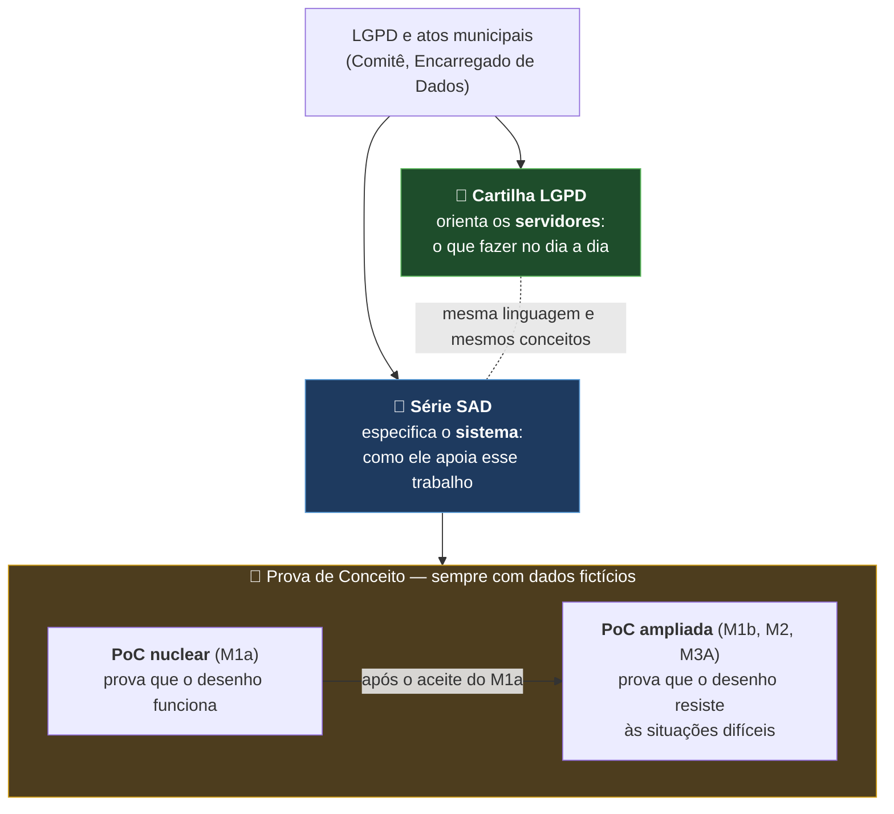

- **Cartilha LGPD** — orienta os servidores sobre o tratamento de dados pessoais: conceitos, responsabilidades, a quem recorrer. É o ponto de partida para entender o *porquê* do sistema.
- **Série SAD** — especifica o sistema que apoia esse trabalho: requisitos, papéis, workflow, dados, segurança e decisões de arquitetura.
- **PoC nuclear e PoC ampliada** — verificam, sempre com dados fictícios, se o desenho dos SADs funciona (nuclear, marco M1a) e se resiste às situações difíceis da administração (ampliada, marcos M1b, M2 e M3A). O aceite da nuclear é condição necessária, mas a ampliada só começa após decisão expressa própria.

A Cartilha e os SADs serão publicados neste repositório na próxima etapa.

## Quem faz o quê

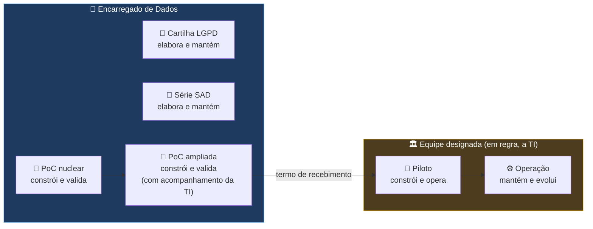

| Etapa | Responsável | Papel do Encarregado |
|---|---|---|
| Cartilha LGPD e série SAD | Encarregado de Dados | Elabora e mantém |
| PoC nuclear | Encarregado de Dados (operador da PoC) | Constrói e valida |
| PoC ampliada | Encarregado de Dados, com acompanhamento da TI | Constrói e valida |
| Piloto | Equipe formalmente designada (em regra, a TI) | Governança de proteção de dados |
| Operação | Equipe designada e unidades usuárias | Orientação e acompanhamento (atribuições legais do Encarregado) |

A passagem do bastão é formalizada por **termo de recebimento**, com o Relatório de Encerramento e Transferência Técnica (SAD 09, seção 37). A equipe do Piloto pode adotar outra tecnologia, desde que a nova implementação seja aprovada nos testes de aceite da PoC.

## O que é

Prova de conceito do sistema que vai apoiar a gestão de processos, atividades e serviços da Prefeitura que tratam dados pessoais, em conformidade com a LGPD. A arquitetura está descrita na série de documentos **SAD** (Solution Architecture Document); esta PoC verifica se o desenho funciona na prática.

A validação acontece em três camadas (SAD 09):


**A PoC nuclear M1a foi aceita pelo Encarregado de Dados em 22/10/2026.** A apresentação e a transferência técnica à T.I. permanecem pendentes. Em 24/10/2026 houve decisão expressa para iniciar a PoC ampliada por incrementos, começando pelo catálogo REV13, pela identificação do ARP e pela estrutura visual do FORM 1 integral. Isso não altera retroativamente o M1a.

#### PoC nuclear × PoC ampliada

As duas camadas usam dados fictícios e são construídas pelo Encarregado de Dados; a diferença está no que cada uma precisa provar (SAD 09, seção 4A):

| | PoC nuclear | PoC ampliada |
|---|---|---|
| Pergunta | O desenho funciona? | O desenho resiste às situações difíceis? |
| Marcos (SAD 09) | M1a | M1b, M2 e M3A, cada um iniciado após o aceite do anterior |
| Escopo | Registro, FORM 1 sintético simplificado, versão, submissão, análise com segregação de funções, devolução com pendência, validação, conclusão, pendência intersecretarial, livro de atos com cadeia de hash e reconstrução da trilha | Suspensão e retomada, cancelamento com efeito nas pendências, reabertura com novo ciclo, continuidade institucional (ausência, saída, troca de chefia), participação por unidade, backup e restauração; FORM 1 integral de ponta a ponta |
| Cenários do SAD 04 | Cerca de 15 (A1 a A4, A9 a A12, A14, A15, A28 a A30) | Cerca de 16 novos, mais a reexecução de todos os da nuclear com o FORM 1 real |
| Dependências externas | Nenhuma além da autorização para implementar | Contrato integral do FORM 1 e envelope de ingestão (SAD09-05 e 01); decisão SAD09-10 |
| Entregáveis | Código, testes de aceite, evidências e diário | Também o relatório de validação e o Relatório de Encerramento e Transferência Técnica (SAD 09, seção 37) |
| Participação da TI | Recebe informação | Acompanha a construção |

A PoC ampliada exige mais trabalho: são três marcos em sequência, as situações difíceis mexem em várias peças ao mesmo tempo, e parte das condições depende de decisões institucionais. Em compensação, ela não começa do zero: reaproveita o chassi da nuclear (livro de atos, pedido idempotente, barreiras e auditoria), e cada ato novo segue o mesmo molde.

**Limite funcional acordado:** os quatro FORMs da Cartilha permanecem como referência principal do método, mas a implementação da PoC ampliada termina no **FORM 1 integral**. Os FORMs 2, 3 e 4 ficam alinhados na arquitetura e reservados para uma etapa posterior; inventários e relatórios de apoio não ampliam esse escopo.

## Como os Registros são organizados

Cada **Registro LGPD** documenta um **tratamento de dados pessoais**. Serviços, processos e atividades são os **objetos** que os Registros descrevem; os **canais** de atendimento formam uma dimensão à parte (veja adiante):

| Objeto | O que é | Pergunta-teste | Exemplo |
|---|---|---|---|
| 🟦 **Serviço** | O que o cidadão recebe | "O cidadão pede isso?" | 2ª via do IPTU |
| 🟩 **Processo** | A sequência de etapas que produz um resultado, muitas vezes passando por várias unidades | "Tem começo, meio e fim?" | Lançamento e cobrança do IPTU |
| 🟪 **Atividade** | Uma etapa dentro de um processo | "É um pedaço de algo maior?" | Cálculo do valor venal |

### Granularidade do objeto principal

**Regra conceitual.** Serviço, Processo e Atividade são três classificações independentes para o objeto principal de um Registro LGPD. Um Serviço pode abranger vários Processos e Atividades, mas essa relação é opcional: não existe obrigação de decompor formalmente todo Serviço nem de criar um Registro para cada etapa interna. Processos e Atividades também podem existir de forma autônoma e ser escolhidos como objeto principal quando esse for o recorte adequado do tratamento.

O **APA** caracteriza o objeto principal e abre o Registro. O **ARP** descreve como o tratamento ocorre na prática, sem precisar enumerar formalmente todos os Processos e Atividades internos. Se uma parte possuir tratamento efetivamente autônomo — considerando finalidade, dados, titulares, agentes, sistemas, compartilhamentos e riscos — a governança poderá avaliar a criação de Registro próprio. O inventário contempla somente objetos que realizam tratamento de dados pessoais e registra categorias e fluxos; não cadastra cidadãos atendidos nem seus dados individuais.

**Exemplo ilustrativo — Secretaria de Cultura.** Um Serviço fictício de participação em atividade cultural pode compreender inscrição, matrícula e conferência documental. Se essas etapas integrarem o mesmo tratamento, poderão ser descritas em um único Registro do Serviço, sem três decomposições ou Registros obrigatórios. Uma etapa somente justificará Registro próprio quando a avaliação demonstrar tratamento autônomo.

**Estado da PoC.** O APA já pode selecionar o objeto e confirmar nenhum, um ou vários canais habituais durante a abertura; isso não multiplica Registros. A pergunta `2.1` do FORM 1 integral recupera esse retrato histórico em modo de consulta para o ARP, distinguindo canais confirmados, ausência expressamente confirmada e Registro antigo sem confirmação. As perguntas `OUV.1` a `OUV.4` e `ESIC.1` a `ESIC.2` são apresentadas de forma independente quando o retrato contém, respectivamente, um canal classificado como Ouvidoria ou e-SIC. O ARP descreve o tratamento no FORM 1 integral, cujos **Blocos 1 a 14 estão implementados como rascunho e acessíveis pelas quatro etapas de navegação**. Uma pré-validação consultiva usa a matriz versionada para listar campos obrigatórios ativos incompletos, condições inequivocamente inativas e regras ainda dependentes de governança, sem alterar respostas nem impedir o salvamento. A submissão integral permanece desabilitada. Esta descrição do estado executável não transforma as regras conceituais acima em decomposição automática.

**Identidade institucional na pré-validação.** A fonte simulada vigente fornece nome fictício, vínculo entre conta e pessoa, unidade, papel e vigência da designação. Ela não fornece cargo/função (`0.2`) nem e-mail institucional (`0.3`). Esses dois metadados permanecem pendências obrigatórias de uma futura integração institucional autenticada: não são digitados livremente nem inventados pela PoC.

### Canais: uma dimensão transversal

Serviços, processos e atividades formam a **estrutura operacional**: os serviços **são realizados por** processos (um serviço pode ser realizado por vários processos, e um processo pode realizar vários serviços), e os processos são compostos por atividades. A expressão "depende de" fica reservada para dependência efetiva (técnica, organizacional, informacional ou operacional). Os **canais** constituem uma **dimensão transversal de atendimento** e se associam diretamente a qualquer objeto do catálogo: um Serviço, Processo ou Atividade pode possuir nenhum, um ou vários canais habituais. Cada vínculo pertence somente ao objeto informado — não há herança automática entre eles — e não representa atendimento individual, cidadão, telefonema ou protocolo. A existência de vários canais não multiplica Registros LGPD. O canal somente possui Registro próprio quando realiza tratamento autônomo; como simples meio de acesso ou encaminhamento, permanece uma informação de apoio do tratamento inventariado.

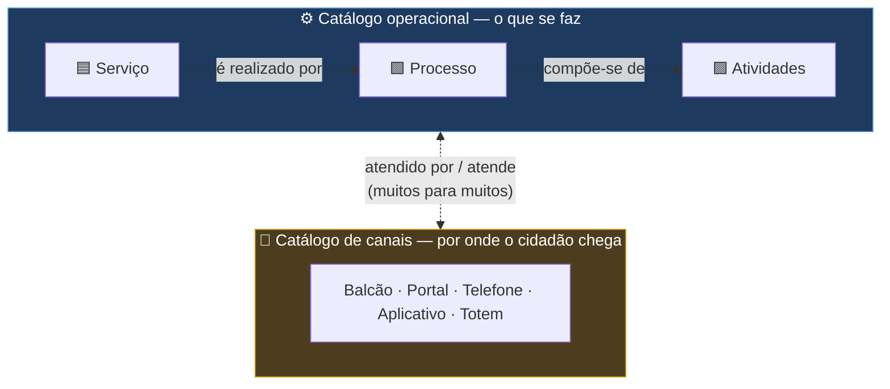

#### Quando o canal ganha Registro próprio

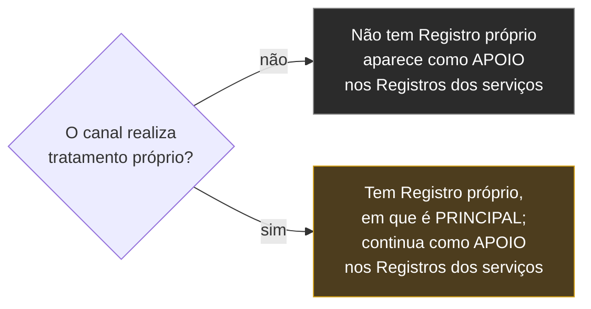

São exemplos de tratamento próprio do canal: gestão de senhas e filas; agendamento; cadastro prévio; gravação de chamadas; videomonitoramento; identificação do atendente e do cidadão; armazenamento temporário em sistema próprio; geração de protocolo transversal. **O simples recebimento e encaminhamento de documentos do serviço não caracteriza, por si só, tratamento autônomo do canal.**

#### Exemplo: separar o que é do canal e o que é do serviço

| | Registro C — Gestão do balcão | Registro A — Atendimento tributário (2ª via do IPTU) |
|---|---|---|
| Descreve | Só o tratamento comum e autônomo do canal | O tratamento do serviço |
| Finalidade | Organizar o atendimento | Emitir a segunda via |
| Dados | Nome, senha, horário e guichê | Inscrição imobiliária e dados do contribuinte |
| Retenção | Histórico da fila por determinado período | Conforme o serviço |
| Sistema | Gerenciador de atendimento | Sistema tributário |
| Balcão de atendimento | **PRINCIPAL** | **APOIO** (canal utilizado) |

Mesmo que o servidor do balcão visualize os dados do IPTU, esse tratamento pertence ao serviço: o Registro do canal contém apenas o que o próprio canal faz com os dados.

### O que é o catálogo

O **catálogo operacional** é a lista oficial dos serviços, processos e atividades da Prefeitura que tratam, ou podem tratar, dados pessoais; o **catálogo de canais** lista as portas de atendimento. Cada item tem um **identificador canônico**: é por ele, e não pelo nome digitado, que o sistema sabe se dois Registros falam da mesma coisa. Ao lado deles existem o **catálogo de contextos de atuação**, para que o contexto também seja escolhido, e não digitado, e o **catálogo de bases e conjuntos de dados** (veja adiante).

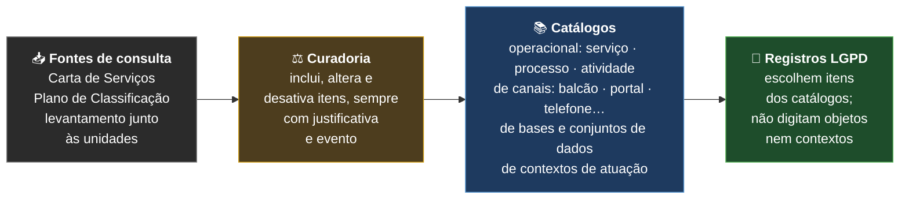

| Cada item do catálogo operacional tem | Exemplo (fictício) |
|---|---|
| Identificador canônico | `OBJ-SRV-001` |
| Tipo | serviço, processo ou atividade |
| Nome oficial | 2ª via do IPTU |
| Relações com outros itens | é realizado por *Lançamento e cobrança do IPTU*; atendido por *Balcão de atendimento* |
| Referência oficial, quando houver | item da Carta de Serviços ou classe do Plano de Classificação |
| Situação | ativo ou desativado — um item nunca é apagado |

**O que o catálogo não é:** não é uma cópia importada da Carta de Serviços (que continua sendo referência de consulta, SAD 05, 13.4); não é preenchido livremente pelo Agente na hora de criar o Registro; e não contém dados pessoais.

#### Como o catálogo real poderá ser formado

A Carta de Serviços e o portal municipal fornecem uma primeira relação de **serviços**. Os FORMs devolvidos pelas Secretarias revelarão também os **processos e atividades** realmente executados. Em ambos os casos, o conteúdo recebido será apenas uma **proposta de item**: não entrará automaticamente no catálogo oficial.

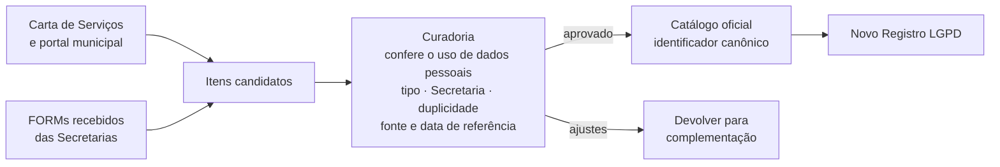

A curadoria deverá ligar cada item a uma ou mais Secretarias, registrar qual delas é responsável e quais apenas participam, normalizar nomes equivalentes e impedir duplicidades. Só interessam ao catálogo LGPD os serviços, processos e atividades que tratem dados pessoais; o sistema não pretende inventariar toda a Prefeitura.

#### O que foi aproveitado dos inventários existentes

A **Cartilha e seus quatro FORMs** são a referência funcional principal. A PoC nuclear exercita uma versão sintética do FORM 1; a PoC ampliada deverá executar o FORM 1 integral. Os FORMs 2, 3 e 4 permanecem visíveis no desenho geral, mas não entram no escopo de implementação dessas duas PoCs.

Os inventários e relatórios preenchidos a partir do modelo de referência servem como **apoio**: oferecem exemplos, vocabulário e situações reais para verificar se o FORM 1 faz as perguntas adequadas. Eles não substituem a Cartilha, não definem novos campos e não são importados automaticamente. Quando revelarem agrupamentos recorrentes — como formação cultural, biblioteca, fiscalização ou gestão de pessoas — esses agrupamentos poderão ser usados como **candidatos ao campo Contexto de atuação**, sempre sujeitos à curadoria.

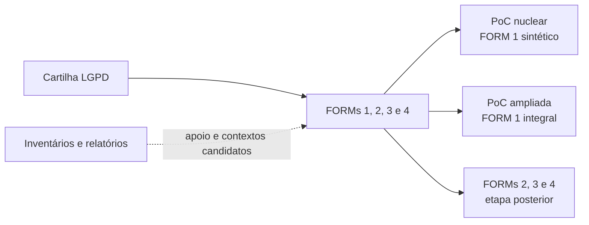

### Diretriz conceitual — Integração e disponibilidade dos FORMS 1 a 4

Os quatro FORMS permanecem instrumentos distintos e complementares de um **único conjunto de análise e governança LGPD** referente a determinado serviço, processo ou atividade. O conjunto possui um Identificador LGPD único, compartilhado pelos quatro instrumentos; essa integração futura não transforma os FORMS em um formulário único nem altera a estrutura funcional definida pela Cartilha.

| Instrumento | Função no conjunto |
|---|---|
| FORM 1 — Levantamento factual | Identificar e descrever como ocorre o tratamento de dados pessoais. |
| FORM 2 — Validação institucional e jurídica | Examinar conformidade, hipóteses legais e questões institucionais. |
| FORM 3 — Avaliação de riscos | Identificar e avaliar riscos, impactos e controles. |
| FORM 4 — Plano de ação | Registrar medidas de adequação, responsáveis, prazos, acompanhamento e evidências. |

O Registro LGPD é aberto por um **Agente Público Autorizado**. Esse agente pode preencher o FORM 1 ou permitir que outro agente devidamente autorizado o faça. A abertura não atribui automaticamente o preenchimento dos demais FORMS; os FORMS 2, 3 e 4 poderão envolver agentes diferentes, conforme competências e autorizações institucionais ainda a definir.

A disponibilidade operacional futura deverá seguir esta sequência, sem criar bloqueios administrativos desnecessários:

1. o FORM 1 fica disponível depois da abertura do Registro LGPD;
2. após a submissão válida do FORM 1, o FORM 2 é liberado para validação, sem atribuição automática a uma pessoa;
3. o FORM 3 é liberado quando as informações e validações do FORM 2 forem suficientes para a avaliação de riscos;
4. o FORM 4 fica disponível quando os FORMS 2 ou 3 identificarem medidas de adequação.

Excepcionalmente, uma providência identificada no FORM 2 poderá ser registrada no FORM 4 antes da conclusão integral do FORM 3, desde que haja justificativa, autorização competente e rastreabilidade.

A futura implementação deverá separar permissões de abertura, preenchimento, análise e validação; identificar a autoria de cada atuação; preservar versões, submissões, decisões e evidências; registrar pendências sem paralisar automaticamente etapas independentes; permitir a reavaliação das etapas afetadas por correções posteriores; e acompanhar as ações do FORM 4 até sua conclusão ou encerramento formal.

> **Limite de escopo:** a integração dos quatro FORMS permanece uma diretriz arquitetural. A PoC nuclear continua inalterada e a PoC ampliada, agora iniciada por incrementos, limita-se ao FORM 1 integral. Os FORMS 2, 3 e 4 continuam reservados para etapa posterior; a atribuição institucional de seus responsáveis e a fronteira entre a validação do FORM 1 e a futura liberação do FORM 2 ainda precisam de definição formal.

Para o catálogo inicial, o inventário oferece somente **candidatos**. Alguns campos ajudam a formar e localizar o item; os demais pertencem ao preenchimento e à análise do tratamento:

| Informação do inventário | Destino correto no sistema |
|---|---|
| Nome do serviço, processo ou atividade | Candidato a item do catálogo, sujeito a normalização e deduplicação |
| Secretaria ou unidade principal | Relação entre a Secretaria responsável e o item do catálogo |
| Frequência e unidade executora | Caracterização operacional posterior; não altera a identidade canônica do item |
| Fontes, meios, sistemas e canais — inclusive 156 | Fluxo e transversalidade do tratamento; não são um quarto tipo de objeto |
| Finalidade, hipótese legal, dados e titulares | FORM 1 e análise de legitimidade, nunca o catálogo inicial |
| Retenção, eliminação, segurança, contratos e riscos | Instrumento previsto na Cartilha e análise posterior; não são usados para liberar o G1 |

Nenhuma resposta vira catálogo oficial automaticamente. Os FORMs podem conter grafias diferentes, itens repetidos e dados funcionais ou pessoais que não devem ser copiados para o catálogo. A curadoria utiliza apenas a estrutura necessária, preserva a fonte e a data de referência e publica um identificador canônico depois da conferência.

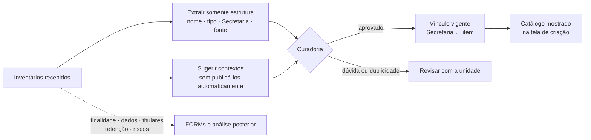

#### A tela não deve abrir um catálogo global

O percurso definitivo será em cascata: **Secretaria responsável → serviço, processo ou atividade → itens vinculados à Secretaria → contextos compatíveis com o item**. Assim, um agente de Planejamento não recebe uma lista indiscriminada de objetos de todas as áreas. Se nenhum item ou contexto servir, ele solicitará revisão do catálogo, sem criar uma denominação livre.

No corte atual da PoC, os objetos e seus vínculos continuam fictícios. As relações **Secretaria ↔ objeto** e **objeto ↔ contexto permitido** são persistidas com fonte e vigência. A tela apresenta somente os itens em que uma Secretaria ao alcance do agente aparece como responsável e, depois da escolha do item, somente seus contextos permitidos. O G1 repete as duas conferências no servidor para impedir um envio forjado. A futura curadoria substituirá os vínculos demonstrativos por relações institucionais aprovadas, sem mudar esse percurso.

#### Onde entram os canais, como o 156

Canal não é um quarto tipo ao lado de serviço, processo e atividade. Depois da escolha do objeto, a interface poderá exibir **“Canais de atendimento relacionados”** como informação proveniente do catálogo — não como uma lista livre de marcações do agente.

- Se o canal apenas encaminha a solicitação, ele é apoio do Registro do serviço ou processo.
- Se o próprio canal identifica a pessoa, protocola, grava, mantém histórico ou realiza outro tratamento autônomo de dados pessoais, ele poderá ter Registro próprio.

Essa decisão preserva a transversalidade sem confundir o canal de entrada com o objeto que efetivamente entrega o serviço ou executa o processo.

**Em aberto (O-80):** quem exercerá formalmente a curadoria; quais serão os primeiros itens aprovados; e a lista inicial de contextos de atuação. O método de formação e revisão está definido acima, mas o catálogo definitivo ainda depende dessa decisão institucional. Na PoC, objetos e contextos permanecem fictícios.

### Contexto de atuação e finalidade: duas coisas diferentes

Na LGPD, **finalidade** tem sentido preciso: "realização do tratamento para propósitos legítimos, específicos, explícitos e informados ao titular" (art. 6º, I). Para não confundir, o sistema usa outro nome para a classificação que serve à prevenção de duplicidade: **contexto de atuação**.

| | Contexto de atuação | Finalidade (LGPD) |
|---|---|---|
| O que é | Classificação cadastral do recorte administrativo e funcional em que o tratamento é descrito | O propósito específico do tratamento, informado ao titular |
| Onde fica | Catálogo de contextos de atuação (escolhido, nunca digitado) | FORM 1, com versões e validação |
| Para que serve | Distinguir tratamentos do mesmo objeto e evitar Registros duplicados | Cumprir o art. 6º, I, e orientar o titular |
| Exemplo | CTX-TRIB-03 — Arrecadação e cobrança tributária | Emitir a 2ª via do carnê para que o contribuinte pague o IPTU do exercício |

A finalidade é sempre declarada **dentro** de um contexto de atuação.

**Definição.** Contexto de atuação é a classificação cadastral que identifica o recorte administrativo e funcional no qual o tratamento associado a um objeto é descrito pelo Registro LGPD. É utilizado para distinguir tratamentos autônomos envolvendo o mesmo objeto e para prevenir Registros duplicados. Não substitui a finalidade do tratamento exigida pela LGPD, não representa a hipótese legal e não corresponde necessariamente a uma Secretaria ou unidade organizacional.

Na tela de criação, a diferença é ensinada por um exemplo da Saúde: no fornecimento de medicamento de alto custo, **Assistência farmacêutica** é o contexto de atuação; a finalidade, descrita depois no FORM 1, é utilizar somente os dados de identificação, contato e saúde necessários para verificar os requisitos, fornecer o medicamento e acompanhar a continuidade do tratamento. Em linguagem direta: **finalidade define para que os dados pessoais são utilizados**.

**Pergunta-teste:** *Em qual frente concreta de atuação administrativa este objeto está sendo utilizado ou executado neste Registro?*

A combinação usada na equivalência é: **objeto + contexto de atuação**.

> **A escolha de contextos diferentes permite a análise separada, mas não prova, por si só, que existem tratamentos autônomos.** Quem decide se há um ou dois tratamentos é a análise do tratamento (finalidade, dados, titulares, hipótese legal, riscos — SAD 02, RF-PRC-15), não o código do contexto.

**Não confundir com:**

| Confusão comum | Exemplo do erro | O que é de fato |
|---|---|---|
| Hipótese legal | "Cumprimento de obrigação legal" | A base que autoriza o tratamento (LGPD, art. 7º), registrada no FORM |
| Operação de tratamento | "Coleta e armazenamento" | O que se faz com o dado |
| Nome do serviço | "2ª via do IPTU" | O objeto do catálogo |
| Justificativa genérica | "Cumprir a LGPD" | Não diz em que frente se atua |

#### Exemplos de contextos de atuação (fictícios)

| Código | Contexto de atuação | Descrição |
|---|---|---|
| CTX-TRIB-01 | Gestão cadastral tributária | Manutenção de cadastros utilizados na constituição e administração de tributos municipais |
| CTX-TRIB-02 | Lançamento tributário | Apuração e constituição de créditos tributários municipais |
| CTX-TRIB-03 | Arrecadação e cobrança tributária | Emissão de guias, pagamentos, parcelamentos e cobrança administrativa de tributos |
| CTX-URB-01 | Planejamento territorial | Uso de informações para planejamento urbano, territorial e definição de políticas de ocupação |
| CTX-URB-02 | Licenciamento de obras | Análise, autorização e acompanhamento de obras e edificações |
| CTX-URB-03 | Regularização fundiária | Identificação e regularização jurídica, urbanística e social de imóveis e ocupações |
| CTX-ATD-01 | Gestão do atendimento ao cidadão | Organização de filas, senhas, agendamentos, protocolos e histórico do atendimento |
| CTX-ATD-02 | Gestão de manifestações | Recebimento e tratamento de reclamações, sugestões, elogios, denúncias e solicitações |
| CTX-TRA-01 | Transparência e acesso à informação | Atendimento de pedidos de acesso à informação e acompanhamento de respostas |
| CTX-RH-01 | Administração funcional | Gestão de vínculos, lotações, frequência, férias, remuneração e demais informações funcionais |
| CTX-RH-02 | Saúde ocupacional | Acompanhamento da saúde, segurança e aptidão laboral dos agentes públicos |
| CTX-EDU-01 | Gestão da vida escolar | Matrícula, frequência, avaliação, transferência e histórico de estudantes |
| CTX-SAU-01 | Assistência à saúde | Prestação e acompanhamento de atendimentos e cuidados de saúde |
| CTX-SOC-01 | Proteção e assistência social | Atendimento, acompanhamento e concessão de benefícios socioassistenciais |
| CTX-FIS-01 | Fiscalização administrativa | Planejamento, execução e registro de ações de fiscalização municipal |
| CTX-COM-01 | Contratações públicas | Planejamento, seleção de fornecedores, contratação e gestão contratual |
| CTX-MOB-01 | Mobilidade e trânsito | Gestão da circulação, transporte, fiscalização e segurança viária |
| CTX-AMB-01 | Gestão e fiscalização ambiental | Licenciamento, monitoramento e fiscalização de atividades com impacto ambiental |
| CTX-SEG-01 | Segurança patrimonial | Controle de acesso, vigilância e proteção de instalações e bens municipais |
| CTX-JUR-01 | Representação e defesa jurídica | Gestão de processos judiciais, administrativos e atividades de representação do Município |

O prefixo do código (TRIB, URB, ATD, RH…) forma uma **família**. O mesmo objeto em dois contextos da **mesma família** gera **advertência**, não erro: *"Este objeto está associado a mais de um contexto da mesma família. Confirme se ele é transversal ou escolha um contexto principal."* Pode ser classificação equivocada, duplicação ou objeto legitimamente transversal. A advertência se resolve definindo um contexto principal e os demais como secundários, marcando o objeto como transversal, registrando justificativa curta ou removendo a associação feita por engano. Entre famílias diferentes (ex.: TRIB e URB) não há advertência, pois a transversalidade entre áreas é legítima. Só famílias configuradas como mutuamente exclusivas impedem duas classificações simultâneas.

#### Mesmo objeto em contextos diferentes

**Processo de gestão de servidores**
- Gestão de servidores + Administração funcional
- Gestão de servidores + Saúde ocupacional
- Gestão de servidores + Representação e defesa jurídica

A existência de mais de um Registro dependerá de os tratamentos serem efetivamente autônomos.

**Balcão de atendimento** + Gestão do atendimento ao cidadão: aplica-se quando o balcão tem tratamento próprio (emissão de senhas, agendamento, identificação do cidadão, registro de horário e guichê, sistema próprio). Quando o balcão apenas recebe e encaminha documentos, ele aparece como APOIO no Registro do serviço e não precisa de combinação própria.

#### Exemplos inadequados

- **Contextos amplos demais:** Administração · Prefeitura · Interesse público · Gestão municipal · Atendimento · Cumprimento legal.
- **Nomes de unidades:** Secretaria de Finanças · Departamento de Recursos Humanos · Gabinete · Secretaria de Educação.

### Bases e conjuntos de dados: o terceiro eixo

Uma base de dados como o **Cadastro imobiliário** não é serviço, processo nem atividade: é um **ativo informacional transversal**, usado por várias atividades, cada uma com a sua finalidade. **A base ou conjunto de dados, enquanto ativo informacional, não é assunto de Registro. As atividades que criam, mantêm ou utilizam a base podem constituir tratamentos documentados em Registros.** Por isso fica num catálogo próprio, o **catálogo de bases e conjuntos de dados**. O nome cobre banco de dados, planilha, arquivo físico ou sistema, porque a LGPD protege os dados pessoais onde quer que estejam.

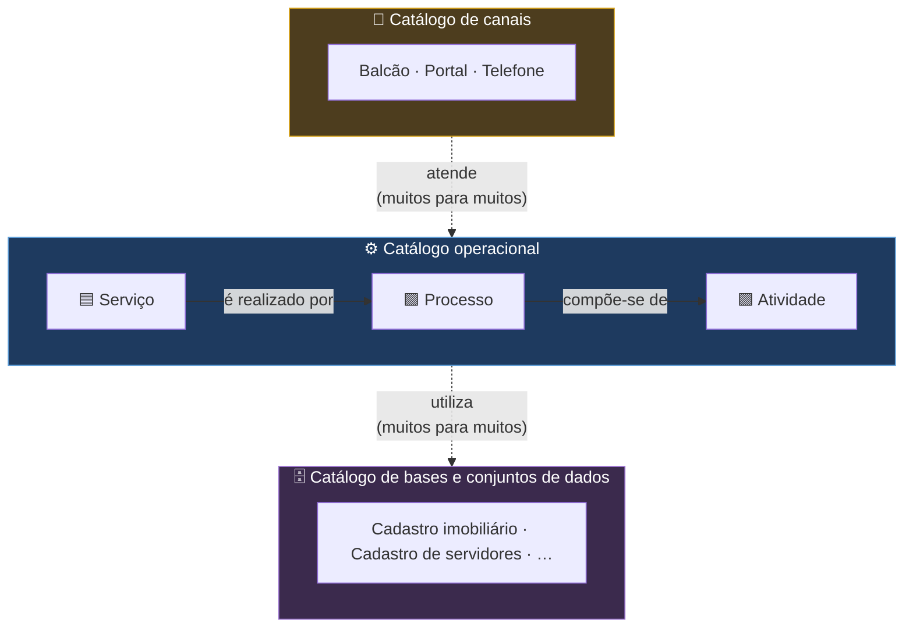

| Elemento | Exemplo | Papel no modelo |
|---|---|---|
| 🗄️ Base ou conjunto de dados | Cadastro imobiliário | Ativo informacional: não é assunto de Registro e não entra na trava |
| ⚙️ Atividade que cria e mantém a base | Gerir e manter o Cadastro imobiliário | Pode constituir tratamento documentado em Registro: coleta, correção, atualização e conservação dos dados |
| ⚙️ Atividades que utilizam a base | Tributação imobiliária, planejamento urbano, regularização fundiária, fiscalização, atendimento | Podem constituir tratamentos documentados em Registros, cada uma com finalidade própria, ligada à base por "utiliza" |

A atividade de tratamento continua sendo o elemento central para finalidade, hipótese legal, titulares, compartilhamentos e retenção; a base funciona como ativo associado a essas atividades. *🧪 DA-38, item 7 (SAD 10 REV15).*

### Temporalidade, retenção e descarte

Mapear um tratamento não termina em saber **quais dados entram** e **para que são usados**. Também precisamos documentar **por quanto tempo devem permanecer**, **qual fato inicia a contagem** e **o que acontece no final**. Esse cuidado vale para dados pessoais em sistemas, bancos, planilhas, documentos físicos e demais conjuntos de dados utilizados pela atividade.

Na Prefeitura já existe um grupo trabalhando a temporalidade documental. Esse grupo é a referência institucional para os prazos e as destinações. A Jornada LGPD não substitui esse trabalho e não cria uma tabela paralela: ela deve ligar cada tratamento à regra oficial aplicável e apontar claramente quando ainda falta definição.

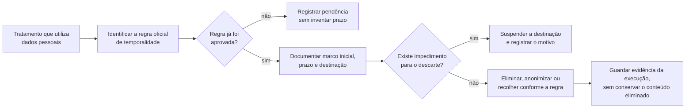

Em termos práticos, o Registro LGPD deverá conseguir informar:

| Pergunta | O que precisa ser documentado |
|---|---|
| Qual regra se aplica? | Código ou referência da tabela de temporalidade e sua versão; enquanto não existir, pendência institucional identificada |
| Quando começa a contagem? | Evento objetivo, como encerramento do processo, término do vínculo ou cumprimento da obrigação |
| Por quanto tempo? | Prazo aprovado, sem estimativa inventada pelo agente |
| Qual é a destinação? | Eliminação segura, anonimização, recolhimento para guarda permanente ou outra destinação formal |
| O descarte está impedido? | Motivo e vigência da suspensão, por exemplo demanda judicial, auditoria, incidente ou obrigação de prestação de contas |
| Como provar a execução? | Quem autorizou, quando ocorreu, qual regra foi aplicada, qual foi o escopo e qual foi o resultado — sem reter novamente os dados descartados |

**Limite atual da PoC:** o FORM 1 sintético ainda não executa descarte nem calcula prazo. Na PoC nuclear, versões e eventos fictícios permanecem preservados para provar integridade e reconstrução da trilha. Isso não significa “guardar dados pessoais para sempre”: a PoC usa somente dados fictícios, e a PoC ampliada deverá incorporar o contrato de temporalidade aprovado antes de automatizar alerta, bloqueio ou destinação. Até lá, não haverá eliminação automática.

### Exemplo: objetos do catálogo e seus Registros

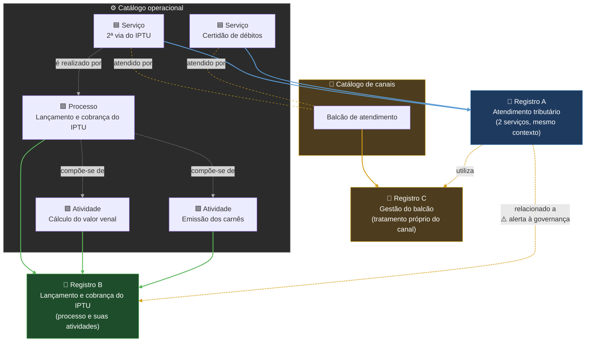

*Exemplos ilustrativos.* Linhas cinzas: a hierarquia entre os objetos. Linhas tracejadas laranja: o serviço é atendido pelo canal. Linhas coloridas: a qual Registro cada objeto pertence. Linhas amarelas: relações entre Registros; a relação entre A e B gera um alerta para a governança avaliar se há sobreposição de tratamentos.

Cada regra abaixo traz duas informações separadas: a **situação normativa** (de onde a regra vem e quanto ela já vale) e a **situação na PoC** (o que o código já faz).

| Símbolo | Situação normativa |
|---|---|
| 📘 | **Requisito vigente**: está escrito num SAD em vigor |
| 🔎 | **Interpretação** de um SAD: decorre do texto, mas não está escrita com essas palavras |
| 🧪 | **Decisão provisória da PoC** (SAD 10, DA-36 a DA-39): já vale para a PoC; os SADs afetados serão ajustados na revisão pós-PoC |
| 📝 | **Decisão do Encarregado ainda não registrada no SAD 10**: será levada a uma nova ficha DA (nenhuma no momento) |

#### Organização dos Registros

| Regra | Situação normativa | Na PoC |
|---|---|---|
| O mesmo objeto prestado por várias Secretarias é **um só** Registro, com uma unidade principal e as demais como participantes, **quando se tratar do mesmo objeto, no mesmo contexto de atuação e sem tratamentos materialmente autônomos** | 📘 SAD 02, RF-PRC-06 | Unidade principal ✔; participantes a fazer |
| Vários serviços com as mesmas operações e finalidade podem integrar **um único** Registro (A) | 📘 SAD 02, RF-PRC-13 | ✔ Um Registro com vários objetos |
| Um processo e as suas atividades ficam, em regra, no **mesmo** Registro (B); uma atividade só ganha Registro próprio se tiver tratamento autônomo (ex.: terceirizada, com operador e base próprios) | 🔎 SAD 02, RF-PRC-15 — granularidade a confirmar | ✔ Permitido pelo modelo |
| A hierarquia (serviço realizado por processo; processo composto de atividades) **não** torna os objetos equivalentes: os Registros se ligam por relação | 🔎 SAD 05, 13.1 | Relações no catálogo a fazer |
| Um canal só tem Registro **próprio** quando realiza tratamento autônomo; nele é PRINCIPAL (C) e, nos Registros dos serviços, APOIO. Receber e encaminhar não basta | 📘 SAD 02, RF-PRC-14 + 🧪 DA-36, item 6 | ✔ Catálogo de canais; papéis a fazer |
| Um ou dois Registros? Decide o **tratamento autônomo** (finalidade, dados, titulares, hipótese legal, riscos), não o rótulo serviço, processo ou atividade | 📘 SAD 02, RF-PRC-15 | — (decisão humana) |

#### Prevenção de duplicidade

| Regra | Situação normativa | Na PoC |
|---|---|---|
| **Bloqueio** (determinístico): não pode haver dois Registros em situação bloqueadora nos quais o mesmo objeto, no mesmo contexto de atuação, apareça como PRINCIPAL ou ABRANGIDO — trava no próprio banco de dados | 🧪 DA-36, itens 1 e 7 + DA-38, item 3 (contexto de atuação no lugar de "finalidade") | ✔ Trava por objeto + contexto no próprio banco, inclusive para pedidos simultâneos |
| **Contexto distinto não basta**: permite a análise separada, mas não prova, por si só, que os tratamentos são autônomos | 🧪 DA-38, item 4 | — (decisão humana) |
| **Sem atalhos**: a etapa só vira item próprio do catálogo quando for divisão real e estável do processo; o contexto é escolhido de catálogo, nunca digitado | 🧪 DA-36, itens 4 e 5 + DA-38, item 1 | ✔ Catálogo fictício de contextos (20) |
| **Advertência de família**: mesmo objeto em dois contextos da **mesma família** (ex.: CTX-TRIB-01 e CTX-TRIB-03) exige resolução; famílias diferentes não geram aviso; só famílias configuradas como mutuamente exclusivas impedem | 🧪 DA-38, item 6 + DA-39, item 2 (correção do pedido, justificativa específica ou transversalidade declarada pela governança) | ✔ Implementada e testada (Etapa 2d) |
| **Alerta** (análise humana), em dois momentos: na **criação**, por objetos relacionados no catálogo ou base de dados comum; na **submissão do FORM 1**, por mesma finalidade, titulares, categorias de dados ou compartilhamentos. O sistema não funde nem bloqueia sozinho | 📘 SAD 05, 5.3 + 🧪 DA-36, item 7 + DA-39, item 4 (dois momentos) | ⚙️ Parcial: base comum; relações do catálogo e verificação na submissão a fazer |

### Assunto ou citado: o papel de cada objeto no Registro

Os objetos ligados a um Registro têm um de quatro papéis. Os dois primeiros são o **assunto** do Registro e entram na trava contra duplicidade (🔒); os dois últimos são apenas **citados** e podem aparecer em vários Registros (🔓). À direita, um exemplo:

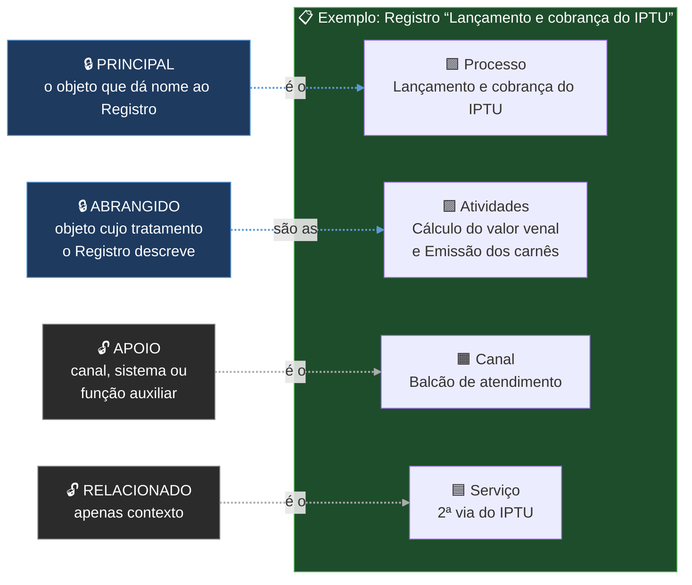

*No exemplo, ninguém mais pode abrir um Registro cujo assunto seja o Lançamento e cobrança do IPTU ou as suas atividades, no mesmo contexto de atuação. Já o Balcão e a 2ª via podem ser citados em outros Registros, e o Balcão continua livre para ter o seu próprio Registro, em que será PRINCIPAL.*

### Situação bloqueadora

| Estado do Registro equivalente | Resultado |
|---|---|
| Em andamento | 🔒 Bloqueia |
| Em validação | 🔒 Bloqueia |
| Em execução | 🔒 Bloqueia |
| Suspenso | 🔒 Bloqueia e orienta retomada ou cancelamento |
| Concluído | 🔒 Bloqueia nova criação e orienta reabertura (G10) |
| Cancelado | ✔ Permite novo Registro, com vínculo ao anterior |

*🧪 DA-36, item 2 (SAD 10 REV13). O SAD 04 exige, no G1, a inexistência de Registro equivalente **ativo**. Incluir Suspenso e Concluído vai além dessa expressão literal, mas é coerente com a preservação do mesmo Registro e de seus ciclos. Exige ajuste do SAD 04.*

#### Questão arquitetural: cancelar a partir de Suspenso ou Concluído (G11)

O G11 do SAD 04 só permite cancelar a partir de estado **ativo** (Em andamento, Em validação, Em execução). Isso impedia cancelar um Registro duplicado que já estivesse Suspenso ou Concluído, a não ser por caminhos artificiais (retomar só para cancelar, ou reabrir criando um ciclo novo só para cancelar), que distorceriam a trilha.

| Situação | Onde está |
|---|---|
| 🧪 Decisão provisória: o G11 passa a valer a partir de qualquer estado diferente de Cancelado; motivo escolhido de catálogo; competência reforçada para cancelar Registro Concluído, sem novo ciclo e sem apagar a conclusão histórica | DA-37 (SAD 10 REV14) |
| Consolidação documental | SAD 04 (G11, Figura 2, seção 6.4, pendências e cenários), na revisão pós-PoC (O-82). Não impede a PoC |
| Na PoC | O cenário 8 (duplicidade descoberta depois) depende da implementação dos atos de suspender, concluir e cancelar, já regulados pela DA-37 |

### Como o sistema evita Registros duplicados

**Ordem de verificação (precedência).** Antes de tudo, a triagem define qual é o objeto (um canal sem tratamento próprio não tem Registro; uma parte operacional vira atividade do catálogo). Depois, as verificações seguem sempre esta ordem:

| Ordem | Verificação | Se a resposta for "sim" | Natureza |
|---|---|---|---|
| 1 | **Equivalência bloqueadora**: o objeto já é PRINCIPAL ou ABRANGIDO de outro Registro em situação bloqueadora, no mesmo contexto de atuação? | 🔒 Bloqueia; as etapas seguintes não se aplicam | Determinística (banco de dados) |
| 2 | **Família de contexto**: o objeto já é assunto de Registro em outro contexto da mesma família? | ⚠️ Advertência: exige justificativa | Confirmação humana |
| 3 | **Objetos relacionados** (triagem estrutural): há objetos relacionados no catálogo ou que usam a mesma base de dados? A semelhança material (finalidade, titulares, dados) é verificada depois, na submissão do FORM 1 | 🔔 Alerta à governança | Análise humana posterior |
| 4 | **Resultado** | **Bloquear**, **criar com justificativa** (após 2) ou **criar** (com ou sem alerta) | — |

O fluxograma está dividido em duas partes. As caixas amarelas (📋) mostram como os exemplos da tabela adiante respondem.

#### Parte 1 — Triagem e bloqueio por equivalência (verificação 1)

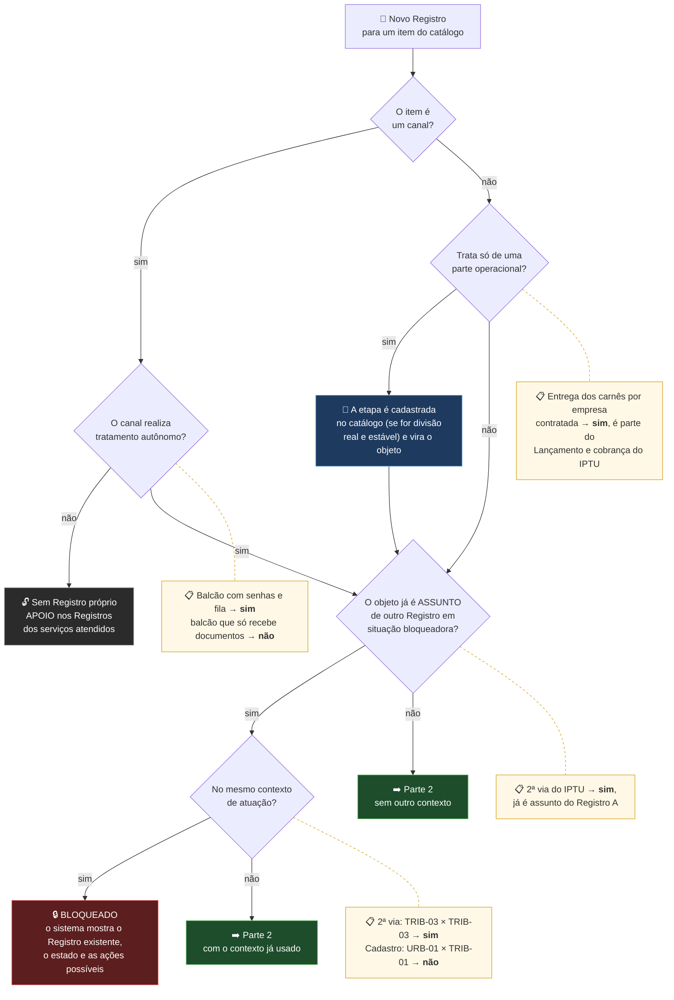

#### Parte 2 — Advertências e alertas (verificações 2 e 3)

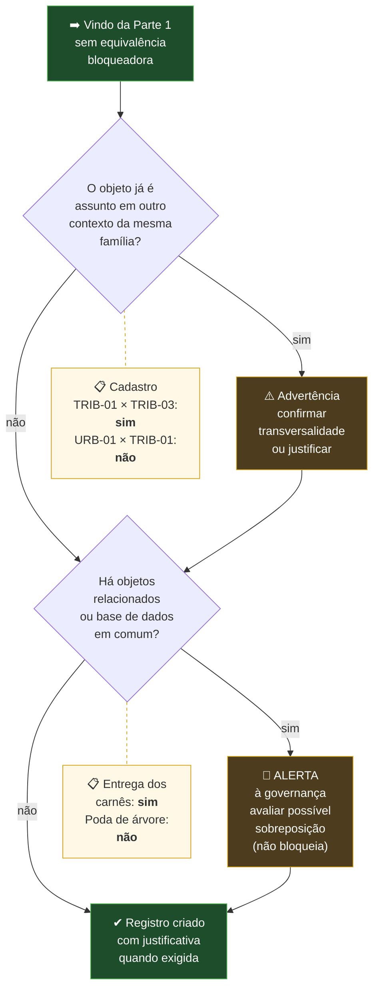

#### Exemplos (fictícios), cada um percorrendo as duas partes do fluxograma

| Ex. | Pedido | Caminho no fluxograma | Resultado |
|---|---|---|---|
| 1 | Criar um Registro chamado "IPTU" para o serviço **2ª via do IPTU**, contexto *Arrecadação e cobrança tributária* (CTX-TRIB-03) | O objeto já é assunto do Registro A, no mesmo contexto | 🔒 **Bloqueado.** O sistema mostra o Registro A, o estado e as ações possíveis (abrir, solicitar acesso) |
| 2 | Registrar a atividade **Gerir e manter o Cadastro imobiliário** no contexto *Planejamento territorial* (CTX-URB-01), quando ela já tem Registro em *Gestão cadastral tributária* (CTX-TRIB-01) | Já é assunto de outro Registro, mas em contexto distinto e de outra família: sem advertência. O contexto distinto permite a análise separada, mas a autonomia dos tratamentos é confirmada na análise do Registro | ✔ **Criado** |
| 3 | Registrar só a **entrega dos carnês por empresa contratada** | É parte operacional: vira atividade no catálogo e a verificação recomeça. Não é assunto de outro Registro, mas está relacionada ao Lançamento e cobrança do IPTU | 🔔 **Alerta** à governança e ✔ **criado** |
| 4 | Criar um Registro para o serviço **Poda de árvore** | Não é assunto de outro Registro e não tem objetos relacionados | ✔ **Criado** |
| 5 | Registrar a mesma atividade de cadastro em *Arrecadação e cobrança tributária* (CTX-TRIB-03), quando já existe em CTX-TRIB-01 | Contexto distinto, mas da mesma família TRIB: pode ser o mesmo tratamento fatiado | ⚠️ **Advertência**, com justificativa, e ✔ **criado** |

*Proposta em teste na PoC (DA-36 e DA-38), em revisão na Etapa 2d. A PoC já executa os exemplos 1, 2, 4 e 5 e o alerta por base de dados comum; o alerta por relações hierárquicas do catálogo (exemplo 3) depende da curadoria (O-80).*

## O que já funciona

| Item | Situação |
|---|---|
| Conexão Python ↔ PostgreSQL, com senha fora do código | ✔ |
| Livro de atos do domínio e livro de auditoria mensal, com cadeia de hash (DA-26, DA-27) | ✔ três tipos de fraude detectados em simulação |
| Pedido idempotente estrito: chave obrigatória, mesmo resultado na repetição, chave reutilizada com outro conteúdo recusada (DA-26; DA-39, item 5) | ✔ |
| Numeração anual LGPD-AAAA-NNNNN, no fuso de São Paulo (DA-39, item 3) | ✔ |
| Base da PoC `lgpd_poc_v2`, migrações versionadas e base própria de testes | ✔ |
| Pessoas, contas, unidades e designações de papéis | ✔ dados fictícios |
| Segregação de funções, comparando a pessoa e nunca a conta (O-66) | ✔ cenários a, b, c, e, f ¹ |
| Criação do Registro pelo G1, com ciclo 1 e FORM 1 Não iniciado | ✔ ² |
| Catálogo operacional e catálogo de canais, com vínculo vigente `ObjetoCanal` para Serviço, Processo ou Atividade (DA-36, item 6) | ✔ fictícios; sem herança automática e sem atendimentos individuais |
| **Prevenção de duplicidade** (geral) | ✔ Etapa 2d concluída ³ |
| ↳ Catálogos fictícios de contextos (com famílias) e de bases e conjuntos de dados, com a relação "utiliza" | ✔ Implementado |
| ↳ Trava determinística objeto + contexto, no próprio banco | ✔ Implementada |
| ↳ Exatamente um PRINCIPAL por Registro, no próprio banco | ✔ Implementado |
| ↳ Advertência de família, com três resoluções (DA-39, item 2) | ✔ Implementada |
| ↳ Declaração de transversalidade, só pela governança (DA-39, item 2) | ✔ Implementada |
| ↳ Alerta estrutural | ⚙️ Parcial: base comum e vínculos fictícios Secretaria → item → contexto ✔; curadoria institucional continua em O-80 |
| ↳ Semelhança por finalidade, categorias de titulares, categorias de dados e compartilhamentos | ✔ Alerta não bloqueante no I3 (DA-39, item 4) |
| ↳ Testes automatizados (pytest, base própria) | ✔ 189 aprovados, mais o ensaio de volume separado |
| Checkpoint externo da cadeia (SAD 08) | a fazer |
| Rascunho do FORM 1: I1 iniciar preenchimento e I2 salvar, com controle otimista | ✔ |
| ↳ Testes de I1 e I2 | ✔ 14 testes: estado, lacre, cadeia, idempotência, autorização, concorrência, rollback, migração e POC-TS-004 |
| ↳ Tela de I1 e I2 | ✔ Botões ligados ao domínio, opções fechadas, orientação contextual e versão lida enviada no salvamento; 6 testes HTTP específicos |
| Contrato fechado do FORM 1 sintético: categorias selecionadas por código, sem nomes de titulares | ✔ Versão 2; códigos desconhecidos e campos livres são recusados |
| Temporalidade, retenção e descarte | ⚙️ Diretriz registrada; prazos e destinações dependerão da tabela oficial e do grupo municipal responsável; sem eliminação automática nesta etapa |
| Submissão do FORM 1: I3 cria versão imutável e G2 leva o Registro a Em validação | ✔ |
| ↳ Testes de I3 e G2 | ✔ 10 testes: snapshot, cadeias, idempotência, validação, autorização, concorrência, rollback, sobreposição e imutabilidade |
| Retirada antes da análise: I4 devolve o FORM 1 ao rascunho e G3 leva o Registro a Em andamento | ✔ |
| ↳ Testes de I4 e G3 | ✔ 7 testes: estados, cadeias, idempotência, autorização, bloqueio após I13, concorrência, rollback e cenário A11 com Versão 2 |
| Início da análise: I13 atribui a versão a um único agente responsável pela análise, com segregação de funções | ✔ |
| ↳ Testes de I13 | ✔ 8 testes: responsável vigente, estados, idempotência, autorização, segregação pela pessoa, versão atual, concorrência, rollback e migração |
| Reatribuição da análise: I14 troca o responsável vigente sem apagar a autoria anterior | ✔ |
| ↳ Testes de I14 | ✔ 6 testes: autoria preservada, idempotência, competência, segregação, concorrência e rollback |
| Validação: I5 valida a versão e G4 recalcula o estado do Registro | ✔ |
| ↳ Ação obrigatória sintética mínima | ✔ Migração 6; estado, responsável, evidência e vínculos com Registro, ciclo e Instrumento |
| ↳ Testes de I5 e G4 | ✔ 8 testes: caminhos com e sem ação aberta, responsável vigente, idempotência, concorrência, rollback e migração |
| Devolução: I6 preserva a versão, P1 cria a pendência e G3 recalcula o Registro | ✔ |
| ↳ Testes de I6, P1 e G3 | ✔ 9 testes: estados, cadeias, motivo, responsável vigente, segregação, versão, idempotência, concorrência, rollback e migração |
| Assunção e ajuste: P2 atribui a pendência e I7 recria o rascunho da versão devolvida | ✔ |
| ↳ Flags operacionais da tela inicial | ✔ Calculadas: correção solicitada, pendência atribuída, resposta aguardando decisão, complementação solicitada e submissão bloqueada |
| ↳ Testes de P2, I7 e flags | ✔ 9 testes: autorização, flags, idempotência, concorrência, rollback, assunção obrigatória, responsável e retomada do I2 |
| Resposta da correção: P3 registra o lacre do rascunho e congela novas alterações | ✔ |
| ↳ Testes de P3 | ✔ 6 testes: lacre, congelamento, tela desatualizada, responsável, idempotência, concorrência e rollback |
| Decisão da correção: P4 aceita; P5 devolve a mesma pendência; P6 retoma a edição | ✔ P5/P6 restritos à pendência criada pelo I6 |
| ↳ Testes de P4, P5, P6 e novo I3 | ✔ 9 testes: A2a, A2b, lacre aceito, motivo, segregação, idempotência, concorrência, rollback e histórico |
| Conclusão sem medidas: G5 conclui o Registro e o ciclo após a validação | ✔ Competência formal separada e portões objetivos |
| ↳ Testes de G5 | ✔ 8 testes: versão validada, competência, pendências, medidas, Versão 2, idempotência, concorrência e rollback |
| Conclusão com medidas: ação obrigatória finalizada com evidência e G6 conclui Registro e ciclo | ✔ Responsável pela ação separado do agente competente para concluir |
| ↳ Testes da ação e do G6 | ✔ 10 testes: momento e responsável corretos, campos obrigatórios, evidência, encerramento formal, competência, bloqueio, preservação, idempotência, concorrência e rollback |
| Pendência intersecretarial mínima: P1 humano, P2, P3 com evidência e P4 pela origem | ✔ Registro permanece na unidade principal e o FORM 1 não é editado pelo destino |
| ↳ Testes da pendência intersecretarial | ✔ 15 testes: criação, contexto mínimo, designações, fila, flags, resposta, evidência, aceite, propriedade, idempotência, concorrência, rollback de P1/P3/P4 e bloqueio do G5 |
| Demais atos ampliados do workflow | a fazer no M1b |
| Telas (FastAPI + Jinja2) e testes de aceite do M1a (POC-TS-001 a 009) | ⚙️ Em andamento: identidade fictícia, contexto inicial, painel, detalhe, I1/I2, escopo institucional e negação auditada; 15 testes HTTP |

¹ Tentativas negadas ficam registradas na auditoria. O cenário d (substituição) está a fazer.
² O início do preenchimento do FORM 1 será um comando posterior ao G1, como no cenário A1 do SAD 04.
³ Trava determinística por objeto e contexto e exatamente um PRINCIPAL, no próprio banco; um contexto por Registro garantido por chave composta (DA-39, item 1); advertência de família e transversalidade (DA-39, item 2); recusas do banco tratadas pelo nome da regra. A suíte chegou a 189 testes automatizados aprovados em 22/10/2026, inclusive pedidos simultâneos, dezenove testes HTTP, quatro testes específicos de identidade e catálogo institucional, quatro variações da barreira de dados pessoais e uma regressão rápida do gerador de volume. Suspenso e Cancelado continuam testados como regra do banco até a chegada dos atos do M1b.1; Concluído já é alcançado pelos G5 e G6 reais.

### Idempotência, em palavras simples

**Idempotência** é a propriedade de uma operação que produz o mesmo resultado quando executada uma ou várias vezes. Apertar repetidamente o botão do elevador não chama vários elevadores; mandar desligar uma luz já apagada não a desliga outra vez. Em contrapartida, fazer dois depósitos de R$ 100 produz R$ 200 e, portanto, não é uma operação idempotente.

Em Python, `x = 5` é idempotente: repetir a atribuição mantém `x` com o valor 5. Já `x += 5` não é, pois cada execução acrescenta mais 5.

Na PoC, cada pedido recebe internamente um `comando_id`, sem exigir que o agente digite essa chave. Esse mecanismo protege o sistema contra clique duplo, reenvio do navegador, oscilação da rede e pedidos simultâneos. Os testes em `testes/test_idempotencia.py` verificam que:

1. repetir o mesmo pedido devolve o resultado original, sem criar outro Registro;
2. repetir um pedido negado devolve a mesma negação;
3. reutilizar a mesma chave com conteúdo diferente é recusado como reutilização indevida; e
4. dois pedidos simultâneos com a mesma chave produzem um único efeito.

Assim, clicar duas vezes em **Criar Registro LGPD** não deve transformar o mesmo pedido em dois códigos LGPD. Essa proteção é essencial para a confiabilidade da auditoria e da cadeia de eventos.

### O que os 189 testes garantem, em linguagem simples

Os testes atuais exercitam o motor da PoC com dados fictícios e procuram responder a perguntas práticas:

- **Criação do Registro:** uma pessoa autorizada consegue criar o Registro, o ciclo 1 e o FORM 1 juntos; uma conta inativa ou uma pessoa sem o papel necessário não consegue.
- **Prevenção de duplicidade:** o mesmo objeto não ocupa duas vezes o mesmo contexto; objetos apenas citados não bloqueiam; advertências de família e alertas por base comum aparecem sem confundir alerta com proibição.
- **Pedidos repetidos e concorrentes:** um duplo clique ou reenvio não duplica o ato; reutilizar a mesma chave com dados diferentes é recusado; pedidos simultâneos recebem tratamento consistente pelo banco.
- **Numeração e integridade:** os códigos anuais continuam distintos mesmo com criações simultâneas, a virada do ano respeita o fuso de São Paulo e as regras estruturais também são protegidas pelo banco.
- **Autoria e segregação:** a regra olha para a pessoa, não apenas para a conta usada. Assim, trocar de conta não permite que alguém valide ou devolva a própria submissão.
- **Rascunho do FORM 1:** I1 inicia o preenchimento e I2 salva sem deixar uma tela antiga apagar um conteúdo mais novo. Falhas simuladas desfazem a operação inteira, sem deixar metade do trabalho gravada.
- **Preenchimento sem nomes de titulares:** categorias de titulares, dados e destinatários são escolhas de catálogos fechados. Texto livre, campo antigo ou código inventado impede a submissão.
- **Submissão:** I3 e G2 criam uma única versão, atualizam os estados juntos, resistem a envios simultâneos, geram o alerta material e impedem alteração ou exclusão da versão protocolada.
- **Retirada antes da análise:** I4 e G3 devolvem o formulário ao rascunho sem apagar a versão enviada. Uma correção seguida de nova submissão cria a Versão 2 e mantém a Versão 1 no histórico.
- **Início da análise:** I13 entrega a versão mais recente a um único agente responsável pela análise. Quem submeteu não pode analisar o próprio trabalho, nem mesmo usando outra conta; duas tentativas simultâneas não criam duas análises.
- **Troca do responsável:** I14 muda somente o agente responsável atual. Quem iniciou e tudo o que já ocorreu continuam no histórico; uma tela desatualizada não consegue desfazer uma reatribuição mais recente.
- **Validação:** somente o responsável atual da análise pode executar I5. O sistema encerra a análise, torna a versão validada a versão vigente e executa o G4 junto: ação aberta leva a **Em execução**; sem ação aberta, o Registro volta a **Em andamento**.
- **Primeiras telas:** o painel identifica claramente qual agente fictício está sendo simulado, apresenta os mapeamentos que ele pode consultar e destaca suas pendências e próximas ações. Esses avisos são tecnicamente flags calculadas. No detalhe, quem possui autorização de `preenchedor` pode iniciar e salvar o FORM 1; outro papel apenas consulta. Se alguém tentar abrir diretamente um Registro de outra unidade, o sistema nega a consulta e registra a tentativa na auditoria.
- **Identidade e contexto inicial:** cada pessoa fictícia possui matrícula única. Antes do FORM 1, a tela confirma primeiro a Secretaria responsável pelo Registro, dentre aquelas em que o Agente possua a designação `responsavel_registro`; depois exige um serviço, processo ou atividade coerente com o catálogo e um contexto. O G1 cria o Registro e o FORM 1 Não iniciado.
- **Catálogo por Secretaria e contexto:** a tela não mistura itens de todas as Secretarias nem contextos incompatíveis. Ela apresenta somente os vínculos fictícios vigentes da Secretaria e do item escolhidos; o servidor repete as conferências e recusa um pedido forjado fora da tela.
- **Devolução:** somente o agente responsável atual pela análise pode executar I6. O sistema preserva a versão, cria uma pendência bloqueante para a Secretaria responsável e sua equipe de preenchimento e executa o G3 junto, sem deixar partes soltas se ocorrer uma falha.
- **Assunção e ajuste:** P2 garante que apenas um agente autorizado assuma a pendência; I7 recria o rascunho a partir da versão devolvida e libera novamente o salvamento pelo I2.
- **Resposta e decisão da correção:** P3 lacra a resposta; P4 aceita exatamente esse conteúdo; ou P5 devolve a mesma pendência com motivo e P6 libera outra correção. O novo I3 só cria a Versão 2 quando o rascunho coincide com o lacre aceito.
- **Conclusão sem medidas:** G5 somente conclui quando o FORM 1 está validado, não existe pendência aberta nem ação obrigatória no ciclo e o agente possui competência formal para concluir. Registro e ciclo são encerrados juntos, sem apagar a versão validada.
- **Conclusão com medidas:** a ação só pode ser finalizada pelo seu responsável quando o Registro está Em execução e sempre exige evidência. Um encerramento excepcional também exige motivo. Depois disso, G6 confere todos os portões e um agente com competência formal conclui Registro e ciclo sem apagar a versão nem a comprovação da medida.
- **Participação intersecretarial:** a unidade principal envia uma pendência à fila institucional de outra unidade. Um agente previamente designado assume e responde com entrada, operações, saída, interfaces e evidências; a origem aceita. O destino não edita o FORM 1, o Registro não muda de unidade principal e G5 permanece bloqueado até o aceite.
- **Flags operacionais:** os avisos da tela inicial são calculados a partir da pendência real. Eles mudam de “Correção solicitada” para “Pendência atribuída a você” sem manter uma segunda verdade no banco.

Esses 189 testes são a cobertura automatizada cotidiana do motor e dos primeiros cortes HTTP. Na rodada formal `M1A-20261022-001`, todos foram aprovados, sem falhas, erros ou testes ignorados. O ensaio pesado do POC-TS-009 foi reexecutado com 1.000 Registros, 50.000 eventos, verificação integral de 1.000 cadeias e reconstrução coincidente de 25 projeções. A execução e os pacotes `POC-EV` aplicáveis estão consolidados no relatório formal, e o Encarregado de Dados aceitou o M1a em 22/10/2026.

### Matriz de aceite da PoC nuclear

Em termos simples, o caminho até o aceite é este:


Hoje, **os nove testes formais estão tecnicamente aprovados e aceitos no M1a**. No `POC-TS-003`, o teste concorrente confirmou a assunção única e a auditoria da tentativa perdedora; no `POC-TS-008`, a carga recusou entradas em formatos pessoais antes do primeiro `INSERT`; no `POC-TS-009`, o ensaio de volume verificou todas as 1.000 cadeias e reconstruiu 25 projeções sem divergência. A rodada identificada e os pacotes `POC-EV` estão prontos para apresentação e transferência à T.I.

| Situação | Testes | O que significa |
|---|---|---|
| ✔ Aprovação técnica | POC-TS-001 a 009 | Rodada identificada concluída e evidências consolidadas. |
| ⏳ Ensaio técnico pendente | Nenhum | O trabalho restante está no fechamento formal, não na criação de outro ensaio técnico. |
| ✔ Aceite do M1a | POC-TS-001 a 009 | Registrado pelo Encarregado de Dados em 22/10/2026, com as limitações conhecidas. |
| ⏳ Transferência técnica | Apresentação à T.I. | A apresentação, os participantes e os encaminhamentos serão registrados posteriormente. |

> 📋 A correspondência teste por teste, os arquivos que já dão cobertura e as evidências que faltam estão na [Matriz de aceite do M1a](docs/aceite/MATRIZ_ACEITE_M1A.md).

> 📊 Os números, tempos e cuidados do ensaio de 1.000 Registros estão no [Relatório técnico do POC-TS-009](docs/aceite/RELATORIO_TECNICO_POC_TS_009.md). Os artefatos operacionais de evidência continuam fora do Git.

> ✅ A rodada formal completa, o resultado dos nove `POC-TS`, os pacotes `POC-EV`, o ambiente e os hashes dos artefatos estão no [Relatório da rodada formal do M1a](docs/aceite/RELATORIO_RODADA_FORMAL_M1A_2026-10-22.md).

### Minuta da Ata de Aceite e Transferência Técnica do M1a

O Encarregado de Dados registrou o aceite do M1a em 22/10/2026, com as limitações conhecidas abaixo. Esta minuta será completada e entregue na apresentação formal à T.I., que caracteriza a passagem técnica e registra participantes, dúvidas e encaminhamentos. O aceite do M1a **não autoriza automaticamente o início da PoC ampliada**, que dependerá de decisão expressa própria.

| Campo | Preenchimento no dia da apresentação |
|---|---|
| Data do aceite do M1a | 22/10/2026 |
| Horário e local da apresentação à T.I. | `[preencher na apresentação]` |
| Unidade que apresenta | Secretaria de Planejamento Urbano e Gestão Estratégica |
| Responsável pelo aceite | Encarregado de Dados |
| Responsável pela apresentação | `[preencher na apresentação]` |
| Representantes da T.I. | `[preencher nomes e funções]` |
| Referência técnica | Commit `df2db0f`, Matriz de Aceite do M1a e Relatório da rodada `M1A-20261022-001` |

**Objeto.** Registrar a apresentação, o aceite e a transferência técnica da PoC nuclear M1a do Sistema Municipal de Governança LGPD, construída exclusivamente com dados fictícios.

**Evidências conferidas.** Foram apresentados o código da PoC, a arquitetura vigente, o percurso do Registro, os nove testes formais `POC-TS-001` a `POC-TS-009`, os resultados reproduzíveis, a cadeia de eventos e os pacotes `POC-EV` aplicáveis. A relação efetivamente entregue deverá ser registrada abaixo:

`[listar arquivos, relatórios, pacotes de evidência e local de guarda]`

**Resultado do aceite.** Assinalar uma opção:

- [ ] M1a aceito sem ressalvas.
- [x] M1a aceito com as limitações conhecidas descritas nesta ata.
- [ ] M1a não aceito; correções obrigatórias descritas nesta ata.

**Ressalvas, limitações e defeitos remanescentes.** Nenhum defeito crítico ou alto pode permanecer aberto para o aceite. Registrar limitações que não impeçam a finalidade do marco e o tratamento combinado:

- checkpoint externo da cadeia e sua custódia institucional permanecem no backlog;
- temporalidade e descarte dependem da tabela oficial e da governança municipal responsável;
- autenticação institucional, integrações, Piloto e produção não pertencem ao M1a;
- apresentação e transferência técnica à T.I. permanecem pendentes.

**Transferência técnica.** O M1a está aceito pelo Encarregado de Dados. A passagem à T.I. será completada quando forem apresentados a visão da solução, as instruções de instalação e execução, o código, os SADs, o README, os testes e as evidências. A direção funcional, o tratamento do backlog e eventual início da PoC ampliada serão objeto de decisão posterior, sem início automático.

**Encaminhamentos e responsáveis.**

| Encaminhamento | Responsável | Prazo ou condição |
|---|---|---|
| Preservar o código, as evidências e a referência do commit aceito | `[preencher]` | `[preencher]` |
| Registrar dúvidas ou limitações identificadas pela T.I. | `[preencher]` | `[preencher]` |
| Deliberar sobre eventual PoC ampliada | Encarregado de Dados | Após leitura do README e decisão expressa |

**Registro dos participantes.**

| Nome | Unidade ou função | Ciência ou assinatura |
|---|---|---|
| `[preencher]` | `[preencher]` | `[preencher]` |
| `[preencher]` | `[preencher]` | `[preencher]` |
| `[preencher]` | `[preencher]` | `[preencher]` |

> A versão preenchida deve receber data, referência do commit e localização das evidências. Se for assinada fora do Git, o README deve registrar apenas a referência e o local de guarda, sem expor assinaturas ou dados pessoais desnecessários.

### Legenda operacional: agentes e funções

Todos os atores humanos do fluxo são **Agentes Públicos Autorizados**. A expressão usada ao lado do agente indica a função que ele exerce naquele ato; não representa um tipo diferente de pessoa.

Na organização municipal prevista para o levantamento, o **Agente Público Autorizado responsável pelo Registro** é o ponto focal da LGPD designado pela Secretaria. Ele abre o Registro, coordena o levantamento local, acompanha pendências e encaminha o FORM 1. O próprio Agente pode também integrar a equipe e preencher o formulário quando possuir essa autorização. A **equipe responsável pelo preenchimento** reúne ainda outros servidores que executam ou conhecem o serviço, processo ou atividade e descrevem a rotina real sob a coordenação funcional desse Agente. Essa coordenação não altera a subordinação administrativa existente na Secretaria.

| Função exercida | Atuação principal |
|---|---|
| Agente Público Autorizado responsável pelo Registro | Abre o Registro, coordena o levantamento, acompanha pendências e encaminha o FORM 1 |
| Equipe responsável pelo preenchimento | Inicia, salva e ajusta o FORM 1 com as informações fornecidas pelos servidores que conhecem a rotina |
| Analista da T.I. | Examina a versão e solicita correções depois da passagem institucional para a T.I. |
| Validador da T.I. | Decide sobre a validação depois da análise, com segregação de funções |
| Responsável pela ação | Executa a medida e registra sua evidência |
| Agente da fila institucional | Assume e responde pendências destinadas à sua unidade; na PoC, usa o papel técnico provisório `agente_pendencia` |
| Competente para concluir | Executa G5 ou G6; na PoC, a autorização técnica provisória é o papel `concluidor` |
| Instância validadora competente | Inicia ou reatribui a análise |

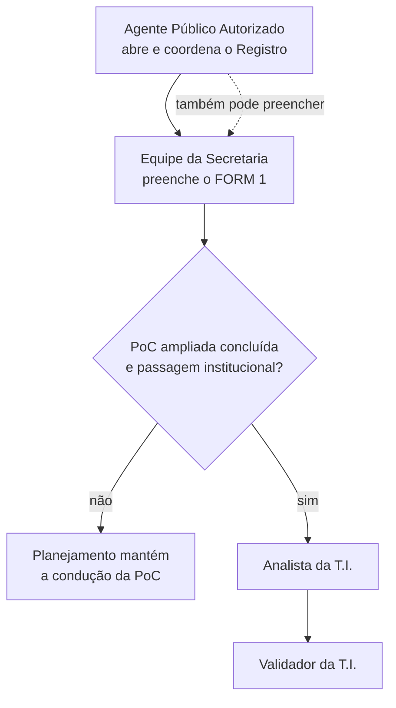

Uma mesma pessoa pode exercer mais de uma função quando possuir autorização e competência, mas a segregação continua valendo. Por exemplo, quem submeteu uma versão não pode iniciar sua análise, validá-la nem devolvê-la. No código, nomes como `responsavel_registro`, `preenchedor`, `analista` e `validador` são identificadores técnicos dos papéis usados para conferir essas autorizações.

Na PoC nuclear, as autorizações técnicas `responsavel_registro` e `preenchedor` são distintas, mas podem ser acumuladas pela mesma pessoa. A massa fictícia demonstra os dois percursos: o Agente principal possui ambas as autorizações e pode abrir e preencher; outro servidor possui somente a autorização de preenchimento e pode colaborar no mesmo Registro. Cada ato preserva autoria individual, controle de versão e auditoria. Os papéis de analista e validador da T.I. são simulados na PoC e somente se tornam atribuições operacionais após a conclusão da PoC ampliada e a passagem institucional do trabalho.

Na preparação do FORM 1 integral, essas funções recebem nomes explícitos: **APA — Agente Público Autorizado**, que abre o Registro, e **ARP — Agente Responsável pelo Preenchimento**, que executa o levantamento factual. APA e ARP podem ser a mesma pessoa. O APA pode indicar outro ARP somente entre pessoas que já possuam conta ativa e designação vigente de `preenchedor` na Secretaria; a indicação não cria permissão. O sistema mantém separadamente o APA de abertura, o APA em exercício, o ARP atual e o executor de cada ato e, futuramente, o agente que submeter a versão.

O primeiro incremento dessa preparação foi verificado por uma suíte completa de **206 testes** no banco exclusivo `lgpd_poc_teste`. Depois do Bloco 1, a **Etapa visual 1** passou a abranger também a porta de entrada, a execução do fluxo, os ramos próprios de Ouvidoria e e-SIC e participantes registrados em ocorrências independentes. A Etapa visual 2 abrange os **Blocos 4 e 5**: categorias de titulares e representantes e as 35 categorias de dados do item 5.1, sem cadastrar pessoas. Em 5.1, `A confirmar` é exclusivo; `Outro` admite complemento descritivo de até 200 caracteres, que pode faltar no rascunho e será obrigatório na futura submissão. Não há conversão, migração, cópia ou sincronização automática com o FORM 1 nuclear nem entre os itens 4.2.5.1 e 5.1. Tipo e nome do objeto continuam reaproveitados da abertura; respostas parciais são aceitas; catálogo, autoria, idempotência, controle de versão, atomicidade e cadeia de eventos são protegidos. A rodada de estabilização preservou participantes ao resalvar o Bloco 1, separou respostas condicionais ativas do histórico inativo e tornou funcional a navegação entre as Etapas 1 e 2; as Etapas 3 e 4 continuam visíveis e desabilitadas. Após a implementação isolada do Bloco 5, a regressão completa aprovou **246 de 246 testes**. Os Blocos 6 a 14 e a submissão integral continuam pendentes; o FORM 1 sintético do contrato 2 permanece inalterado.

#### Continuidade institucional do APA

O Registro LGPD permanece sob responsabilidade da Secretaria mesmo quando muda a pessoa que exerce a função de APA. Cada Secretaria pode possuir **um titular ativo** e **um ou mais suplentes formalmente designados**; a designação registra situação, vigência, fundamento administrativo e quem registrou a autorização. A massa da PoC usa somente identidades e fundamentos fictícios.

Na **substituição temporária**, uma autoridade institucional autorizada informa o suplente, o titular substituído, o motivo e o período. O suplente somente atua durante esse intervalo; seus eventos registram o executor real e, em `em_nome_de`, o titular representado. O encerramento registra o retorno do titular. Na **sucessão definitiva**, um suplente vigente passa a titular, o mandato anterior é encerrado e o evento preserva quem autorizou, o titular anterior, o sucessor, o motivo e a data. O banco impede mais de um titular ativo e mais de uma substituição temporária aberta por Secretaria; comandos repetidos são idempotentes e disputas simultâneas resultam em uma única substituição.

Essas mudanças não transferem nem reabrem Registros. `Registro.criado_por` continua identificando imutavelmente o APA que realizou a abertura; formulários, respostas, eventos, evidências e o ARP permanecem inalterados. Se o ARP também precisar mudar, deverá ser usado seu procedimento próprio e auditável. A tela do Registro apenas identifica o **APA de abertura**, o **APA em exercício** e o **ARP atual**; ainda não existe uma interface administrativa para cadastrar designações, iniciar/encerrar afastamentos ou registrar sucessões. Nesta PoC, o papel técnico provisório `governanca_protecao_dados` registra essas autorizações, e ninguém pode conceder a si próprio poderes de APA. Uma substituição que alcance o fim previsto deixa de conferir exercício ao suplente, mas deverá ser encerrada formalmente antes de se abrir outra.

Após este incremento, a regressão completa aprovou **257 de 257 testes** no banco exclusivo `lgpd_poc_teste`, incluindo titular em exercício, suplente dentro e fora da vigência, retorno, sucessão definitiva, preservação do Registro, ARP e rascunho, recusas, trilha de eventos, idempotência, concorrência, rollback e migração. O contrato nuclear 2 e os Blocos 1 a 5 do FORM 1 integral permanecem preservados.

A associação catalogal de canais foi generalizada de `ServicoCanal` para `ObjetoCanal`, preservando os vínculos anteriores, suas vigências e a unicidade de cada par vigente. A migração 14 renomeia a estrutura e sua chave, sem copiar ou apagar linhas; no banco de demonstração, os três vínculos fictícios anteriores foram preservados, com as duas chaves estrangeiras e o índice único parcial íntegros. A regressão completa aprovou **267 de 267 testes**, incluindo a continuidade institucional do APA e dez cenários específicos de canais. Essa preparação estrutural ainda não seleciona canais na abertura nem os transporta para o formulário. O desenho funcional de **múltiplos canais** continua registrado no [Plano de estabilização antes do Bloco 5](docs/planejamento/PLANO_PRE_BLOCO_5_FORM1.md), e o campo `2.1` permanece de escolha única até incremento posterior.

Na abertura ampliada, depois de escolher Secretaria, tipo e objeto, o APA visualiza os canais habituais vigentes e confirma os aplicáveis — podendo confirmar nenhum, um ou vários. A confirmação produz um retrato histórico ligado ao Registro: guarda a referência ao vínculo catalogal, os códigos e o nome exibido naquele momento, além da autoria e da data; mudanças posteriores no catálogo não reescrevem esse retrato. A migração 15 acrescenta somente essas projeções e não reinterpreta Registros anteriores. O G1 nuclear permanece compatível: quando a confirmação ampliada não é informada, seus parâmetros e seu evento continuam no esquema 2; no novo percurso, o evento de esquema 3 registra inclusive a confirmação vazia. A regressão completa aprovou **286 de 286 testes**.

**Serviço, Processo e Atividade são classificações independentes.** Podem possuir relacionamentos opcionais entre si e nenhum vínculo é herdado automaticamente. Associar vários canais ao mesmo objeto também não cria vários Registros LGPD: os canais descrevem meios habituais de entrada, não atendimentos individuais. Este incremento não altera o FORM 1, a pergunta `2.1` nem as condicionais de Ouvidoria e e-SIC.

No Incremento 3, a pergunta canônica `2.1` conservou seu identificador, texto e posição no Bloco 2, mas passou a exibir ao ARP, sem nova digitação, os canais historicamente confirmados pelo APA. Esse retrato é somente para consulta e usa os códigos e nomes preservados no Registro, sem depender de mudanças posteriores no catálogo. A interface e o domínio impedem que o ARP sobrescreva a confirmação do APA. Há três estados explícitos: um ou vários canais confirmados; nenhum canal confirmado por decisão expressa; e Registro anterior sem confirmação histórica, que mantém a compatibilidade do preenchimento legado. A REV13 pergunta pela porta pela qual a demanda chega **inicialmente**, enquanto o retrato do APA contém canais **habituais** e pode ser múltiplo; por isso não ocorre conversão artificial para uma escolha única. As ramificações de Ouvidoria e e-SIC não foram alteradas neste incremento e continuam pendentes de integração específica. Não houve nova migração. A regressão integral aprovou **292 de 292 testes**.

No Incremento 4, os identificadores canônicos `OUV.1` a `OUV.4` e `ESIC.1` a `ESIC.2` foram preservados e passaram a ser condicionados pelo retrato histórico dos canais, sem inferência pelo nome apresentado. Ouvidoria e e-SIC ativam seus ramos de forma independente; quando ambos foram confirmados, os dois ramos aparecem uma única vez, e canais genéricos — inclusive portal, telefone ou 156 — não são equiparados a eles. Registros antigos sem confirmação histórica conservam a resposta legada de `2.1` e seus dados, sem transformar ausência de confirmação em resposta negativa. A migração 16 acrescenta ao catálogo uma classificação opcional limitada a `Ouvidoria` e `e-SIC` e a copia para o snapshot das novas confirmações; não há preenchimento retroativo nem reinterpretação do histórico. A regressão integral aprovou **300 de 300 testes**.

No Incremento 5, os **Blocos 6 a 10** foram incorporados ao rascunho integral com os identificadores, controles, alternativas e condicionais da REV13: origem dos dados; operações de tratamento; sistemas, meios, canais e suportes; perfis de acesso; e envio, disponibilização ou saída. As respostas parciais continuam permitidas, ramos que perdem aplicabilidade deixam a resposta ativa sem apagar seu histórico, e opções inexistentes, repetidas ou forjadas são recusadas. Os itens `6.2.2`, `9.2.2` e `10.4` reutilizam o catálogo canônico de categorias do item `5.1`, sem criar cópias independentes. No Bloco 8, a condição documental relativa a WhatsApp foi implementada para a alternativa canônica existente `WhatsApp corporativo`; a referência da matriz a WhatsApp pessoal permanece como lacuna de decisão, sem criação de alternativa nova. Os Blocos 11 a 14 e a submissão integral permanecem pendentes. Nenhuma migração de banco foi necessária neste incremento, pois os novos campos usam o rascunho JSON versionado já existente.

No Incremento 6, os **Blocos 11 a 14** completaram os 128 identificadores do rascunho REV13: armazenamento e dependência de terceiro; guarda e destinação; exposição física ou visual; e achados e pendências. As condicionais seguem a matriz canônica, o prazo do item `12.1.1` aceita somente número, e as alternativas `Nenhuma das situações acima`, `A confirmar` e `Não se aplica` do item `13.1` são aceitas apenas isoladamente. Nenhuma exclusividade pendente dos demais campos foi criada por analogia. Não houve migração, pois o envelope JSON versionado já comporta esses blocos. A conclusão dos 14 blocos **não habilita a submissão integral**, que depende de incremento próprio, das validações de obrigatoriedade ativas e das decisões humanas ainda registradas neste documento.

### Política e Matriz de Obrigatoriedade — FORM 1 Integral

A obrigatoriedade é definida de forma declarativa e campo a campo. A fonte única é a matriz versionada [`MATRIZ-F1-REV13-OBR-v1`](docs/planejamento/MATRIZ_CAMPOS_FORM1_REV13.md), que permite consultar os **128 identificadores**, sua etapa, classificação, condição de exibição e decisões pendentes. O README não reproduz as 128 linhas para evitar duas cópias independentes.

| Classificação | Efeito na futura submissão integral |
|---|---|
| Essencial, somente leitura | Deve vir de fonte institucional confiável; não admite digitação livre de identidade. |
| Obrigatória essencial | Deve estar respondida quando o campo for sempre visível. |
| Obrigatória condicional | Deve estar respondida somente quando sua condição estiver ativa. |
| Facultativa | Sua ausência não bloqueia a submissão. |

As três fases aplicam regras diferentes:

1. **Abertura:** cria e identifica o Registro, define a Secretaria e as responsabilidades APA/ARP; não exige o preenchimento dos 128 identificadores.
2. **Rascunho:** pode permanecer incompleto. Campos vazios e `A confirmar` não impedem salvar e retomar; valores informados continuam sujeitos aos catálogos, à autorização, à idempotência e ao controle de versão. Quando uma condição deixa de valer, a resposta dependente sai do conjunto ativo sem ser apagada: fica no histórico inativo, com a versão da mudança. Um envio forjado para ramo inativo é recusado.
3. **Submissão integral:** a futura validação calculará os campos ativos e exigirá todos os essenciais e condicionais ativos. Campo oculto ou condicional inativo e campo facultativo não bloquearão. Essa submissão ainda não está implementada.

`A confirmar` é uma pendência explícita, não ausência de resposta. Somente pode ser usado onde a REV13 o oferece e, na submissão, não satisfará campo essencial ou condicional ativo. Em campo facultativo poderá permanecer, mas deverá ser sinalizado para confirmação. `Não se aplica` também só pode ser usado onde estiver previsto; é resposta conclusiva, satisfaz a obrigatoriedade e desativa dependências, salvo regra expressa em sentido diferente. Em seleção múltipla, não poderá coexistir com alternativa factual nem com `A confirmar`.

Uma alteração futura de obrigatoriedade deverá ser feita primeiro na matriz central, com nova versão e testes. Interface, validações e documentação derivada deverão apontar para a mesma versão. Até o incremento F1-6, essas são regras documentadas para a futura submissão; não se deve confundi-las com bloqueios já implementados no salvamento do rascunho.

**Auditoria do Incremento 7.** A conferência entre catálogo, matriz e implementação encontrou correspondência dos 128 identificadores: 3 essenciais somente leitura, 25 obrigatórios essenciais, 69 obrigatórios condicionais, 4 facultativos pela REV13 e 27 facultativos nesta proposta. O relatório original está em [`AUDITORIA_MATRIZ_F1_REV13_INCREMENTO_7.md`](docs/planejamento/AUDITORIA_MATRIZ_F1_REV13_INCREMENTO_7.md). Na Etapa B do Incremento 7C, a decisão F1-D05 foi consolidada para os **38 contextos** com `Outro`, `Outra` ou equivalente: complemento independente de até 200 caracteres, aceito incompleto no rascunho, consultado pela pré-validação e preservado em histórico quando desativado. Participantes repetíveis e perguntas que reutilizam o catálogo 5.1 não compartilham complementos. O item `2.1` confirmado pelo APA permanece somente leitura para o ARP. A exclusividade visual imediata de `A confirmar` foi aplicada apenas ao item `5.1`, mantendo a validação do domínio. A regressão aprovou **383 de 383 testes**, sem nova migração. A submissão continua bloqueada: `0.2` e `0.3` não possuem fonte institucional confiável, F1-D06 e a condição de `10.2.1` seguem pendentes, e falta o marco formal de liberação. Nenhum comportamento do contrato 2 foi alterado.

**Classificação informativa do catálogo 5.1 — Etapa C do Incremento 7C.** A matriz versionada `F1-CLASS-5.1-v1` cobre as 35 alternativas: 19 `PESSOAL_COMUM`, 9 `SENSIVEL` e 7 `AVALIAR_CONTEXTO`. Ela é fixa, somente para leitura e reutilizada em `5.1`, `4.2.5.1`, `6.2.2`, `9.2.2` e `10.4`; não integra as respostas gravadas pelo servidor. `Outro` aparece como **Pendente de avaliação** e `A confirmar` como **Pendente de identificação**. Alertas informam que dado comum não significa risco baixo e que conteúdo ou contexto podem revelar informação sensível. O enquadramento relativo a povos ciganos/Roma e as situações de revelação indireta permanecem sujeitos a validação jurídica. Não foi criada classificação automática de risco ou análise contextual, e a sinalização não substitui a hipótese legal do FORM 2 nem a avaliação de riscos do FORM 3. A regressão aprovou **389 de 389 testes**, sem nova migração. A submissão integral permanece bloqueada.

**Destinatários estruturados — Etapa D do Incremento 7C.** O item canônico `10.2.1` agora usa, no contrato candidato 3, ocorrências repetíveis vinculadas às categorias concretas marcadas em `10.2`. A estrutura distingue destinatário identificado, requisição eventual e situação ainda não determinável; unidades municipais vêm do catálogo institucional, e empresas, entidades, órgãos externos e meios de publicação possuem atributos próprios. O rascunho pode permanecer incompleto, enquanto a pré-validação consultiva aponta por categoria e ocorrência a ausência de identificação, CNPJ fictício, instrumento, fundamento ou justificativa. `A confirmar` não cria destinatário artificial. Alterações e remoções preservam a versão anterior no histórico inativo, com idempotência, controle de concorrência, autoria, evento e lacre. Texto livre legado é exibido sem conversão automática e exige revisão humana. Nenhuma migração SQL foi necessária: as ocorrências ficam no envelope JSON versionado. A regressão aprovou **398 de 398 testes**. A submissão integral continua bloqueada, e a futura aprovação humana das justificativas e dos instrumentos permanece uma decisão institucional.

**Navegação integral — Incremento 8A.** As quatro etapas visuais estão habilitadas para consulta e, conforme as permissões existentes, edição dos 14 blocos no mesmo rascunho. A mudança de etapa preserva o conteúdo já carregado, a etapa escolhida na sessão do navegador e todas as regras de autorização e condicionamento no servidor. A pré-validação continua apenas consultiva e não existe ação de submissão integral. A regressão aprovou **399 de 399 testes**, sem migração de banco ou alteração dos contratos 2 e 3.

### Como o FORM 1 evita nomes de titulares

O FORM 1 sintético descreve o tratamento, não as pessoas. Em vez de digitar nomes, o servidor seleciona categorias como **Contribuinte**, **Servidor público** ou **Estudante**. O mesmo vale para categorias de dados e destinatários de compartilhamento.

As categorias permitem **seleção múltipla**, mas isso não significa marcar todos os papéis que uma pessoa exerce na vida. O servidor marca somente os papéis pertinentes ao serviço, processo ou atividade que está sendo documentado. Uma pessoa que trabalha na Prefeitura, paga IPTU e utiliza a farmácia de alto custo aparece como **Servidor público** no tratamento funcional, **Contribuinte** no tratamento tributário e **Cidadão usuário de serviço público** no atendimento farmacêutico. Duas ou mais categorias são marcadas juntas apenas quando o mesmo tratamento realmente alcança esses diferentes papéis.

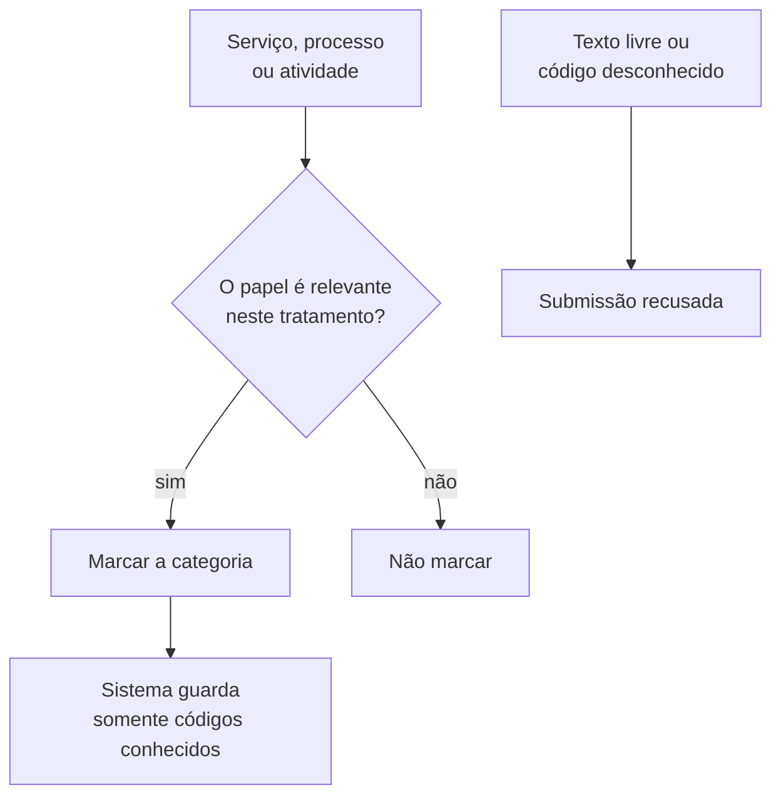

A única descrição livre deste contrato é a finalidade, limitada a 500 caracteres e acompanhada da orientação de não informar nomes, CPF, matrícula ou qualquer outro dado pessoal. Se uma categoria estiver ausente, ela deve ser incluída pela governança; não existe a opção “Outro” com texto livre. A relação completa está no [Contrato do FORM 1 sintético](docs/arquitetura/CONTRATO_FORM1_SINTETICO.md).

### Orientação operacional: retomar o preenchimento depois

Ao retornar no dia seguinte — ou depois de fechar o navegador e abrir novamente — o servidor deve encontrar o FORM 1 no estado **Em preenchimento**, com o conteúdo do último I2 (**Salvar**) confirmado pelo sistema. O Registro continua **Em andamento** até que o formulário seja submetido.

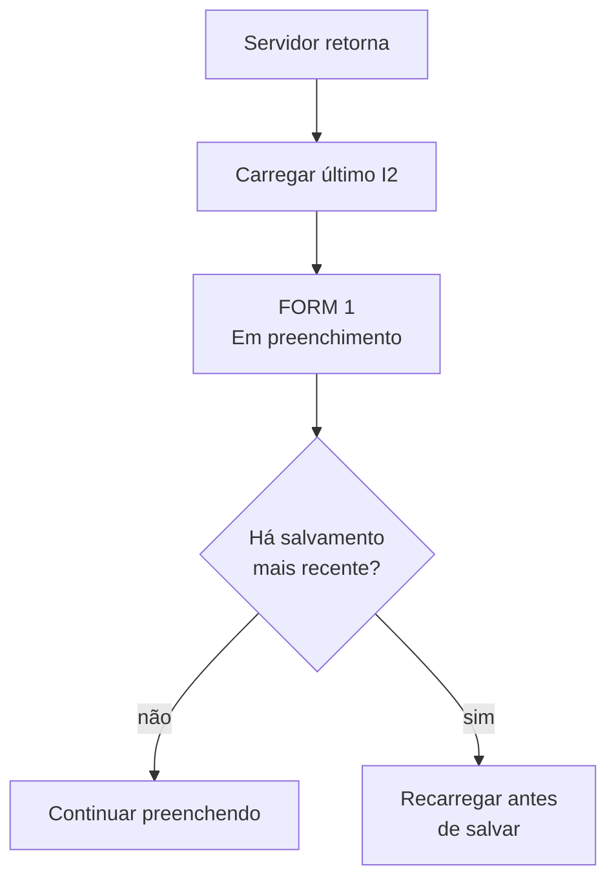

Na futura tela, a retomada deve seguir estas diretrizes:

- mostrar o conteúdo do último salvamento confirmado, o número do rascunho, a data, a hora e a pessoa que salvou;
- informar claramente que texto apenas digitado, mas ainda não salvo, não foi preservado — o motor atual não possui salvamento automático;
- nunca deixar uma tela antiga sobrescrever silenciosamente uma alteração mais nova;
- se outra pessoa tiver salvado durante o intervalo, recusar o salvamento desatualizado e orientar o servidor a recarregar o formulário;
- depois da submissão pelo I3, abrir a versão preservada para consulta e não apresentar o FORM 1 como um rascunho livremente editável.

Esse comportamento está implementado e testado no motor, no banco e no primeiro corte da interface. A tela atual mostra o número do rascunho e a pessoa responsável pelo último salvamento; exibir também data e hora em linguagem simples permanece como aprimoramento da interface.

### O que acontece quando o FORM 1 é enviado para validação

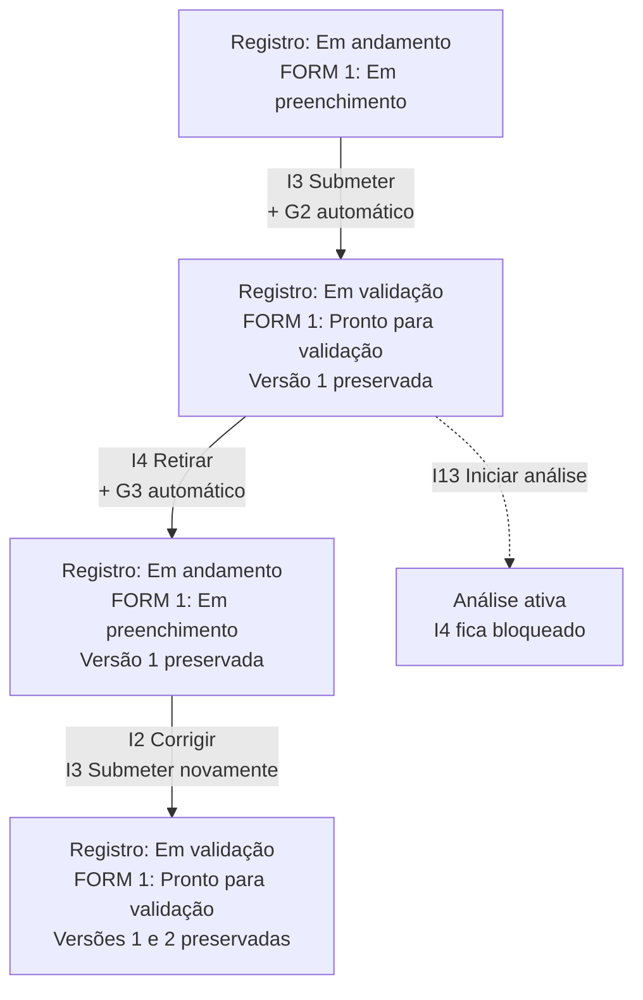

Enquanto o FORM 1 está **Em preenchimento**, ele é um rascunho: uma pessoa autorizada como `preenchedor` pode salvá-lo várias vezes pelo I2. Cada salvamento aumenta o número do rascunho, para que uma tela antiga não sobrescreva silenciosamente um conteúdo mais novo.

Ao acionar o I3 (**Submeter**), o sistema faz o seguinte:

1. Confirma que a conta está ativa e que a pessoa possui autorização de `preenchedor` na Secretaria responsável.
2. Confere se o rascunho ainda é a versão que a pessoa leu e se o seu lacre corresponde ao conteúdo guardado.
3. Verifica os campos mínimos do FORM 1 sintético: finalidade, categorias de titulares, categorias de dados e compartilhamentos; as categorias devem usar códigos conhecidos.
4. Compara essas informações com as versões mais recentes dos outros Registros. Uma coincidência gera um **alerta para análise humana**, mas não bloqueia automaticamente a submissão.
5. Tira uma “fotografia” do rascunho e a guarda como **Versão 1** — ou Versão N nas submissões futuras. Essa versão não pode ser editada nem apagada, inclusive por alteração direta no banco.
6. Grava o I3 na cadeia do Instrumento e, como consequência automática, grava o G2 na cadeia do Registro.
7. Deixa o FORM 1 **Pronto para validação** e o Registro **Em validação**.

Esses passos formam uma única operação: se qualquer parte falhar, nenhuma delas fica gravada pela metade. Repetir exatamente o mesmo pedido também não cria outra versão. Se duas pessoas tentarem submeter simultaneamente, somente uma submissão é aceita.

> **Importante:** “submetida” ainda não significa “validada”. Depois do I3, a versão foi preservada para exame, mas `versao_vigente_id` continua vazia. Somente o I5, depois de uma análise ativa, torna essa versão vigente.

#### E se o preenchedor perceber um erro antes da análise?

Enquanto ninguém tiver iniciado a análise pelo I13, uma pessoa autorizada como `preenchedor` pode usar o I4 (**Retirar da validação**). A Versão 1 permanece intacta no histórico, mas o FORM 1 volta a **Em preenchimento** e o G3 automático devolve o Registro a **Em andamento**. O rascunho pode então ser corrigido pelo I2; ao submeter novamente, o sistema cria a Versão 2, sem substituir nem apagar a anterior.

O I4 também é uma operação única com o G3: os dois eventos e as duas mudanças de estado são gravados juntos ou são desfeitos juntos. Depois que o I13 iniciar a análise, a retirada deixa de ser permitida; qualquer correção deverá seguir o percurso formal de devolução.

### O que acontece quando alguém inicia a análise

O I13 não valida nem devolve o formulário. Ele apenas registra que uma pessoa autorizada assumiu a análise de uma versão específica. Neste texto, **agente** é a pessoa que atua no processo; **analista** é apenas o nome técnico do papel que autoriza essa pessoa a exercer a função de análise naquele momento.

```mermaid
flowchart TD
    S["Pedido para iniciar a análise"] --> P{"O agente possui o papel<br/>técnico de analista?"}
    P -- "não" --> N["Pedido recusado<br/>e tentativa auditada"]
    P -- "sim" --> A{"É a mesma pessoa<br/>que submeteu a versão?"}
    A -- "sim" --> N
    A -- "não" --> V{"É a versão mais recente<br/>e ainda está sem análise?"}
    V -- "não" --> N
    V -- "sim" --> OK["I13 gravado<br/>responsável vigente definido<br/>I4 bloqueado"]
```

A segregação é feita pela **pessoa**, e não pelo nome da conta. Portanto, quem submeteu pela conta A1 não pode trocar para a conta A2 e analisar o próprio trabalho. O sistema também impede que dois agentes assumam simultaneamente a mesma versão: somente o primeiro pedido válido cria a análise; o outro é recusado e auditado.

O FORM 1 continua **Pronto para validação** e o Registro continua **Em validação**, porque iniciar a análise não decide o resultado. A análise fica ligada à versão e mantém um único responsável vigente.

#### Como funciona a troca do agente responsável

O I14 permite que uma pessoa com competência de validador transfira a análise para outro agente autorizado a exercer o papel técnico de analista. A troca não apaga quem iniciou a análise nem altera eventos anteriores:

```mermaid
flowchart LR
    A["I13<br/>Análise iniciada por B"] --> B["Responsável atual: B"]
    B -- "I14 reatribuir" --> C["Responsável atual: F"]
    A -. "autoria preservada" .-> C
```

O pedido informa o responsável que aparecia na tela. Se outra pessoa já tiver feito uma reatribuição, o sistema pede para recarregar em vez de sobrescrever a mudança. O novo responsável precisa estar ativo, estar autorizado para a função de análise na unidade e não pode ser quem submeteu a versão.

### O que acontece quando o agente responsável devolve

#### Guia rápido dos procedimentos P

A letra **P** identifica os atos praticados sobre uma **Pendência**. Ela não significa uma nova espécie de formulário: representa a providência que precisa ser acompanhada até ter uma resposta e uma decisão.

| Procedimento | Em linguagem simples | Quem atua | Resultado |
|---|---|---|---|
| **P1 — Criar** | Abre a pendência: automaticamente na devolução do I6 ou por um agente da unidade de origem no percurso intersecretarial | Sistema ou agente designado da origem | Pendência **Aberta** na fila da unidade destinatária |
| **P2 — Assumir** | Um agente autorizado aceita cuidar da providência | Agente autorizado da unidade de destino | Pendência **Em atendimento** com responsável nominal |
| **P3 — Responder** | Na correção, entrega e lacra o rascunho; na participação, registra entrada, operações, saída, interfaces e evidências | Agente que assumiu | Pendência **Respondida** e conteúdo exato lacrado |
| **P4 — Aceitar** | Confirma que a resposta apresentada é suficiente | Instância validadora na correção ou agente designado da unidade de origem na participação | Pendência **Encerrada** e lacre aceito |
| **P5 — Devolver resposta** | Informa, com motivo, que a correção ainda é insuficiente | Instância validadora, com segregação | Mesma pendência **Devolvida para complementação** |
| **P6 — Retomar** | Reabre o trabalho para complementar a correção | Agente responsável pela pendência | Pendência volta a **Em atendimento** e a edição é liberada |

No M1a, P5 e P6 são usados somente nesta pendência de correção criada pelo I6. O uso geral desses procedimentos em outros tipos de pendência pertence à PoC ampliada.

Quando a versão tem uma lacuna ou inconsistência, o responsável vigente pela análise pode executar I6 com um motivo. O sistema realiza três registros inseparáveis:

```mermaid
flowchart TD
    I6["I6<br/>Devolver versão"] --> P1["P1 automático<br/>Criar pendência"]
    P1 --> G3["G3 automático<br/>Recalcular Registro"]
    G3 --> R["Registro<br/>Em andamento"]
    G3 --> F["FORM 1<br/>Devolvido para ajuste"]
```

A Versão N continua intacta. A análise daquela versão é encerrada e a pendência nasce **Aberta**, bloqueando uma nova submissão. Ela é enviada para a unidade responsável pelo preenchimento, e não diretamente para uma pessoa: P2 registra qual agente assumiu a providência.

O rascunho também não é liberado automaticamente pelo I6. I7 marca o início formal do ajuste. Se I6, P1 ou G3 falhar, a operação inteira é desfeita; repetir o mesmo pedido não cria outra pendência.

#### Como a pendência sai da fila e chega ao agente

P2 e I7 são dois atos separados. Primeiro, um agente autorizado da unidade assume a pendência; somente depois ele inicia o ajuste:

```mermaid
flowchart LR
    A["Pendência<br/>Aberta"] -- "P2 assumir" --> E["Em atendimento<br/>Responsável definido"]
    E -- "I7 iniciar ajuste" --> F["FORM 1<br/>Em preenchimento"]
    F --> S["I2<br/>Salvar correção"]
```

Se duas pessoas tentarem assumir ao mesmo tempo, somente a primeira confirmação vale. O I7 confere que o pedido veio da mesma pessoa que assumiu a pendência, cria um novo rascunho copiando a versão devolvida e mantém a pendência **Em atendimento** até a resposta P3.

#### Como a correção é entregue sem mudar durante a conferência

Depois de corrigir e salvar, o agente que assumiu a pendência usa o P3 para apresentar a resposta. O sistema não guarda apenas a frase "corrigido": ele registra o **lacre do conteúdo exato** que está sendo entregue.

```mermaid
flowchart LR
    A["I2<br/>Correção salva"] --> P["P3<br/>Apresentar resposta"]
    P --> L["Lacre do rascunho<br/>registrado"]
    L --> R["Pendência<br/>Respondida"]
    R --> B["Novos I2 bloqueados<br/>até a decisão"]
```

Em termos práticos, é como colocar a correção em um envelope lacrado: a pessoa responsável pela análise examina exatamente aquilo que foi apresentado. Uma tela antiga não consegue responder por cima de uma gravação mais nova; dois cliques simultâneos produzem uma única resposta; e qualquer falha desfaz a operação inteira.

#### O que acontece com o envelope da correção

Uma pessoa autorizada da instância validadora, diferente de quem submeteu o formulário, escolhe um dos dois caminhos:

```mermaid
flowchart TD
    R["Pendência Respondida<br/>rascunho congelado"] --> D{"A correção é suficiente?"}
    D -- "sim · P4" --> E["Pendência Encerrada<br/>lacre aceito"]
    E --> I["I3 permitido somente<br/>com o mesmo lacre"]
    I --> V["Versão 2 imutável"]
    D -- "não · P5 com motivo" --> C["Mesma pendência<br/>Devolvida para complementação"]
    C -- "P6 retomar" --> A["Em atendimento<br/>edição liberada"]
    A -- "I2 + novo P3" --> R
```

O P5 não abre outra pendência e não apaga a primeira resposta: tudo permanece no histórico. O P6 apenas devolve a pendência ao agente responsável e libera o rascunho. Se alguém alterar o conteúdo depois do P4, o I3 percebe que o lacre mudou e recusa a submissão; é necessário apresentar e aceitar a correção adequada.

#### Pendências e próximas ações da tela inicial

Na interface, o servidor vê **O que precisa da sua atenção**. Tecnicamente, esses avisos são flags: não são opções de múltipla escolha nem caixas gravadas separadamente. O sistema as calcula sempre que a tela é carregada, conforme os papéis do agente e o estado real das pendências:

```mermaid
flowchart TD
    A["Pendência aberta"] --> C["Atenção<br/>Correção solicitada"]
    A --> B["Bloqueio<br/>Submissão bloqueada"]
    P["P2 confirmado"] --> V["Próxima ação<br/>Atribuída a você"]
    P --> B
    R["P3 respondida"] --> D["Validador<br/>Resposta aguardando decisão"]
    X["P5 devolvida"] --> N["Agente responsável<br/>Complementação solicitada"]
    X --> B
```

Assim, uma mudança no workflow aparece imediatamente na tela e não existe o risco de uma flag antiga contradizer o estado real. Um agente de outra unidade não recebe a correção na sua fila; quem assumiu recebe as ações de ajuste e complementação, enquanto a instância validadora recebe a resposta que precisa decidir.

#### O primeiro corte da interface

Ao abrir a aplicação, escolhemos uma matrícula **fictícia** para simular o agente. Isso ainda não é o login definitivo: é uma maneira transparente de demonstrar os papéis da PoC. Em produção, o servidor deverá informar matrícula e senha individual; a Prefeitura validará a credencial e fornecerá a identidade funcional necessária. A plataforma não armazenará senha na PoC nem improvisará uma integração direta com o banco de pessoal.

Depois da identidade vem o contexto do trabalho. Antes de iniciar o FORM 1, o Agente Público Autorizado responsável pelo Registro seleciona primeiro a Secretaria dentro de seu alcance institucional. Em seguida, escolhe se mapeará um serviço, processo ou atividade do catálogo e seleciona o contexto de atuação. O G1 então cria o Registro, o ciclo 1 e o FORM 1 **Não iniciado**:

```mermaid
flowchart LR
    M["Matrícula fictícia"] --> U["Secretaria responsável<br/>autorizada"]
    U --> T{"Serviço, processo<br/>ou atividade?"}
    T --> O["Item do catálogo"]
    O --> C["Contexto"]
    C --> G["G1<br/>Registro + FORM 1"]
```

Na tela inicial, **Criar novo Registro LGPD** apenas abre essa etapa de preparação. Nenhum Registro é criado pelo primeiro clique. A gravação ocorre somente quando o agente confirma Secretaria, tipo, item do catálogo e contexto no botão **Confirmar e criar Registro LGPD**.

O nome do objeto não é digitado livremente: vem do catálogo oficial. A Secretaria responsável cria e mantém o Registro e aparece primeiro para delimitar o contexto institucional. Na implantação municipal, ela será selecionada em lista fechada das 18 Secretarias; departamentos e setores poderão executar partes do trabalho, e outras Secretarias poderão participar, sem transferência automática da responsabilidade. O contrato completo está em [Identidade do agente e contexto inicial](docs/arquitetura/CONTRATO_IDENTIDADE_E_CONTEXTO_INICIAL.md).

Nesta PoC, o catálogo institucional está limitado às **18 Secretarias da Administração Direta**. O Hortoprev não será tratado: por ser autarquia da Administração Indireta, fica fora do recorte aprovado para esta demonstração.

Os nomes das 18 Secretarias são metadados institucionais públicos e aparecem como no portal municipal; agentes, matrículas, designações, serviços e Registros permanecem fictícios. O catálogo não concede autorização: na PoC nuclear, a criação fica disponível a quem possui a designação técnica `responsavel_registro`, enquanto o preenchimento exige `preenchedor`. O Agente Público Autorizado responsável pelo Registro pode possuir ambas; outro servidor autorizado pode possuir somente `preenchedor` e colaborar no FORM 1.

O painel procura os Registros da unidade do agente e também aqueles que chegaram até ele por uma pendência institucional ativa. Na interface, essa seção recebe o nome **Mapeamentos disponíveis para você**. “Disponível” significa que o agente pode consultar o Registro por sua designação institucional ou por participação vigente; não significa que seja proprietário do objeto nem que possa executar qualquer ato.

```mermaid
flowchart LR
    A["Conta fictícia escolhida"] --> I["Identifica pessoa,<br/>papéis e unidades"]
    I --> E{"Registro está<br/>no alcance?"}
    E -- "sim" --> P["Painel mostra mapeamento<br/>e avisos pertinentes"]
    E -- "não" --> N["Consulta negada"]
    N --> U["Tentativa registrada<br/>na auditoria"]
```

Se o agente puder consultar dez Registros, os dez aparecerão na lista. Ele abre individualmente o serviço, processo ou atividade que deseja examinar. A lista não é seleção múltipla: situação é calculada pelo workflow; cada Registro possui uma Secretaria responsável e um contexto de atuação. Seleção múltipla ocorre dentro do FORM 1 somente onde a natureza da pergunta admite várias categorias, como titulares, dados e compartilhamentos.

> 💭 **Hipótese para decisão futura — visão de coordenação.** Além do painel operacional de cada servidor, a Prefeitura poderá avaliar um dashboard agregado com cobertura por Secretaria, objetos por situação, FORMs pendentes, validações, pendências intersecretariais, medidas abertas e tempo desde a última revisão. Hospedagem e administração técnica pela T.I. não atribuem automaticamente a ela a coordenação funcional do conteúdo LGPD; papel, indicadores, alcance e permissões desse dashboard ainda precisam de decisão institucional e não são requisito implementado da PoC nuclear.

No detalhe do Registro, o agente com autorização de `preenchedor` já pode iniciar o FORM 1 pelo I1 e salvar o rascunho pelo I2. A finalidade possui espaço limitado para uma descrição sem dados pessoais; titulares, dados e compartilhamentos aparecem como opções fechadas, sem campo “Outro”.

```mermaid
flowchart LR
    R["Registro aberto"] --> I1["I1<br/>Iniciar preenchimento"]
    I1 --> V1["Rascunho 1<br/>vazio"]
    V1 --> T["Agente preenche<br/>e seleciona categorias"]
    T --> I2["I2<br/>Salvar com a versão lida"]
    I2 --> V2["Rascunho seguinte<br/>lacrado"]
    A["Tela antiga"] -. "versão não confere" .-> N["Salvamento negado<br/>conteúdo novo preservado"]
```

Em linguagem simples, cada salvamento aumenta o número do rascunho. Se duas telas tentarem salvar o mesmo número, apenas a primeira vence; a segunda recebe a orientação para recarregar. O HTML não decide essa regra: ele envia o pedido para as funções de domínio já testadas. A submissão I3 e as decisões posteriores ainda não foram ligadas à interface.

### O Registro permanece com a Secretaria responsável

O Registro não é “enviado” nem transferido sempre que outra pessoa precisa atuar. **Planejamento Urbano e Gestão Estratégica continua sendo a Secretaria responsável**; o que circula são tarefas, versões para análise e pendências de participação. Essa distinção evita perder a responsabilidade institucional e preserva uma única trilha de auditoria.

| Situação | O que acontece | O que não acontece |
|---|---|---|
| Outro agente da mesma Secretaria precisa atuar | O agente autorizado recebe ou assume a próxima ação conforme seu papel | O Registro não muda de Secretaria |
| O FORM 1 é submetido para validação | A versão segue para análise; I13 define o responsável e I14 permite reatribuir a análise | O analista não se torna proprietário do Registro |
| Outra Secretaria precisa colaborar | A Secretaria responsável cria uma pendência de participação; o destino assume, responde e devolve evidências | O destino não edita o FORM 1 nem assume o Registro |
| Seria necessário mudar a Secretaria responsável | Exige decisão institucional e percurso próprio, ainda não implementado | A troca não pode ser feita informalmente por um agente |

```mermaid
flowchart TD
    R["Registro permanece em<br/>Planejamento"]
    R --> A["Outro agente de Planejamento<br/>atua conforme seu papel"]
    R --> V["Versão do FORM 1<br/>segue para análise"]
    R --> P["Pendência solicita participação<br/>de outra Secretaria"]
    A -. "não transfere" .-> R
    V -. "não transfere" .-> R
    P -. "resposta e evidências retornam" .-> R
```

Na interface, as expressões operacionais serão **“Solicitar participação de outra Secretaria”** e **“Atribuir próxima ação a outro agente”**, evitando o rótulo ambíguo “Enviar Registro”. O M1a já implementa a participação intersecretarial e a reatribuição da análise; o repasse interno formal da responsabilidade pelo preenchimento e as regras completas de substituição pertencem aos incrementos posteriores.

### Como funciona a pendência entre duas Secretarias

No percurso intersecretarial, P1 é humano: um agente designado da Secretaria responsável solicita uma participação à fila institucional de outra Secretaria. O destino não recebe autorização para editar o FORM 1 e o Registro não troca de responsável institucional.

```mermaid
flowchart LR
    N["Planejamento<br/>mantém o Registro"] -- "P1: solicita participação" --> F["Fila institucional<br/>Finanças"]
    F -- "P2: agente designado assume" --> T["Providência em atendimento"]
    T -- "P3: resposta + evidências" --> R["Resposta lacrada"]
    R -- "P4: origem aceita" --> E["Pendência encerrada"]
    E -. "Registro continua em Planejamento" .-> N
```

A resposta possui um contrato pequeno e fechado: etapa executada, entrada recebida, operações realizadas, saída produzida, interfaces com a etapa seguinte e referências de evidência. Campos inesperados ou evidência vazia são recusados. Na carga fictícia, `agente_pendencia` representa a designação prévia pela chefia mencionada no SAD; não é sinônimo de `responsavel_registro`, `preenchedor`, analista ou validador.

Enquanto a participação estiver ativa, a futura tela da unidade destinatária mostra a providência recebida ou atribuída e informa que a conclusão está bloqueada. Depois do P3, a unidade de origem vê a resposta aguardando decisão. O P4 encerra a pendência e libera o portão de conclusão. Duas pessoas tentando assumir ao mesmo tempo não produzem dois responsáveis: somente a primeira confirmação vence.

### O que acontece quando o agente responsável valida

O I5 só aceita o pedido da pessoa que aparece como responsável atual da análise. Quando ela valida, o sistema encerra a análise, marca o FORM 1 como **Validado** e aponta a versão examinada como a versão vigente. Na mesma operação, o G4 olha para as ações obrigatórias abertas e decide o estado global:

```mermaid
flowchart TD
    I5["I5<br/>Versão validada"] --> G4{"G4<br/>Há ação aberta?"}
    G4 -- "não" --> A["Registro<br/>Em andamento"]
    G4 -- "sim" --> E["Registro<br/>Em execução"]
```

Em linguagem simples: o agente responsável pela análise não escolhe manualmente entre **Em andamento** e **Em execução**. Ele apenas valida. Se existir uma providência que ainda precisa ser acompanhada, o sistema mantém o Registro em execução; se não existir, devolve-o a Em andamento, pronto para o G5 concluir formalmente o Registro.

### Como o Registro é concluído quando não há medidas

Validar e concluir são decisões diferentes. O I5 confirma o conteúdo técnico; depois, um agente com competência formal executa o G5 para encerrar institucionalmente o Registro:

```mermaid
flowchart TD
    V["FORM 1 Validado<br/>Registro Em andamento"] --> P{"Portões do G5"}
    P -- "FORM validado" --> A{"Há pendência aberta<br/>ou medida no ciclo?"}
    P -- "FORM incompleto" --> N["Conclusão recusada"]
    A -- "sim" --> N
    A -- "não" --> C{"Agente possui competência<br/>formal para concluir?"}
    C -- "não" --> N
    C -- "sim · G5" --> F["Registro Concluído<br/>Ciclo concluído"]
```

O G5 não é automático e não é consequência escondida do botão **Validar**. Ele exige o papel técnico provisório `concluidor`, encerra Registro e ciclo na mesma transação e preserva o FORM 1 e sua versão validada. Dois cliques simultâneos produzem uma única conclusão; se ocorrer uma falha, nada fica concluído pela metade.

### Como o Registro é concluído quando há medidas

A ação usada nesta etapa é propositalmente pequena: guarda estado, responsável, evidência e vínculos com o Registro, o ciclo e o Instrumento. Ela prova o percurso do M1a sem fingir que o FORM 4 completo já foi construído.

```mermaid
flowchart TD
    V["I5 valida o FORM 1"] --> G4{"G4<br/>Há ação aberta?"}
    G4 -- "sim" --> E["Registro Em execução"]
    E --> R{"Agente é o responsável<br/>pela ação?"}
    R -- "não" --> B["Finalização recusada"]
    R -- "sim" --> D{"Resultado da medida"}
    D -- "concluída" --> P["Evidência obrigatória"]
    D -- "encerrada" --> M["Motivo e evidência<br/>obrigatórios"]
    P --> G6{"Agente competente executa G6<br/>e todos os portões estão livres?"}
    M --> G6
    G6 -- "não" --> E
    G6 -- "sim" --> F["Registro Concluído<br/>Ciclo concluído"]
```

Em linguagem simples: validar o formulário não finge que a medida já foi cumprida. O responsável pela ação primeiro documenta o que aconteceu. Se a medida foi substituída ou deixou de ser aplicável, ele pode encerrá-la formalmente, mas precisa explicar o motivo e anexar evidência. Depois, outra decisão institucional acontece: um agente com o papel técnico provisório `concluidor` executa G6. O sistema confere FORM validado, ciclo ativo, pendências resolvidas e todas as ações finalizadas com evidência; só então conclui Registro e ciclo juntos.

O G6 também resiste a duplo clique e pedidos simultâneos. Se houver falha antes do commit, Registro e ciclo continuam Em execução, sem uma conclusão pela metade. A versão validada e a evidência da medida permanecem no histórico.

### Evolução visual planejada para a PoC ampliada

A PoC nuclear aceita permanece como referência funcional e visual estável. A evolução abaixo não altera retroativamente o M1a e não começa automaticamente: deverá constituir incremento próprio da PoC ampliada, depois de decisão expressa, com comparação antes/depois e testes proporcionais.

O objetivo é transformar a base visual já aplicada em um sistema pequeno de decisões reutilizáveis. Em vez de repetir valores em cada página, a interface poderá separar responsabilidades:

```text
app/estaticos/
├── tokens.css       cores, tipografia, espaços, raios e sombras
├── components.css   botões, campos, mensagens, tabelas e indicadores
├── motion.css       transições e preferência por movimento reduzido
└── estilo.css       composição específica das páginas
```

Um token é um nome estável para uma decisão visual. Se `--cor-acao` representar o azul institucional, a eventual alteração desse token poderá atualizar de modo coerente todos os botões, links e seleções que o utilizem. Isso reduz divergências e torna a revisão pela T.I. mais simples. O código vigente já utiliza variáveis CSS para a paleta básica; a divisão acima é uma evolução planejada, ainda não executada.

Antes de adotar biblioteca externa de componentes ou animações, a equipe deverá verificar benefício, acessibilidade, manutenção, segurança, compatibilidade com a identidade municipal e impacto nas dependências. A alternativa preferencial continua sendo HTML semântico e componentes CSS pequenos; uma biblioteca só será incorporada quando resolver problema demonstrável sem impor identidade estranha à Prefeitura.

O incremento poderá utilizar um painel curto de referências visuais aprovado pelo responsável do produto — por exemplo, Cartilha LGPD, páginas oficiais da Prefeitura, apresentação institucional e interfaces administrativas consideradas claras. As referências orientarão contraste, densidade, hierarquia, formas e sensação geral; não autorizam copiar marcas ou telas de terceiros e não substituem o manual oficial de identidade.

Movimento será funcional e discreto: confirmação de salvamento, expansão de seção ou mudança de etapa em aproximadamente 150 a 250 milissegundos. Não serão usados movimento contínuo, piscadas, parallax ou efeitos que atrasem o trabalho. A informação continuará disponível em texto e, quando pertinente, ícone; cor ou animação nunca será o único indicador. A preferência `prefers-reduced-motion` será respeitada.

Cada incremento visual deverá:

1. registrar objetivo, referência e decisão;
2. comparar a interface antes e depois em desktop e largura reduzida;
3. testar teclado, foco, contraste, mensagens, erros e estados vazios;
4. executar os testes HTTP afetados;
5. confirmar que nenhuma regra de domínio migrou para CSS ou JavaScript;
6. documentar limitações e dependências introduzidas.

As diretrizes resumidas estão em [`docs/contexto/design-system.md`](docs/contexto/design-system.md). Antes do primeiro incremento visual da PoC ampliada, a especificação completa deverá ser organizada em pasta documental própria e mantida no Git com as demais decisões do sistema.

## Marcos e critérios de saída

> 🗺️ **Para entender o percurso de um Registro no M1a em cinco minutos, veja o [Mapa do M1a](docs/arquitetura/MAPA_M1a.md)**: estados, percursos (sem medidas, com devolução, com medidas, pendência para outra Secretaria) e regras comuns. O mapa só ilustra; prevalecem o SAD 04 (REV12), o SAD 09 e a DA-39.

Cada marco tem as suas condições de entrada e de saída (SAD 09, seções 4A, 4C e 30). Cada critério de aceite (POC-CA) gera uma evidência de mesmo número (POC-EV): POC-CA-001 → POC-EV-001, e assim por diante. Uma camada só é aceita quando os seus cenários, testes e critérios forem verificados.

**Regras comuns a todos os marcos** (📘 SAD 09, seção 30):

- **Quem aprova:** o operador da PoC executa os testes; o **Encarregado de Dados** aceita o marco e eventuais exceções.
- **Como se encerra:** aceite registrado em ata da PoC, apresentada à T.I. junto com a transferência técnica e referenciada no SAD 10; evidências preservadas até o fim do Piloto. A minuta operacional está neste README e a versão preenchida deve indicar seu local de guarda.
- **O que impede:** nenhum defeito **crítico** (impede a finalidade do marco ou compromete integridade, segregação ou dados) ou **alto** (falha de requisito obrigatório sem contorno) pode estar aberto. O marco é reaberto se um desses defeitos aparecer depois do aceite.

*Na PoC nuclear, operador e aceitante são a mesma pessoa. Por isso as evidências são automatizadas e reproduzíveis: qualquer terceiro, inclusive a TI, pode reexecutá-las.*

| | M1a · PoC nuclear | M1b · PoC ampliada |
|---|---|---|
| Condições de entrada | SAD 09 aprovado e instrução "IMPLEMENTAR PoC" (seção 35); SAD09-02, 04, 06, 07, 08 e 09 resolvidas (DA-28, DA-34); SAD09-03 provisória | M1a aceito |
| Critérios de aceite | POC-CA-001 a 006, 009, 011, 014 e 015; cenários A1 a A4, A9 a A12, A14, A15, A28 a A30; testes POC-TS-001 a 009 | POC-CA-010, 012 e 013; cenários A5 a A7, A13, A16, A18, A19, A24, A31 a A33, A35, A36; testes POC-TS-010, 011, 013 a 017 |
| Evidências exigidas | POC-EV-001 a 006, 009, 011, 014 e 015 | POC-EV-010, 012 e 013 |
| Autoridade que aprova | Encarregado de Dados | Encarregado de Dados |
| Condição de encerramento | Critérios aprovados, cadeia de eventos verificada e ata do aceite | Critérios aprovados, cenários do M1a reexecutados e ata do aceite |
| Pendências que impedem avançar | Defeito crítico ou alto aberto; regra usada pelo código ainda sem registro no SAD 10 (hoje, nenhuma) | Defeito crítico ou alto aberto; G11 conforme DA-37 sem implementar; competência para cancelar Registro Concluído (DA-37, item 4) em aberto |

| | M2 · PoC ampliada | M3A · PoC ampliada |
|---|---|---|
| Condições de entrada | M1b aceito; contrato integral do FORM 1 aprovado (SAD09-05) e envelope de ingestão definido (SAD09-01) | M2 aceito; decisão SAD09-10 definida antes do encerramento da PoC |
| Critérios de aceite | POC-CA-007 e 008; cenários A17 e A34; teste POC-TS-012 | POC-CA-012, 016 e 017, com verificação final de todos os demais; reexecução dos cenários anteriores com o FORM 1 real |
| Evidências exigidas | POC-EV-007 e 008 | POC-EV-012, 016 e 017, mais as evidências reexecutadas |
| Autoridade que aprova | Encarregado de Dados | Encarregado de Dados |
| Condição de encerramento | Critérios aprovados e ata do aceite | Critérios aprovados, ata do aceite e Relatório de Encerramento e Transferência Técnica (SAD 09, seção 37): encerra a PoC |
| Pendências que impedem avançar | SAD09-01 ou SAD09-05 em aberto; cópias fictícias equivalentes aos formulários reais não preparadas | SAD09-10 em aberto; relatório não elaborado. O Piloto exige autorização própria (SAD 09, 4A.7) |

## Pacotes de implementação do M1b

O workflow é **um só**, definido no SAD 04. O escopo, os marcos e os testes de aceite estão no SAD 09. Os pacotes abaixo só **organizam o trabalho** dentro do M1b: não redefinem regras. A situação de cada pacote é *pendente*, *em execução* ou *concluído* (com testes). O **aceite formal**, com ata, é do M1b inteiro (SAD 09, seção 30).

```
M1a — PoC nuclear
M1b — Fluxos de controle
  M1b.1 — Autorizações, suspensão, retomada e cancelamento
          (inclui o P10 mínimo necessário ao cancelamento em cascata)
  M1b.2 — Reabertura e novos ciclos
  M1b.3 — Pendências completas, participação e continuidade
          (inclui P5 a P9 e a integração completa do P10; AB-02 decidida antes do aceite final)
  M1b.4 — Backup, restauração, integridade e adaptadores
```

| Pacote | Escopo principal | Cenários (SAD 04) | Testes | Critérios específicos | Situação |
|---|---|---|---|---|---|
| M1b.1 | Matriz provisória de autorizações; suspensão; retomada; cancelamento; P10 mínimo para o efeito em cascata | A5, A6, A35 | POC-TS-011, 016, 017 | Cenários aprovados | Pendente |
| M1b.2 | Reabertura; novo ciclo; preservação dos ciclos; ações e pendências pós-conclusão | A7, A13, A32, A33 | — | Cenários aprovados | Pendente |
| M1b.3 | P5 a P9; participação por unidade; continuidade institucional; reatribuições; integração do P10 ao fluxo completo | A16, A18, A19, A24, A31, A36 | — | POC-CA-010 | Pendente |
| M1b.4 | Backup; restauração; evidências; verificação das cadeias; adaptadores simulados | — | POC-TS-010, 013, 014, 015 | POC-CA-012 e 013 | Pendente |

*Fora do M1b:* A17, A34, POC-TS-012 e POC-CA-007 e 008 pertencem ao **M2** (ingestão, mapeamento e reprocessamento). Cada cenário, teste e critério do M1b aparece em exatamente um pacote.

**Dependências explícitas** (o pacote só começa quando estiverem cumpridas):

| Pacote | Dependências |
|---|---|
| M1b.1 | M1a aceito; matriz provisória de autorizações; **regras de prazo decididas** (O-84); calendário da PoC definido; P10 mínimo para o cancelamento em cascata |
| M1b.2 | M1a aceito; **percurso com medidas e G6 comprovados no M1a**, com a ação obrigatória sintética disponível (usada no A32); regras de ciclo e de preservação das ações definidas |
| M1b.3 | M1b.1 concluído; P1 a P4 disponíveis; regras de substituição e reatribuição definidas; **AB-02 decidida antes do aceite final** (não impede o início do pacote; se não virar situação autônoma, registra-se qual dos quatro casos absorve o comportamento) |
| M1b.4 | Pacotes funcionais anteriores concluídos; conteúdo do backup definido; ambiente limpo de restauração; contrato dos adaptadores e verificação das cadeias disponíveis |

**Critérios gerais**, reaplicados como verificação em cada pacote: POC-CA-001 (requisitos obrigatórios implementados), 002 (todos com método de verificação), 003 (cenários críticos executados), 014 (ausência de dados reais) e 015 (nenhum defeito crítico ou alto aberto).

## Próximos passos

| Ordem | Passo | O que inclui | Marco |
|---|---|---|---|
| 1 | Etapa 2d: testes automatizados | Converter os cenários atuais em testes (pytest), num banco de teste próprio | M1a |
| 2 | Etapa 2d: correções | Idempotência estrita, tratamento específico das recusas do banco, papéis explícitos no pedido, numeração anual (D4), um contexto por Registro (D1) | M1a |
| 3 | Etapa 2d: advertência e transversalidade | Resolução da advertência de família e declaração de transversalidade (D2) | M1a |
| 4 | Concluir o núcleo do workflow | Rascunho, versão, submissão (com a verificação material), retirada da submissão antes da análise (I4, cenário A11), análise com segregação e reatribuição da análise (I14, cenário A14), devolução com pendência (P1 a P4, e P5/P6 no percurso da devolução), validação, conclusão e pendência intersecretarial; ação obrigatória sintética mínima e percurso com medidas (I5 → G4 → Em execução → G6) | M1a |
| 5 | Formalizar os testes de aceite do M1a | Os nove testes possuem cobertura técnica relevante; consolidar a rodada identificada, associar o POC-TS-009 ao commit do checkpoint e gerar as evidências POC-EV conforme a [matriz de aceite](docs/aceite/MATRIZ_ACEITE_M1A.md) | M1a |
| 6 | Fechar as decisões normativas pendentes | Competência do item 4 da DA-37 (quadro abaixo) | M1a → M1b |
| 7 | Executar o M1b em quatro pacotes | M1b.1 a M1b.4, cada um só depois de cumpridas as suas dependências (quadro "Pacotes de implementação do M1b") | M1b |

## Pendências normativas consolidadas

| Item | Assunto | Natureza | Quem decide | O que bloqueia | Onde será registrado |
|---|---|---|---|---|---|
| O-80 | Curadoria e carga dos catálogos | ⏳ Responsável institucional e conteúdo inicial pendentes; método operacional definido | A definir | Catálogo definitivo (na PoC, objetos e contextos são fictícios) | SAD correspondente (SAD 05 e SAD 03) |
| O-82 | Consolidação documental da decisão do G11 no SAD 04 | 📄 Consolidação (decidido na DA-37) | Encarregado | Nada na PoC | SAD 04, na revisão pós-PoC |
| O-83 | Consolidação documental de contextos, bases e famílias | 📄 Consolidação (decidido na DA-38) | Encarregado | Nada na PoC | SADs 02, 04, 05, 08 e 09, na revisão pós-PoC |
| D1, D2, D4 e devolução | Um contexto por Registro; advertência e transversalidade; numeração anual; devolução com congelamento por hash e P5/P6 | 📄 Consolidação (decidido na DA-39, SAD 10 REV16) | Encarregado | Nada na PoC | SADs 02, 03, 05 e 08, na revisão pós-PoC |
| DA-37, item 4 | Papel competente para cancelar Registro Concluído | ⏳ Decisão pendente | Encarregado | Cancelamento de Registro Concluído (M1b) | SAD 03 |
| AB-02 | Saída não programada como quinta situação de continuidade | ⏳ Decisão pendente | Encarregado | Aceite final do M1b.3 (não impede o início) | SAD 04 e SAD 02 |
| Prazos (O-84) | Regras de prazo na suspensão: contagem por tipo de prazo, retomada, prazos pausáveis, alteração da data, histórico, calendário | ⏳ Decisão de entrada do M1b.1 (proposta registrada no O-84) | Encarregado | Início do M1b.1 | SAD 04 (14) e SAD 10 |
| SAD09-01, 05 e 10 | Envelope de ingestão, contrato integral do FORM 1, decisão de encerramento | ⏳ Decisão pendente | Conforme SAD 09, seção 33 | Entrada do M2 e encerramento do M3A | SAD 09 e SAD 10 |
| Temporalidade e descarte | Referência oficial, versão, marco inicial, prazo, destinação, suspensão e evidência da execução | ⏳ Articulação institucional | Grupo municipal responsável pela temporalidade, com participação da governança LGPD | Automação de alertas e descarte na PoC ampliada; não bloqueia a PoC nuclear fictícia | FORM 1 integral, SADs afetados e tabela oficial de temporalidade |

## Tecnologias (DA-28)

Python 3.14 · PostgreSQL 18 · SQLAlchemy · psycopg · python-dotenv · pytest · FastAPI · Jinja2

## Refinamento posterior ao aceite do M1a — papéis de abertura e preenchimento

O aceite técnico e institucional registrado em 22/10/2026 permanece associado à rodada `M1A-20261022-001`, ao checkpoint `df2db0f5b49579844eacd6107a633da14176f427` e aos 189 testes então executados. O refinamento posterior não reescreve essa evidência histórica nem constitui um novo aceite institucional.

Em 24/10/2026, a PoC nuclear foi ajustada para explicitar dois papéis que podem ser acumulados pela mesma pessoa:

- o **Agente Público Autorizado responsável pelo Registro**, ponto focal LGPD da Secretaria, abre e coordena o Registro;
- o **servidor preenchedor** registra e complementa as informações do FORM 1, sempre com autoria individual.

O Agente pode possuir as duas autorizações e abrir e preencher o mesmo Registro. Outros servidores autorizados podem possuir somente a autorização de preenchimento e colaborar sob a coordenação do Agente. O Registro continua pertencendo à Secretaria responsável, e a segregação entre quem submete/preenche e quem analisa ou valida na T.I. continua obrigatória.

A massa exclusivamente fictícia demonstra esses percursos. A suíte completa posterior ao ajuste aprovou **193 de 193 testes** no banco `lgpd_poc_teste`. Esse resultado é evidência técnica do refinamento; sua incorporação a uma nova rodada formal ou ata, se necessária, continua sendo um ato institucional.

O resultado reproduzível dessa execução está no [Adendo da rodada complementar `M1A-20261024-002`](docs/aceite/ADENDO_RODADA_COMPLEMENTAR_M1A_2026-10-24.md). O adendo não modifica a ata já documentada nem substitui a rodada formal anterior.

## Instalação e execução

O passo a passo para montar o ambiente (Python, PostgreSQL, `.env`) e rodar a PoC — instalação, migrações, carga fictícia, demonstrações e testes automatizados — está em **[docs/operacao/INSTALACAO.md](docs/operacao/INSTALACAO.md)**.

Resumo, numa base já configurada:
```
python -m instalacao.criar_tabelas
python -m carga_ficticia
python -m pytest
python -m uvicorn app.main:app --reload
```

Com o último comando em execução, a tela fica disponível em `http://127.0.0.1:8000`. Ela usa somente as pessoas, contas e Registros fictícios da PoC.

## Guia do repositório para a T.I.

Ao acessar o GitHub, a T.I. encontrará a PoC executável e a documentação necessária para compreender, instalar, testar e revisar este recorte. O ponto de entrada é este `README.md`.

```text
governanca-lgpd-hortolandia/
├── README.md                 visão funcional, situação e instruções principais
├── AGENTS.md                 guardrails para agentes de IA
├── .env.exemplo              variáveis locais sem senhas reais
├── requirements.txt          dependências Python
├── pytest.ini                configuração dos testes
├── app/                      domínio, workflow, banco e interface web
├── carga_ficticia/           pessoas, unidades e catálogos exclusivamente fictícios
├── demonstracoes/            percursos reproduzíveis da PoC
├── instalacao/               criação das estruturas iniciais
├── migracoes/                evolução controlada do banco de dados
├── scripts/                  verificações e ensaios técnicos auxiliares
├── testes/                   testes automatizados e cenários de regressão
└── docs/
    ├── aceite/               matriz, relatórios e evidências consolidadas
    ├── apresentacao/         material de passagem e seu gerador editável
    ├── arquitetura/          contratos e mapas técnicos da PoC
    ├── contexto/             resumos para leitura inicial por agentes de IA
    ├── design-system/        identidade visual e evolução futura da interface
    ├── diario/               histórico cronológico das decisões e execuções
    ├── operacao/             instalação, execução e procedimentos operacionais
    ├── planejamento/         marcos, backlog e organização dos incrementos
    └── revisoes/             revisões técnicas realizadas durante a construção
```

### Roteiro de leitura recomendado para a T.I.

| Ordem | Local | O que a equipe encontrará |
|---|---|---|
| 1 | `README.md` | Escopo, regras do domínio, estado do M1a, limitações e comandos principais |
| 2 | `docs/operacao/` | Passo a passo para preparar o ambiente e executar a PoC |
| 3 | `docs/arquitetura/` | Contratos técnicos e mapas que ligam a interface ao workflow |
| 4 | `docs/aceite/` | Cenários formais, rodadas identificadas e resultados dos testes |
| 5 | `app/` e `testes/` | Implementação das regras e provas automatizadas de seu comportamento |
| 6 | `docs/diario/` | Decisões, limitações e mudanças registradas ao longo do trabalho |

Os SADs numerados e a Cartilha LGPD continuam como fontes oficiais no pacote institucional `Solution_Architecture_Document_(SAD)_Documento_de_Arquitetura_da_Solução`. O GitHub contém a implementação da PoC, seus contratos de apoio e os materiais de apresentação; não substitui a coleção oficial dos SADs nem a Cartilha.

## Documentos deste repositório

| Documento | Para que serve |
|---|---|
| [Contrato de identidade e contexto inicial](docs/arquitetura/CONTRATO_IDENTIDADE_E_CONTEXTO_INICIAL.md) | Registra matrícula, autenticação futura e o percurso Secretaria responsável → serviço/processo/atividade → contexto → G1 |
| [docs/arquitetura/MAPA_M1a.md](docs/arquitetura/MAPA_M1a.md) | O percurso de um Registro no M1a, em diagramas (ilustrativo; prevalecem os SADs) |
| [docs/aceite/MATRIZ_ACEITE_M1A.md](docs/aceite/MATRIZ_ACEITE_M1A.md) | O que cada POC-TS-001 a 009 comprova, a cobertura já existente e as evidências que ainda faltam para o aceite |
| [docs/aceite/RELATORIO_TECNICO_POC_TS_009.md](docs/aceite/RELATORIO_TECNICO_POC_TS_009.md) | Resultado sintético do ensaio de volume com 1.000 Registros, 50.000 eventos e reconstrução de amostra |
| [docs/aceite/ADENDO_RODADA_COMPLEMENTAR_M1A_2026-10-24.md](docs/aceite/ADENDO_RODADA_COMPLEMENTAR_M1A_2026-10-24.md) | Registra os 193 testes executados após separar abertura e preenchimento, sem alterar a ata existente |
| [docs/arquitetura/ARQUITETURA_POC.md](docs/arquitetura/ARQUITETURA_POC.md) | Camadas do sistema, responsabilidades e mapa das pastas |
| [docs/operacao/INSTALACAO.md](docs/operacao/INSTALACAO.md) | Montar o ambiente e rodar a PoC |
| [docs/diario/DIARIO_POC.md](docs/diario/DIARIO_POC.md) | Registro datado de tudo o que foi feito |
| [Apresentação à T.I. — versão 11](docs/apresentacao/Apresentacao_TI_Sistema_LGPD_M1a_v11.pptx) | Expõe a jornada, os FORMs, os SADs, o fluxo de papéis e a árvore do repositório disponível à T.I. |
| [docs/revisoes/](docs/revisoes/) | Revisões técnicas de etapas (ex.: Etapa 2c) |

**Organização das pastas:** pasta na raiz = código (`app`, `instalacao`, `migracoes`, `carga_ficticia`, `demonstracoes`, `scripts`, `testes`); `docs/` = texto.

## Autoria

Elaboração: **Ailton Vendramini** — Encarregado de Dados da Prefeitura Municipal de Hortolândia (Decreto Municipal nº 5.200/2023).
