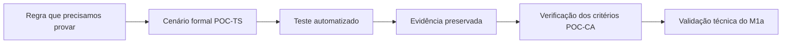

# Matriz de aceite da PoC nuclear M1a

Esta matriz mostra, em linguagem direta, o que cada teste formal da PoC nuclear precisa provar, o que já está coberto pela suíte automatizada e o que ainda falta para transformar essa cobertura em evidência formal de aceite.

O ponto principal é simples: **um teste automatizado aprovado ajuda a demonstrar o requisito, mas não encerra sozinho a formalização institucional**. Para fechar tecnicamente o M1a, a execução deve ser identificada, ter resultado preservado e produzir a evidência aplicável. Eventual aceite institucional seguirá o instrumento próprio definido pela Prefeitura.

## Legenda

- **Aprovado tecnicamente:** o ensaio foi executado numa rodada identificada e o resultado está consolidado.
- **Validação técnica registrada:** o Encarregado de Dados confirmou tecnicamente o marco em 22/10/2026. A apresentação à T.I. será uma passagem de conhecimento e não produzirá uma ata de aceite da T.I.; eventual formalização institucional seguirá instrumento próprio.

## Matriz dos testes formais

| Teste formal | O que precisamos provar | Cobertura automatizada localizada | Evidência que falta preservar | Situação para o aceite |
|---|---|---|---|---|
| **POC-TS-001** | Repetir o mesmo `comando_id` devolve o resultado original e não cria outro evento. | `testes/test_idempotencia.py` e testes de repetição dos atos G1, I1 a I7, P1 a P6, G5 e G6. | Rodada `M1A-20261022-001` e [relatório consolidado](RELATORIO_RODADA_FORMAL_M1A_2026-10-22.md). | **Aprovado tecnicamente.** |
| **POC-TS-002** | Dois comandos simultâneos na mesma cadeia não criam lacuna nem repetem a sequência. | Ensaios concorrentes em `testes/test_rascunho.py`, `testes/test_submissao.py`, `testes/test_conclusao.py`, `testes/test_conclusao_medidas.py` e `testes/test_pendencia_intersecretarial.py`. | Rodada identificada, testes concorrentes e cadeia conferida. | **Aprovado tecnicamente.** |
| **POC-TS-003** | Duas pessoas tentando assumir a mesma análise ou pendência resultam em uma única assunção; a segunda tentativa é negada e auditada. | Concorrência de I13 e P2 coberta em `testes/test_submissao.py` e `testes/test_pendencia_intersecretarial.py`; o ensaio com duas pessoas confirma uma única assunção e exatamente uma tentativa negada na auditoria. | Rodada identificada com assunção única e auditoria da tentativa perdedora. | **Aprovado tecnicamente.** |
| **POC-TS-004** | Uma tela desatualizada não sobrescreve um rascunho mais novo. | `test_poc_ts_004_versao_desatualizada_nao_sobrescreve_rascunho` e `test_i2_recusa_tela_desatualizada_sem_sobrescrever`. | Rodada identificada no domínio e na interface. | **Aprovado tecnicamente.** |
| **POC-TS-005** | Se houver falha entre evento e projeção, a transação não deixa nenhuma gravação parcial. | Testes de atomicidade e rollback nos módulos de rascunho, submissão, conclusão e pendências. | Rodada identificada com falhas simuladas e gravações desfeitas juntas. | **Aprovado tecnicamente.** |
| **POC-TS-006** | Um comando que produziria vários eventos é desfeito por inteiro quando ocorre rollback. | Rollbacks de I3 com G2, I4 com G3, I5 com G4 e I6 com P1 e G3 em `testes/test_submissao.py`. | Rodada identificada sem evento residual dos comandos desfeitos. | **Aprovado tecnicamente.** |
| **POC-TS-007** | Tentar abrir diretamente um Registro de outra Secretaria é negado e deixa auditoria. | `test_acesso_direto_a_registro_de_outra_unidade_e_negado_e_auditado` em `testes/test_interface.py`. | Rodada identificada com negação e auditoria confirmadas. | **Aprovado tecnicamente.** |
| **POC-TS-008** | A massa sintética rejeita a introdução de dado pessoal real durante o carregamento. | `carga_ficticia/seguranca.py` exige marcadores sintéticos nas identidades e recusa CPF, e-mail ou telefone em formato pessoal antes do primeiro `INSERT`. `testes/test_carga_ficticia.py` demonstra a recusa sem usar nem reproduzir dado pessoal real. | Rodada identificada sem gravação parcial nem reprodução do conteúdo suspeito. | **Aprovado tecnicamente.** |
| **POC-TS-009** | Com 1.000 Registros e cerca de 50.000 eventos, todas as cadeias continuam íntegras e uma amostra reconstruída coincide com as projeções. | O executor separado `demonstracoes/poc_ts_009.py` foi aprovado com 1.000 Registros, 50.000 eventos, 1.000 cadeias íntegras e 25 projeções reconstruídas sem divergência. `testes/test_volume.py` protege o gerador com uma regressão cotidiana pequena. | Commit `df2db0f`, [relatório técnico](RELATORIO_TECNICO_POC_TS_009.md), resultado operacional e hash no relatório consolidado. | **Aprovado tecnicamente.** |

## Evidências e critérios de aceite

Os identificadores `POC-EV` não correspondem diretamente aos números dos testes `POC-TS`. Conforme o SAD 09, cada evidência formal acompanha seu respectivo critério: `POC-CA-001` gera `POC-EV-001`, por exemplo. Os resultados dos nove testes desta matriz alimentarão as evidências exigidas para o M1a: `POC-EV-001` a `POC-EV-006`, `POC-EV-009`, `POC-EV-011`, `POC-EV-014` e `POC-EV-015`.

Cada pacote de evidência deve registrar, no mínimo:

- identificador do teste e data da execução;
- versão do código ou commit executado;
- massa fictícia utilizada;
- resultado esperado e resultado observado;
- saída dos testes e consultas de conferência necessárias;
- defeito encontrado, quando houver, e sua situação;
- responsável pela execução e referência usada na validação técnica.

Não devem ser copiados nomes, CPF, matrícula funcional real ou qualquer outro dado pessoal para produzir essas evidências.

## Leitura do estado atual

| Grupo | Quantidade | Leitura |
|---|---:|---|
| Testes aprovados tecnicamente | 9 de 9 | Rodada `M1A-20261022-001` consolidada e vinculada ao commit `df2db0f`. |
| Testes ainda sem ensaio técnico completo | 0 de 9 | O POC-TS-009 foi reexecutado separadamente com 50.000 eventos. |
| Testes com evidência consolidada | 9 de 9 | Resultados e pacotes `POC-EV` aplicáveis estão no relatório da rodada formal. |
| Testes validados tecnicamente no M1a | 9 de 9 | Validação técnica confirmada pelo Encarregado de Dados em 22/10/2026, com limitações conhecidas. |

Essa contagem não significa que a implementação voltou ao início. Ela separa honestamente três coisas diferentes: **o motor construído**, **o teste automatizado** e **o aceite institucional**.

## Ordem recomendada para o fechamento

1. Apresentar o [relatório da rodada formal](RELATORIO_RODADA_FORMAL_M1A_2026-10-22.md) e os hashes dos artefatos operacionais à T.I.
2. Mostrar à T.I. a árvore do repositório, a instalação, os testes e as limitações conhecidas.
3. Registrar dúvidas e encaminhamentos pelos meios institucionais adotados pela Prefeitura, sem iniciar automaticamente a PoC ampliada.

## Fontes de verdade

- SAD 09 REV12, especialmente seções 27.1, 30 e 31;
- SAD 08 vigente, para auditoria, cadeia e critérios de segurança aplicáveis;
- SAD 10 REV16, decisão DA-39, para o fechamento funcional do M1a;
- `README.md` e `docs/arquitetura/MAPA_M1a.md`, como guias operacionais do repositório.
