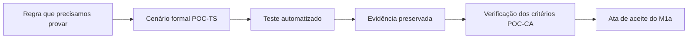

# Matriz de aceite da PoC nuclear M1a

Esta matriz mostra, em linguagem direta, o que cada teste formal da PoC nuclear precisa provar, o que já está coberto pela suíte automatizada e o que ainda falta para transformar essa cobertura em evidência formal de aceite.

O ponto principal é simples: **um teste automatizado aprovado ajuda a demonstrar o requisito, mas não encerra sozinho o aceite**. Para fechar o M1a, a execução deve ser identificada, ter resultado preservado, produzir a evidência aplicável e integrar a ata de aceite.

## Legenda

- **Coberto:** existe teste automatizado diretamente relacionado e aprovado.
- **Parcial:** existe cobertura relevante, mas falta uma verificação específica ou o pacote formal de evidência.
- **Pendente:** ainda falta implementar ou executar o ensaio exigido pelo SAD 09.

## Matriz dos testes formais

| Teste formal | O que precisamos provar | Cobertura automatizada localizada | Evidência que falta preservar | Situação para o aceite |
|---|---|---|---|---|
| **POC-TS-001** | Repetir o mesmo `comando_id` devolve o resultado original e não cria outro evento. | `testes/test_idempotencia.py` e testes de repetição dos atos G1, I1 a I7, P1 a P6, G5 e G6. | Relatório da execução, resultado das duas chamadas e contagem dos eventos antes e depois da repetição. | **Parcial:** comportamento coberto; evidência formal pendente. |
| **POC-TS-002** | Dois comandos simultâneos na mesma cadeia não criam lacuna nem repetem a sequência. | Ensaios concorrentes em `testes/test_rascunho.py`, `testes/test_submissao.py`, `testes/test_conclusao.py`, `testes/test_conclusao_medidas.py` e `testes/test_pendencia_intersecretarial.py`. | Execução identificada de uma amostra representativa, relação ordenada dos eventos e verificação da cadeia. | **Parcial:** concorrência coberta; evidência formal pendente. |
| **POC-TS-003** | Duas pessoas tentando assumir a mesma análise ou pendência resultam em uma única assunção; a segunda tentativa é negada e auditada. | Concorrência de I13 e P2 coberta em `testes/test_submissao.py` e `testes/test_pendencia_intersecretarial.py`; o ensaio com duas pessoas confirma uma única assunção e exatamente uma tentativa negada na auditoria. | Preservar o extrato da execução com o responsável vencedor, o comando perdedor e o respectivo evento de auditoria. | **Parcial:** comportamento completo coberto; evidência formal pendente. |
| **POC-TS-004** | Uma tela desatualizada não sobrescreve um rascunho mais novo. | `test_poc_ts_004_versao_desatualizada_nao_sobrescreve_rascunho` e `test_i2_recusa_tela_desatualizada_sem_sobrescrever`. | Captura do percurso pela interface, versões lida e vigente e consulta final do rascunho preservado. | **Parcial:** cenário coberto no domínio e na interface; evidência formal pendente. |
| **POC-TS-005** | Se houver falha entre evento e projeção, a transação não deixa nenhuma gravação parcial. | Testes de atomicidade e rollback nos módulos de rascunho, submissão, conclusão e pendências. | Escolher um percurso representativo, registrar a falha simulada e demonstrar que evento, snapshot e projeção foram desfeitos juntos. | **Parcial:** comportamento coberto; execução formal ainda não empacotada. |
| **POC-TS-006** | Um comando que produziria vários eventos é desfeito por inteiro quando ocorre rollback. | Rollbacks de I3 com G2, I4 com G3, I5 com G4 e I6 com P1 e G3 em `testes/test_submissao.py`. | Extrato do banco antes e depois da falha, demonstrando que nenhum evento do comando permaneceu. | **Parcial:** comportamento coberto; evidência formal pendente. |
| **POC-TS-007** | Tentar abrir diretamente um Registro de outra Secretaria é negado e deixa auditoria. | `test_acesso_direto_a_registro_de_outra_unidade_e_negado_e_auditado` em `testes/test_interface.py`. | Captura da resposta negada e extrato correspondente do livro de auditoria. | **Parcial:** cenário coberto; evidência formal pendente. |
| **POC-TS-008** | A massa sintética rejeita a introdução de dado pessoal real durante o carregamento. | `carga_ficticia/seguranca.py` exige marcadores sintéticos nas identidades e recusa CPF, e-mail ou telefone em formato pessoal antes do primeiro `INSERT`. `testes/test_carga_ficticia.py` demonstra a recusa sem usar nem reproduzir dado pessoal real. | Preservar o relatório da rodada identificada, demonstrando a recusa, a ausência de gravação parcial e a omissão do conteúdo suspeito na mensagem. | **Parcial:** barreira e testes implementados; evidência formal pendente. |
| **POC-TS-009** | Com 1.000 Registros e cerca de 50.000 eventos, todas as cadeias continuam íntegras e uma amostra reconstruída coincide com as projeções. | A suíte verifica cadeias e reconstruções em volumes funcionais menores. | Criar a massa de volume, medir a execução, verificar integralmente as cadeias e comparar a amostra reconstruída com as projeções. | **Pendente.** |

## Evidências e critérios de aceite

Os identificadores `POC-EV` não correspondem diretamente aos números dos testes `POC-TS`. Conforme o SAD 09, cada evidência formal acompanha seu respectivo critério: `POC-CA-001` gera `POC-EV-001`, por exemplo. Os resultados dos nove testes desta matriz alimentarão as evidências exigidas para o M1a: `POC-EV-001` a `POC-EV-006`, `POC-EV-009`, `POC-EV-011`, `POC-EV-014` e `POC-EV-015`.

Cada pacote de evidência deve registrar, no mínimo:

- identificador do teste e data da execução;
- versão do código ou commit executado;
- massa fictícia utilizada;
- resultado esperado e resultado observado;
- saída dos testes e consultas de conferência necessárias;
- defeito encontrado, quando houver, e sua situação;
- responsável pela execução e referência usada na ata de aceite.

Não devem ser copiados nomes, CPF, matrícula funcional real ou qualquer outro dado pessoal para produzir essas evidências.

## Leitura do estado atual

| Grupo | Quantidade | Leitura |
|---|---:|---|
| Testes com cobertura automatizada relevante | 8 de 9 | Falta principalmente transformar a execução em evidência formal. |
| Testes ainda sem ensaio completo | 1 de 9 | POC-TS-009. |
| Testes formalmente aceitos | 0 de 9 | O aceite somente será marcado após execução identificada, evidência e conferência. |

Essa contagem não significa que a implementação voltou ao início. Ela separa honestamente três coisas diferentes: **o motor construído**, **o teste automatizado** e **o aceite institucional**.

## Ordem recomendada para o fechamento

1. Preparar e executar a massa do POC-TS-009.
2. Reexecutar POC-TS-001 a POC-TS-008 numa rodada identificada e guardar os resultados.
3. Organizar os resultados dentro dos pacotes `POC-EV` aplicáveis.
4. Verificar a cadeia de eventos, registrar defeitos remanescentes e preparar a ata de aceite do M1a.

## Fontes de verdade

- SAD 09 REV12, especialmente seções 27.1, 30 e 31;
- SAD 08 vigente, para auditoria, cadeia e critérios de segurança aplicáveis;
- SAD 10 REV16, decisão DA-39, para o fechamento funcional do M1a;
- `README.md` e `docs/arquitetura/MAPA_M1a.md`, como guias operacionais do repositório.
