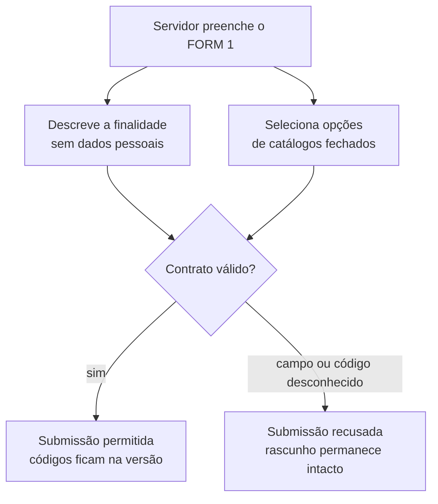

# Contrato do FORM 1 sintético

**Versão vigente:** 2

**Escopo:** PoC nuclear M1a

**Dados:** exclusivamente fictícios

Este contrato existe para testar o motor do workflow sem reproduzir o FORM 1 real. Ele descreve tratamentos ligados a serviços, processos e atividades; não cadastra pessoas titulares nem admite seus nomes, documentos ou outros identificadores.

## Como o preenchimento funciona

O servidor não digita categorias livremente. A interface futura deverá apresentar seleção múltipla. Se uma opção necessária não existir, sua inclusão dependerá da governança do catálogo; a opção “Outro” com texto livre não faz parte deste contrato.

## Campos

| Campo | Tipo | Regra |
|---|---|---|
| `finalidade` | Texto, até 500 caracteres | Obrigatório. Deve descrever o propósito do tratamento sem nomes, CPF, matrícula ou outros dados pessoais. |
| `categorias_titulares` | Lista de códigos | Obrigatória e não vazia. Aceita somente o catálogo de categorias de titulares. |
| `categorias_dados` | Lista de códigos | Obrigatória e não vazia. Aceita somente o catálogo de categorias de dados. |
| `compartilhamentos` | Lista de códigos | Obrigatória, mas pode ser vazia. Aceita somente o catálogo de destinatários. |

Campos adicionais, códigos desconhecidos e códigos repetidos são recusados na submissão.

## Catálogo de categorias de titulares

| Código | Categoria |
|---|---|
| `TIT-CONTRIBUINTE` | Contribuinte |
| `TIT-CIDADAO-USUARIO` | Cidadão usuário de serviço público |
| `TIT-SERVIDOR` | Servidor público |
| `TIT-ESTUDANTE` | Estudante |
| `TIT-RESPONSAVEL-LEGAL` | Responsável legal |
| `TIT-REPRESENTANTE-FORNECEDOR` | Representante de fornecedor |

## Catálogo de categorias de dados

| Código | Categoria |
|---|---|
| `DAD-IDENTIFICACAO` | Dados de identificação |
| `DAD-CONTATO` | Dados de contato |
| `DAD-ENDERECO` | Dados de endereço |
| `DAD-FINANCEIRO` | Dados financeiros |
| `DAD-FUNCIONAL` | Dados funcionais |
| `DAD-ACADEMICO` | Dados acadêmicos |
| `DAD-SAUDE` | Dados de saúde |

## Catálogo de destinatários de compartilhamento

| Código | Destinatário |
|---|---|
| `DST-ORGAO-MUNICIPAL` | Outro órgão ou unidade municipal |
| `DST-ORGAO-PUBLICO-EXTERNO` | Órgão público externo |
| `DST-OPERADOR-CONTRATADO` | Operador contratado |

## Versionamento

As versões criadas antes desta formalização permanecem preservadas como contrato 1. Novas submissões usam o contrato 2 e guardam esse número junto ao snapshot imutável. Alterar o catálogo ou a estrutura do formulário exige uma nova versão de contrato; nunca se reescreve uma versão já submetida.
