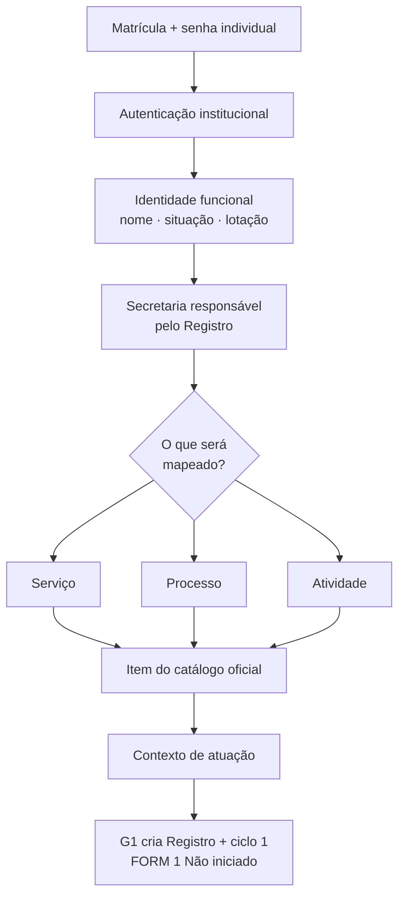
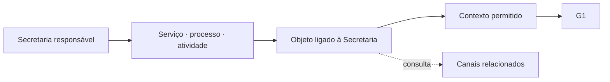

# Contrato de identidade do agente e contexto inicial do Registro

## Decisões institucionais incorporadas

- Em Hortolândia, cada servidor — concursado ou não — possui uma única matrícula.
- A matrícula será o nome de usuário apresentado na entrada da plataforma.
- Cada servidor utilizará senha individual, nunca compartilhada.
- A fonte oficial da Prefeitura deverá confirmar a identidade funcional depois da autenticação.
- A plataforma não cadastra pessoas titulares dos serviços: o FORM 1 guarda somente categorias.
- Os dados funcionais do agente têm outro propósito: autenticação, autorização, autoria e auditoria.
- Antes do FORM 1, o agente seleciona primeiro a Secretaria responsável pelo Registro dentro de seu alcance institucional.
- Em seguida, define se mapeará um serviço, processo ou atividade do catálogo e escolhe o contexto de atuação.
- A Prefeitura permanece a controladora; a Secretaria é a responsável interna pelo Registro. Departamentos e setores podem executar partes do objeto sem substituir essa responsabilidade.

## Percurso inicial

## Catálogos que condicionam o percurso

- A lista de objetos não deverá ser global: depois da Secretaria e do tipo, a tela mostrará somente itens relacionados àquela Secretaria.
- A Carta de Serviços e o portal municipal poderão iniciar a relação de serviços; os FORMs recebidos das Secretarias serão fonte de candidatos a serviços, processos e atividades.
- Um item informado no FORM não se torna oficial automaticamente. A curadoria deverá verificar se há tratamento de dados pessoais, classificar o tipo, normalizar duplicidades, vincular as Secretarias responsáveis ou participantes e atribuir identificador canônico.
- Após o objeto, a tela deverá oferecer apenas contextos de atuação compatíveis. Se nenhum servir, o agente solicitará revisão do catálogo, sem digitação livre.
- Canal de atendimento — inclusive o 156 — não é um quarto tipo de objeto. Será apresentado como relação informativa do catálogo. Só terá Registro próprio quando realizar tratamento autônomo de dados pessoais; quando apenas encaminhar, será apoio do Registro principal.

As relações **Secretaria ↔ objeto** e **objeto ↔ contexto permitido** não foram antecipadas no primeiro corte da interface. Elas serão implementadas em incremento próprio, com testes, depois da definição da curadoria e da carga inicial (O-80).

## Dados mínimos do agente

| Dado | Finalidade na plataforma |
|---|---|
| Identificador técnico interno | Relacionar eventos sem espalhar a matrícula por todas as tabelas |
| Matrícula única | Nome de usuário e ligação com a identidade institucional |
| Nome | Identificação clara nas telas e atos autorizados |
| Situação funcional | Impedir acesso de vínculo inativo |
| Lotação atual | Apoiar a determinação do alcance institucional |
| Designações e vigência | Autorizar preenchimento, análise, validação e conclusão |
| Histórico de atuação | Autoria, segregação de funções e auditoria |

CPF, endereço, remuneração e demais dados do cadastro de pessoal não integram este contrato.

## Limite da PoC

Matrículas, pessoas, designações, objetos, contextos e Registros atuais são fictícios. Somente os nomes públicos das 18 Secretarias são reais; seus identificadores e vínculos internos continuam próprios da PoC. O seletor inicial apenas simula uma entrada por matrícula; nenhuma senha existe na PoC. A autenticação real não será improvisada nem conectada diretamente ao banco de pessoal. Ana e Rafael deverão informar o mecanismo institucional para validar matrícula e senha e fornecer somente os atributos necessários.

O primeiro corte permite escolher a Secretaria responsável entre aquelas nas quais o agente fictício é elaborador. Na implantação municipal, a seleção deverá vir de uma lista fechada das 18 Secretarias, sem digitação livre. O modelo preserva internamente o identificador técnico `unidade_principal_id`; essa nomenclatura não precisa ser exposta ao agente. O cadastro permanente de Secretarias participantes continua reservado à PoC ampliada; no M1a, a colaboração já é demonstrada pelo percurso de pendência intersecretarial sem transferência da responsabilidade principal.

O escopo desta PoC está restrito às 18 Secretarias da Administração Direta. O Hortoprev, autarquia da Administração Indireta, não integra o catálogo nem os percursos demonstrados nesta etapa. Uma eventual inclusão futura exigirá decisão própria de escopo e a revisão da denominação apresentada ao agente.

Os nomes das Secretarias são metadados institucionais públicos, conferidos no portal municipal em 19/10/2026. Sua presença no catálogo não equivale a autorização: a lista apresentada a cada agente é a interseção entre as Secretarias ativas e suas designações vigentes de elaborador.
