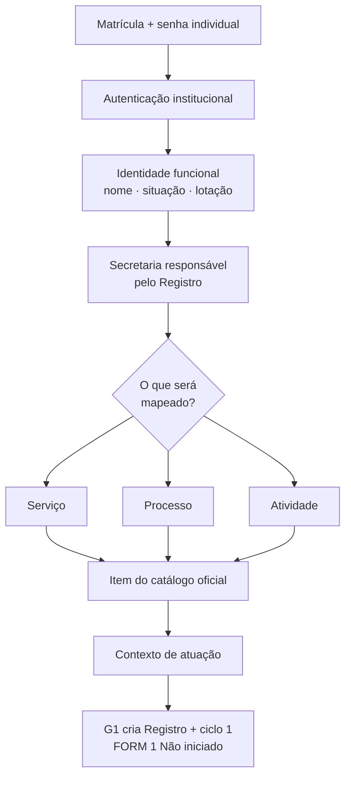

# Contrato de identidade do agente e contexto inicial do Registro

## Decisões institucionais incorporadas

- Em Hortolândia, cada servidor — concursado ou não — possui uma única matrícula.
- A matrícula será o nome de usuário apresentado na entrada da plataforma.
- Cada servidor utilizará senha individual, nunca compartilhada.
- A fonte oficial da Prefeitura deverá confirmar a identidade funcional depois da autenticação.
- A plataforma não cadastra pessoas titulares dos serviços: o FORM 1 guarda somente categorias.
- Os dados funcionais do agente têm outro propósito: autenticação, autorização, autoria e auditoria.
- Antes do FORM 1, o agente seleciona primeiro a Secretaria responsável pelo Registro dentro de seu alcance institucional.
- Em seguida, define se mapeará um serviço, processo ou atividade do catálogo e escolhe o contexto de atuação.
- A Prefeitura permanece a controladora; a Secretaria é a responsável interna pelo Registro. Departamentos e setores podem executar partes do objeto sem substituir essa responsabilidade.

## Percurso inicial

## Dados mínimos do agente

| Dado | Finalidade na plataforma |
|---|---|
| Identificador técnico interno | Relacionar eventos sem espalhar a matrícula por todas as tabelas |
| Matrícula única | Nome de usuário e ligação com a identidade institucional |
| Nome | Identificação clara nas telas e atos autorizados |
| Situação funcional | Impedir acesso de vínculo inativo |
| Lotação atual | Apoiar a determinação do alcance institucional |
| Designações e vigência | Autorizar preenchimento, análise, validação e conclusão |
| Histórico de atuação | Autoria, segregação de funções e auditoria |

CPF, endereço, remuneração e demais dados do cadastro de pessoal não integram este contrato.

## Limite da PoC

Todas as matrículas, pessoas, unidades, objetos e contextos atuais são fictícios. O seletor inicial apenas simula uma entrada por matrícula; nenhuma senha existe na PoC. A autenticação real não será improvisada nem conectada diretamente ao banco de pessoal. Ana e Rafael deverão informar o mecanismo institucional para validar matrícula e senha e fornecer somente os atributos necessários.

O primeiro corte permite escolher a Secretaria responsável entre aquelas nas quais o agente fictício é elaborador. Na implantação municipal, a seleção deverá vir de uma lista fechada das 18 Secretarias, sem digitação livre. O modelo preserva internamente o identificador técnico `unidade_principal_id`; essa nomenclatura não precisa ser exposta ao agente. O cadastro permanente de Secretarias participantes continua reservado à PoC ampliada; no M1a, a colaboração já é demonstrada pelo percurso de pendência intersecretarial sem transferência da responsabilidade principal.

O escopo desta PoC está restrito às 18 Secretarias da Administração Direta. O Hortoprev, autarquia da Administração Indireta, não integra o catálogo nem os percursos demonstrados nesta etapa. Uma eventual inclusão futura exigirá decisão própria de escopo e a revisão da denominação apresentada ao agente.
