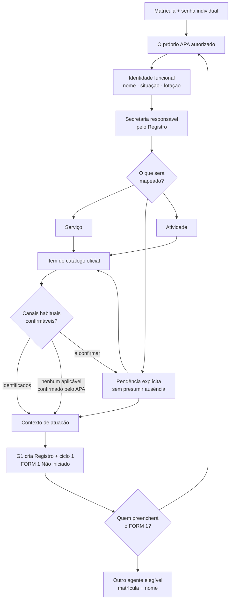
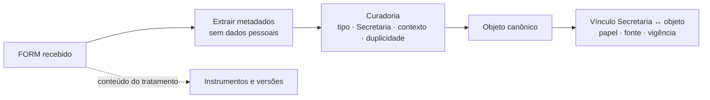

# Contrato de identidade do agente e contexto inicial do Registro

## Decisões institucionais incorporadas

- Em Hortolândia, cada servidor — concursado ou não — possui uma única matrícula.
- A matrícula será o nome de usuário apresentado na entrada da plataforma.
- Cada servidor utilizará senha individual, nunca compartilhada.
- A fonte oficial da Prefeitura deverá confirmar a identidade funcional depois da autenticação.
- A plataforma não cadastra pessoas titulares dos serviços: o FORM 1 guarda somente categorias.
- Os dados funcionais do agente têm outro propósito: autenticação, autorização, autoria e auditoria.
- Antes do FORM 1, o agente seleciona primeiro a Secretaria responsável pelo Registro dentro de seu alcance institucional.
- Em seguida, define se mapeará um serviço, processo ou atividade do catálogo e escolhe o contexto de atuação.
- Antes da criação, o APA declara expressamente os canais habituais identificados, que nenhum canal se aplica ou que a informação ainda precisa ser confirmada. A situação pendente não é interpretada como ausência de canal.
- A Prefeitura permanece a controladora; a Secretaria é a responsável interna pelo Registro. Departamentos e setores podem executar partes do objeto sem substituir essa responsabilidade.
- O ponto focal da LGPD será apresentado como **Agente Público Autorizado responsável pelo Registro**: abre o Registro, coordena o levantamento local, acompanha pendências e encaminha o FORM 1. Quando também autorizado para o preenchimento, pode executar pessoalmente os atos do FORM 1.
- Na PoC ampliada, a forma curta **APA — Agente Público Autorizado** identifica essa função de abertura. **ARP — Agente Responsável pelo Preenchimento** identifica a pessoa designada para executar o levantamento factual do FORM 1 integral. APA e ARP podem ser a mesma pessoa.
- A indicação do ARP não concede autorização. A pessoa indicada precisa possuir previamente conta ativa e designação vigente de `preenchedor` na Secretaria responsável.
- A equipe de preenchimento é formada pelos servidores que executam ou conhecem a rotina. Ela atua sob coordenação funcional do Agente, sem alteração da subordinação administrativa existente.
- Analista e validador são funções futuras da Secretaria de T.I., exercidas depois da conclusão da PoC ampliada e da passagem institucional, com a segregação de funções aplicável.

## Percurso inicial

## Catálogos que condicionam o percurso

- A lista de objetos não deverá ser global: depois da Secretaria e do tipo, a tela mostrará somente itens relacionados àquela Secretaria.
- A Carta de Serviços e o portal municipal poderão iniciar a relação de serviços; os FORMs recebidos das Secretarias serão fonte de candidatos a serviços, processos e atividades.
- Um item informado no FORM não se torna oficial automaticamente. A curadoria deverá verificar se há tratamento de dados pessoais, classificar o tipo, normalizar duplicidades, vincular as Secretarias responsáveis ou participantes e atribuir identificador canônico.
- Após o objeto, a tela oferece o catálogo geral de canais ativos e destaca como sugestões os vínculos vigentes de `ObjetoCanal`. O APA pode declarar um ou vários canais, confirmar que nenhum se aplica ou registrar que ainda precisa confirmar. Uma declaração direta vale somente para o Registro e não cria nem altera `ObjetoCanal`; ausência de vínculo nunca é convertida automaticamente em “nenhum”.
- Depois dos canais, a tela oferece apenas contextos de atuação compatíveis. Se nenhum servir, o agente solicitará revisão do catálogo, sem digitação livre. A ajuda identifica o contexto selecionado e o distingue da finalidade do tratamento, que será descrita no FORM 1.
- Canal de atendimento — inclusive o 156 — não é um quarto tipo de objeto. Só terá Registro próprio quando realizar tratamento autônomo de dados pessoais; quando apenas encaminhar, será apoio do Registro principal.

As relações **Secretaria ↔ objeto** e **objeto ↔ contexto permitido** possuem estruturas próprias, com fonte e vigência; a primeira também distingue os papéis `RESPONSAVEL` e `PARTICIPANTE`. No corte atual, a tela oferece somente os vínculos fictícios vigentes da Secretaria e do item escolhidos, e o G1 repete as duas autorizações no servidor. A curadoria e a carga institucional dos vínculos continuam pendentes (O-80), mas não exigirão mudança no percurso da interface.

### Contrato G1 v4 — canais declarados pelo APA

O contrato G1 v4 preserva os contratos anteriores e acrescenta três situações mutuamente exclusivas para o campo 4 da abertura: `identificados`, `nenhum` e `informacao_insuficiente`. Em `identificados`, deve existir ao menos um canal ativo do catálogo geral; nas outras situações, a lista deve permanecer vazia. Canal inexistente, inativo, repetido ou combinado com uma situação contraditória é recusado no domínio.

O retrato histórico do Registro guarda a situação, a versão do contrato, autoria, data e, quando houver canais, o código e o nome exibidos. Cada item informa se veio de um vínculo vigente de `ObjetoCanal` (`VINCULO_OBJETO`) ou de uma declaração direta do APA (`DECLARACAO_APA`). A segunda origem não modifica o catálogo mestre. Os eventos antigos dos esquemas 2 e 3 não são regravados; novas aberturas ampliadas usam o esquema 4.

O 8AA cobre a declaração no ato de abertura. Uma correção futura deverá ser um novo comando auditável: acrescentará evento com executor, data e versão, atualizará a projeção corrente e preservará o evento G1 e a autoria anteriores. Não existe neste incremento interface nem comando para corrigir os canais depois da abertura; a projeção não deve ser editada diretamente.

O catálogo geral usa identificadores estáveis para oito modalidades reconhecidas institucionalmente: Presencial / balcão de atendimento (`CNL-001`), Portal da Prefeitura (`CNL-002`), Telefone (`CNL-003`), Ouvidoria (`CNL-004`), e-SIC (`CNL-005`), Central 156 (`CNL-006`), WhatsApp corporativo (`CNL-007`) e E-mail institucional (`CNL-008`). A existência do canal não cria vínculo com qualquer objeto. Os vínculos da PoC permanecem demonstrativos e somente `ObjetoCanal` pode afirmar uma sugestão prévia. A migração cadastral 19 preserva IDs e snapshots históricos e não cria novos vínculos.

A migração 18 acrescenta esses metadados sem apagar vínculos existentes: confirmações anteriores com itens são classificadas como `identificados`, confirmações vazias como `nenhum`, e seus itens recebem a origem `VINCULO_OBJETO`. A reversão estrutural é possível apenas enquanto não existirem declarações diretas ou confirmações pendentes, porque esses conteúdos não podem ser representados com segurança pelo esquema anterior.

## Aproveitamento estrutural do inventário existente

O contrato funcional vem da Cartilha e de seus quatro FORMs. A PoC nuclear usa um FORM 1 sintético e a PoC ampliada deverá executar o FORM 1 integral; os FORMs 2, 3 e 4 permanecem como referência arquitetural para etapa posterior.

Inventários e relatórios baseados no modelo de referência são material de apoio. Eles podem fornecer exemplos, vocabulário e **candidatos a Contexto de atuação**, mas não substituem os FORMs, não criam campos e não ampliam o escopo da PoC.

O catálogo inicial aproveitará somente metadados estruturais: nome candidato do serviço, processo ou atividade; tipo; Secretaria principal; fonte e data de referência. Agrupamentos recorrentes poderão propor contextos candidatos. As respostas não serão importadas automaticamente. Frequência, unidade executora, fontes, meios, finalidade, hipóteses legais, dados, titulares, retenção, eliminação, segurança, contratos e riscos pertencem aos instrumentos e à análise posterior.

Essa separação impede que nomes, matrículas, CPFs ou respostas livres eventualmente presentes nos inventários sejam copiados para o catálogo operacional.

## Dados mínimos do agente

| Dado | Finalidade na plataforma |
|---|---|
| Identificador técnico interno | Relacionar eventos sem espalhar a matrícula por todas as tabelas |
| Matrícula única | Nome de usuário e ligação com a identidade institucional |
| Nome | Identificação clara nas telas e atos autorizados |
| Situação funcional | Impedir acesso de vínculo inativo |
| Lotação atual | Apoiar a determinação do alcance institucional |
| Designações e vigência | Autorizar preenchimento, análise, validação e conclusão |
| Histórico de atuação | Autoria, segregação de funções e auditoria |

CPF, endereço, remuneração e demais dados do cadastro de pessoal não integram este contrato.

## Limite da PoC

Matrículas, pessoas, designações, objetos, contextos e Registros atuais são fictícios. Somente os nomes públicos das 18 Secretarias são reais; seus identificadores e vínculos internos continuam próprios da PoC. O seletor inicial apenas simula uma entrada por matrícula; nenhuma senha existe na PoC. A autenticação real não será improvisada nem conectada diretamente ao banco de pessoal. As áreas responsáveis deverão informar o mecanismo institucional para validar matrícula e senha e fornecer somente os atributos necessários.

O primeiro corte permite escolher a Secretaria responsável entre aquelas nas quais o agente fictício possui `responsavel_registro`. O preenchimento exige a autorização técnica distinta `preenchedor`. O Agente Público Autorizado responsável pelo Registro pode acumular ambas e executar abertura e preenchimento; outro servidor pode possuir somente `preenchedor` e colaborar com autoria individual. A seleção da Secretaria deverá vir de uma lista fechada das 18 Secretarias, sem digitação livre. O modelo preserva internamente o identificador técnico `unidade_principal_id`; essa nomenclatura não precisa ser exposta ao agente. O cadastro permanente de Secretarias participantes continua reservado à PoC ampliada; no M1a, a colaboração intersecretarial também é demonstrada pelo percurso de pendência sem transferência da responsabilidade principal.

O primeiro incremento da PoC ampliada acrescenta uma projeção do ARP atual vinculada ao Registro e preserva o APA de abertura em `Registro.criado_por`. Cada atribuição autorizada entra no livro de atos; a projeção mantém somente a situação vigente. Nome, função e e-mail dos itens 0.1 a 0.3 somente poderão ser exibidos quando vierem da identidade institucional confirmada. A PoC atual dispõe de nome fictício, mas ainda não possui cargo/função nem e-mail institucional.

Depois que o G1 cria o Registro, a interface mantém o ARP como pendência explícita e conduz o APA à escolha entre preencher pessoalmente ou indicar outro agente. O próprio APA somente pode assumir quando já possuir autorização de `preenchedor`; a alternativa “outro” lista apenas pessoas elegíveis com conta ativa e designação vigente na Secretaria. A atribuição registra Registro, autor, destinatário, data e versão, é idempotente e não concede permissão. Até essa confirmação, nenhum agente não autorizado pode iniciar o FORM 1.

O escopo desta PoC está restrito às 18 Secretarias da Administração Direta. O Hortoprev, autarquia da Administração Indireta, não integra o catálogo nem os percursos demonstrados nesta etapa. Uma eventual inclusão futura exigirá decisão própria de escopo e a revisão da denominação apresentada ao agente.

Os nomes das Secretarias são metadados institucionais públicos, conferidos no portal municipal em 19/10/2026. Sua presença no catálogo não equivale a autorização: a lista apresentada para criação é a interseção entre as Secretarias ativas e as designações vigentes de `responsavel_registro` do agente.
