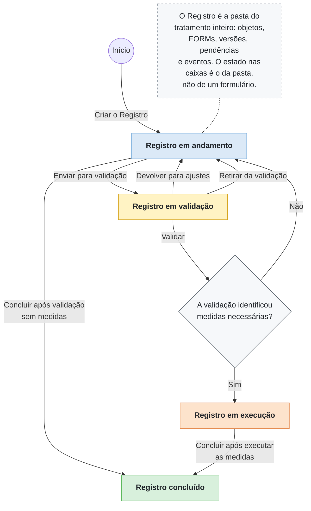
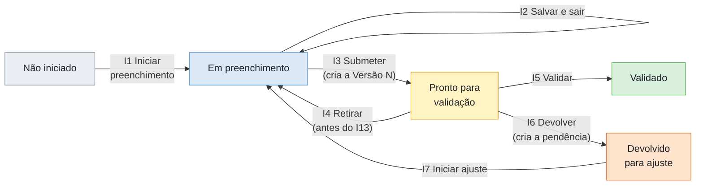
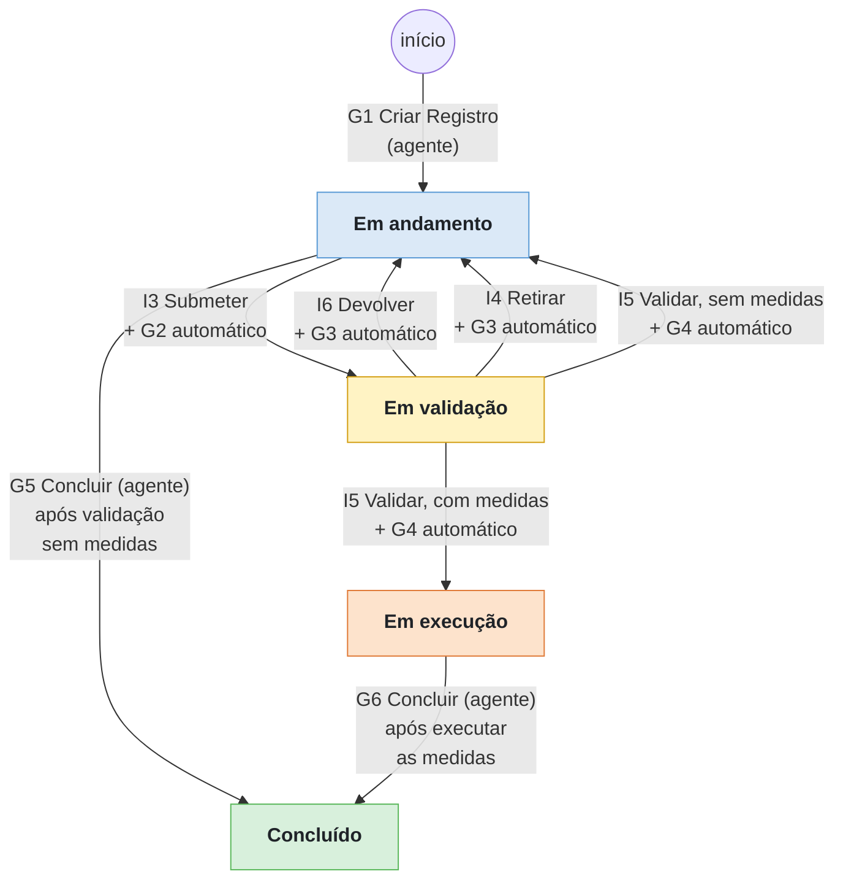
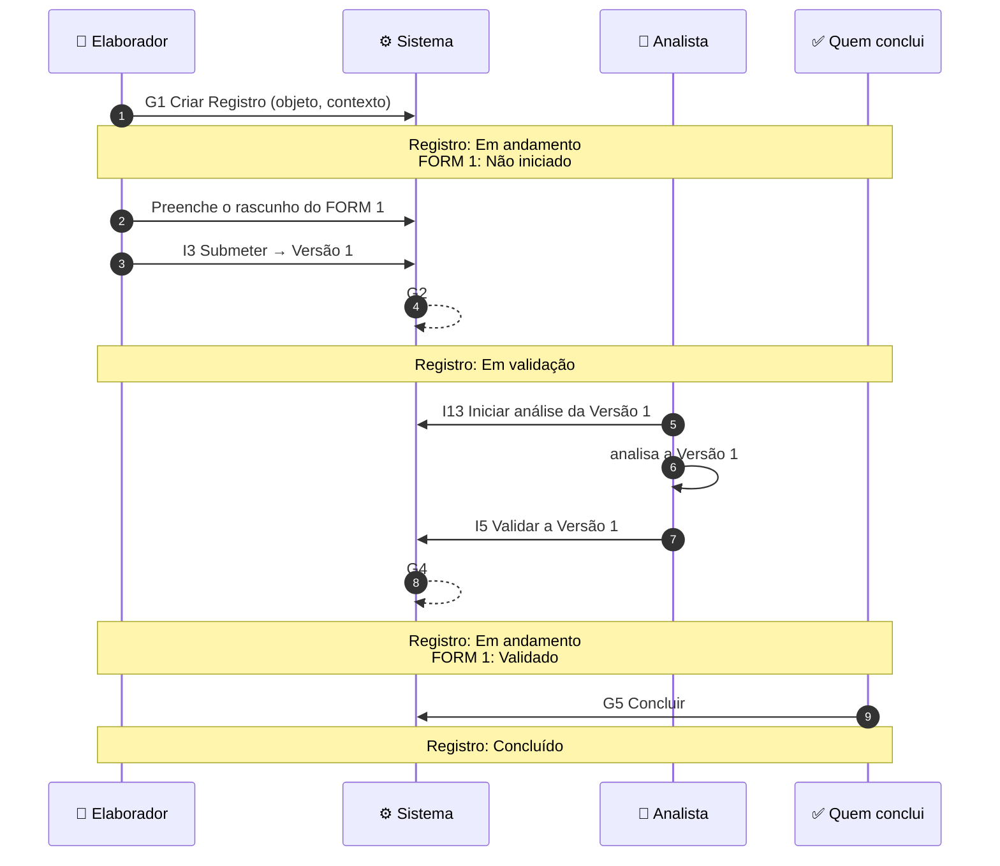
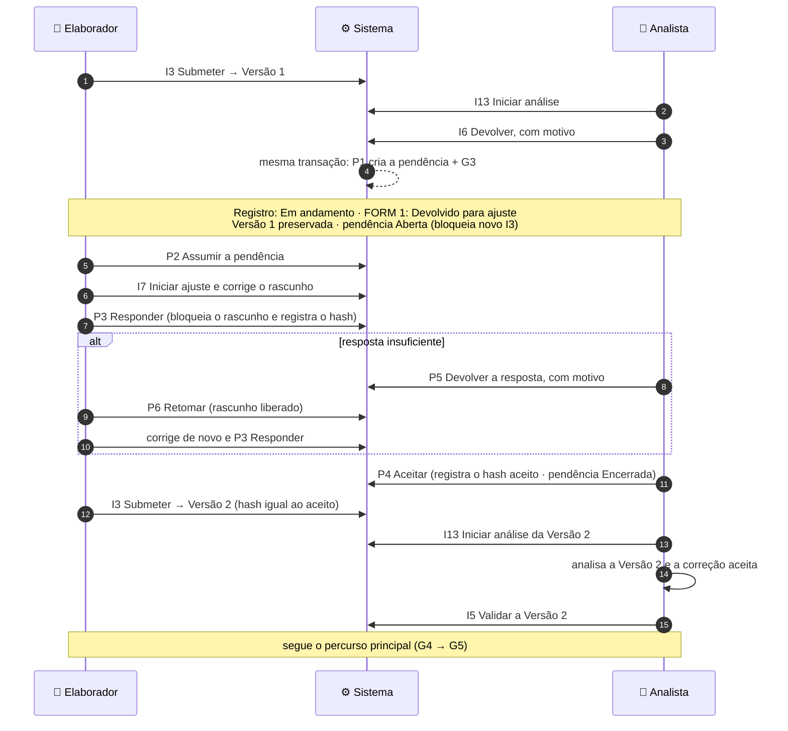
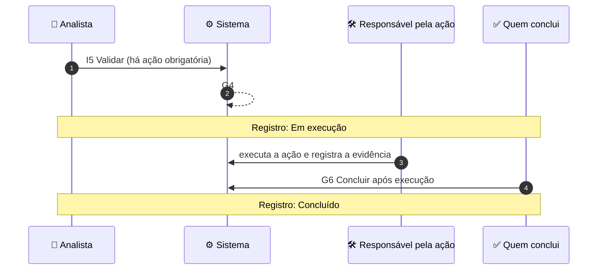
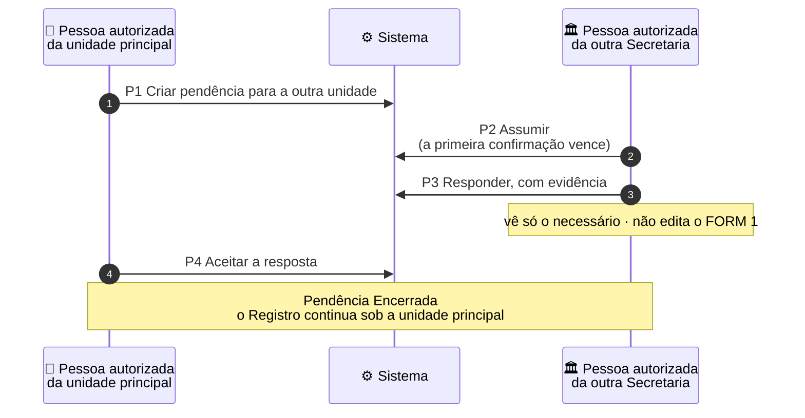

# Mapa do M1a — como um Registro caminha dentro da PoC nuclear

*Volta ao [README](../../README.md). Leitura em 5 minutos. Este mapa só ilustra: a regra vale como está no SAD 04 (REV12), no SAD 09 (4A.1 e 27.1) e no SAD 10 (DA-39). Em caso de divergência, prevalecem os SADs. Somente dados fictícios.*

> **Como ler.** Cada coluna é **quem age**. Cada seta é **um ato**, com o seu código. As faixas amarelas mostram **em que estado ficou o Registro** (ou a pendência).

## 1. Visão geral do fluxo

> **Nota de rastreabilidade técnica.** Algumas ações do **agente público autorizado** (Cartilha, seção 3.1), doravante **agente**, provocam atualizações automáticas no sistema. Os códigos de cada ação estão na tabela abaixo e no quadro técnico (seção 1B). A definição completa de cada código está no **SAD 04 (REV12)**: seção 7 para os atos **G** (Registro) e seção 9 para os atos **I** (Instrumento), reproduzida ao final da seção 1B.

| O agente público autorizado faz | Código do ato | Atualização automática após o ato |
|---|---|---|
| Criar o Registro | G1 | — |
| Enviar para validação | I3 | G2 |
| Devolver para ajustes | I6 | G3 |
| Retirar da validação | I4 | G3 |
| Validar | I5 | G4 |
| Concluir após validação sem medidas | G5 | — |
| Concluir após executar as medidas | G6 | — |

### 1A. Os estados do FORM 1 (o Instrumento) no M1a

Dentro da pasta, o FORM 1 tem os seus próprios estados (SAD 04, seção 9). É o estado do FORM 1 que **puxa** o estado do Registro.

| Quando o FORM 1 está… | o Registro fica… |
|---|---|
| Não iniciado, Em preenchimento ou Devolvido para ajuste | Em andamento |
| Pronto para validação | Em validação |
| Validado, com ação obrigatória aberta | Em execução |
| Validado, sem ação aberta | Em andamento, até alguém concluir (G5) |

*No M1a só existe o FORM 1. Na PoC ampliada, com mais de um formulário, a mesma regra olha para todos: basta um estar Pronto para validação para o Registro ficar Em validação.*

### 1B. Quadro técnico do fluxo

**Legenda.** Caixa colorida = **estado do Registro**. Texto na seta = o que provoca a mudança:

| Código | O que é | Quem faz |
|---|---|---|
| **I** (I3, I4, I5, I6) | ato sobre o **Instrumento** (o FORM) | o **agente** |
| **G1, G5, G6** | ato sobre o **Registro** (a pasta) | o **agente** |
| **G2, G3, G4** | recálculo do estado do Registro | o **sistema**, sozinho, junto com o ato do agente |

Por isso cada seta mostra primeiro o ato do agente e, depois do **+**, o recálculo automático que ele dispara.

**Por que "validar sem medidas" não leva direto a Concluído.** Pelo SAD 04 (REV12), o G4 só recalcula o estado: sem ação obrigatória aberta, o Registro volta para *Em andamento*. Concluir é sempre uma **decisão do agente** (G5 ou G6), nunca automática.

**Uma regra só decide o estado** (SAD 04, 6.3): há instrumento pronto para validação → *Em validação*; senão, há ação obrigatória aberta → *Em execução*; senão → *Em andamento*. Por isso G2, G3 e G4 não são pedidos de ninguém: o sistema os grava **na mesma transação** do ato que os causou.

#### Tabela completa dos códigos usados neste mapa

Transcrição das matrizes do SAD 04 (REV12), seções 7 e 9, sem a coluna de registros mínimos. Em caso de divergência, prevalece o SAD.

| Código | De | Ato | Quem pratica | Condições | Para |
|---|---|---|---|---|---|
| **G1** | — | Criar Registro | Responsável funcional / gestor da área | Tratamento identificado; um único contexto de atuação; exatamente um objeto PRINCIPAL e zero ou mais ABRANGIDOS; inexistência de Registro equivalente em situação bloqueadora — Em andamento, Em validação, Em execução, Suspenso ou Concluído (Cancelado não bloqueia; para Concluído, o caminho é G10) — conforme DA-36, DA-38 e DA-39 | Em andamento |
| **G2** | Em andamento ou Em execução | Instrumento submetido | AUTOMÁTICA | Algum instrumento Pronto para validação | Estado ativo recalculado (seção 6.3) |
| **G3** | Em validação | Instrumento devolvido / retirado | AUTOMÁTICA | Nenhum instrumento Pronto para validação; há instrumento em preenchimento, devolvido ou revisão | Estado ativo recalculado (seção 6.3) |
| **G4** | Em validação | Recalcular após validação | AUTOMÁTICA | I5 validou a Versão N | Estado ativo recalculado (seção 6.3): Em validação se outro instrumento estiver Pronto para validação; Em execução se houver ações obrigatórias abertas; Em andamento nos demais casos |
| **G5** | Em andamento | Concluir sem medidas | Papel com permissão Concluir e competência formal (SAD 03) | Instrumentos obrigatórios válidos; nenhuma pendência bloqueante; sem medidas a executar; pendências não bloqueantes abertas marcadas como pós-conclusão ou encerradas (seção 13.5) | Concluído |
| **G6** | Em execução | Concluir | Papel com permissão Concluir e competência formal (SAD 03) | Ações obrigatórias concluídas ou encerradas; nenhuma pendência bloqueante; pendências não bloqueantes abertas marcadas como pós-conclusão ou encerradas (seção 13.5) | Concluído |
| **I1** | Não iniciado | Iniciar preenchimento | Responsável pelo preenchimento | Gate de precedência atendido | Em preenchimento |
| **I2** | Em preenchimento | Salvar e sair | Responsável pelo preenchimento | — | Em preenchimento |
| **I3** | Em preenchimento | Submeter | Responsável pelo preenchimento | Campos mínimos; nenhuma pendência bloqueante para a submissão; havendo pendência de devolução encerrada por P4, o lacre do rascunho é igual ao aceito (DA-39, item 6) | Pronto para validação |
| **I4** | Pronto para validação | Retirar submissão | Responsável pelo preenchimento | Sem evento “Iniciar análise” para a Versão N | Em preenchimento |
| **I5** | Pronto para validação | Validar | Responsável vigente pela análise, designado pela instância validadora definida no SAD 03 | Análise iniciada para a Versão N; executor é o responsável vigente pela análise e não é o submetente da Versão N (SAD 08, SEG-01) | Validado |
| **I6** | Pronto para validação | Devolver | Responsável vigente pela análise, designado pela instância validadora definida no SAD 03 | Análise iniciada para a Versão N; lacuna/inconsistência; executor é o responsável vigente pela análise e não é o submetente da Versão N (SAD 08, SEG-01) | Devolvido para ajuste |
| **I7** | Devolvido para ajuste | Iniciar ajuste | Responsável pelo preenchimento | — | Em preenchimento |

Eventos de análise do SAD 04 (I13 e I14), que não mudam o estado do FORM:

| Código | Ato | Objeto e efeito |
|---|---|---|
| **I13** | Iniciar análise | Instrumento (Versão N): atribui a análise a um único validador; bloqueia I4 (seção 8.3). |
| **I14** | Reatribuir análise | Instrumento (Versão N): troca o responsável vigente, com motivo; novo responsável distinto do submetente. |

## 2. Percurso principal: sem medidas

**Antes do I13**, o elaborador ainda pode retirar a submissão (I4, cenário A11). **Depois do I13**, não pode mais. Só existe **uma análise ativa por versão**, nunca feita por quem submeteu. Entre o I13 e o I5 pode ocorrer uma devolução (I6, seção 3) ou, se a análise precisar ser transferida, a reatribuição do responsável vigente (I14, cenário A14).

## 3. Percurso com devolução

**O P4 não valida a Versão 2.** Ele só reconhece que a correção pedida foi apresentada e registra o hash do conteúdo aceito. A validação continua sendo o I5. O I3 compara o hash atual do rascunho com o aceito: se forem diferentes, é negado. Aqui, o Elaborador age como pessoa autorizada da unidade destinatária (P2, P3, P6) e o Analista, como pessoa autorizada da unidade de origem (P4, P5). O ciclo P5 → P6 → P3 pode se repetir, sempre com **a mesma pendência**, e as respostas anteriores ficam no histórico.

## 4. Percurso com medidas

O **G6 é ato humano autorizado**: só ocorre com a ação obrigatória encerrada, nenhuma pendência bloqueante e as pendências não bloqueantes tratadas (encerradas, canceladas ou marcadas pós-conclusão). No M1a, a ação é **sintética e mínima**: estado, responsável, evidência e vínculo com o Registro, o ciclo e o Instrumento. O FORM 4 completo não faz parte do M1a. A mesma ação é reaproveitada no M1b.2.

## 5. Pendência para outra Secretaria

**Pendência e conclusão** (SAD 04, 13.5): pendência **bloqueante** aberta impede concluir. Pendência **não bloqueante** aberta precisa ser encerrada, cancelada ou marcada **pós-conclusão**, com prazo próprio. Só as marcadas continuam andando depois do Registro concluído.

## 6. Regras que valem para todos os percursos

| Regra | Em uma frase |
|---|---|
| Pedido único | Todo comando que altera dados recebe uma chave (comando_id). A repetição idêntica devolve o resultado original; a reutilização da chave com parâmetros diferentes é recusada. Eventos derivados (G2, G3, G4) ficam vinculados ao comando causador. |
| Tudo ou nada | O ato, os eventos automáticos e a pendência criada são gravados juntos, ou nada é gravado. |
| Segregação | Quem submeteu uma versão não analisa, não valida e não devolve essa versão, nem por outra conta. |
| Negar e registrar | Tentativas negadas por autorização, segregação, concorrência, estado ou reutilização indevida de chave geram evento no livro de auditoria do mês. |
| Livro de atos | Cada evento de domínio entra na cadeia do **objeto afetado** (Registro, Instrumento, Pendência…), com lacre (hash) e elo com o anterior. Eventos relacionados mantêm vínculo causal entre si; a cadeia do Registro não absorve as dos demais objetos. |

## 7. O que fica fora do M1a

**Exceção já no M1a:** P5 e P6 são implementados apenas no percurso restrito da pendência criada automaticamente por I6.

Suspender, retomar e cancelar (M1b.1) · reabrir e novos ciclos (M1b.2) · pendências completas, participação e continuidade (M1b.3) · backup e restauração (M1b.4) · FORM 1 real e ingestão (M2) · Dossiê (M3A).
