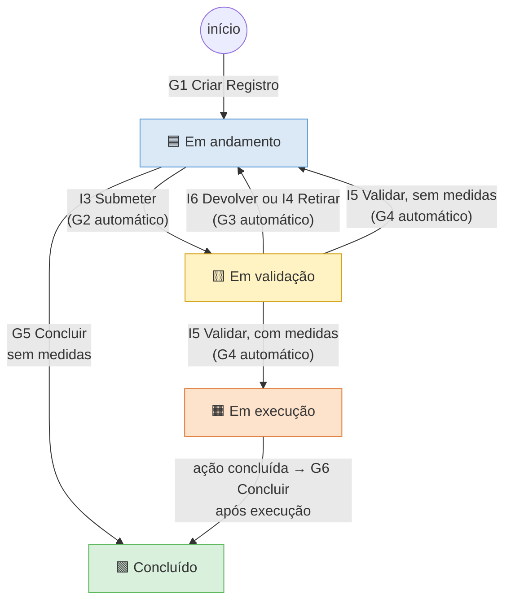
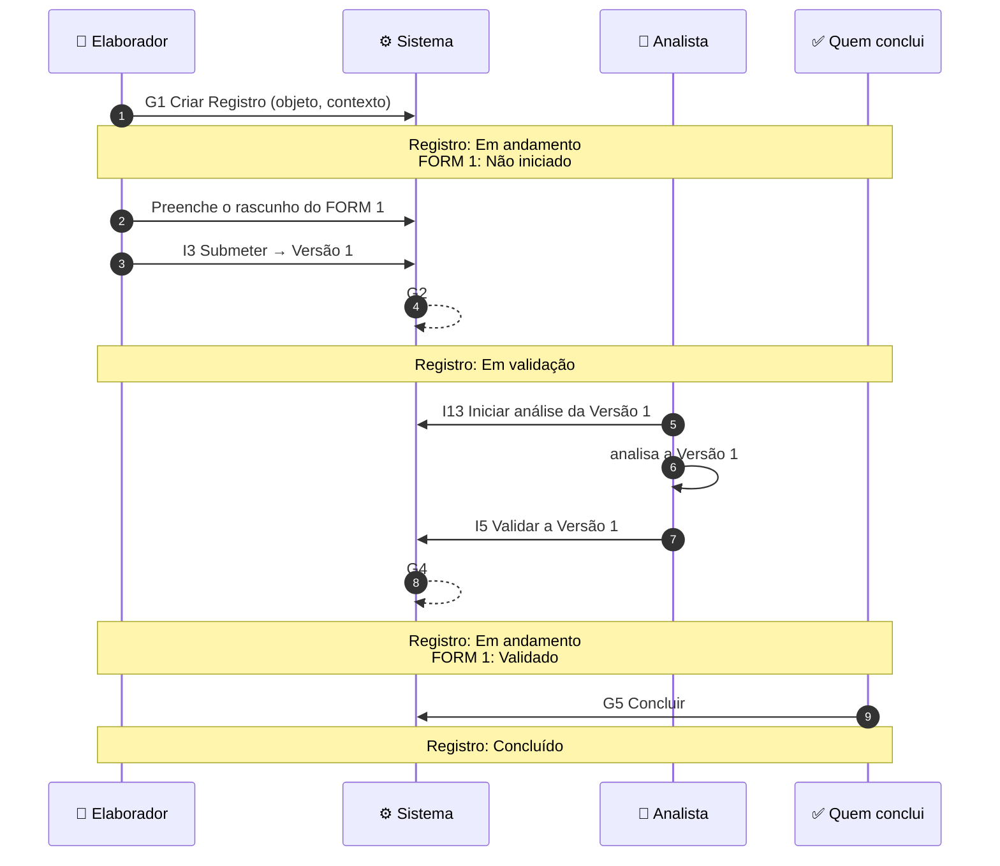
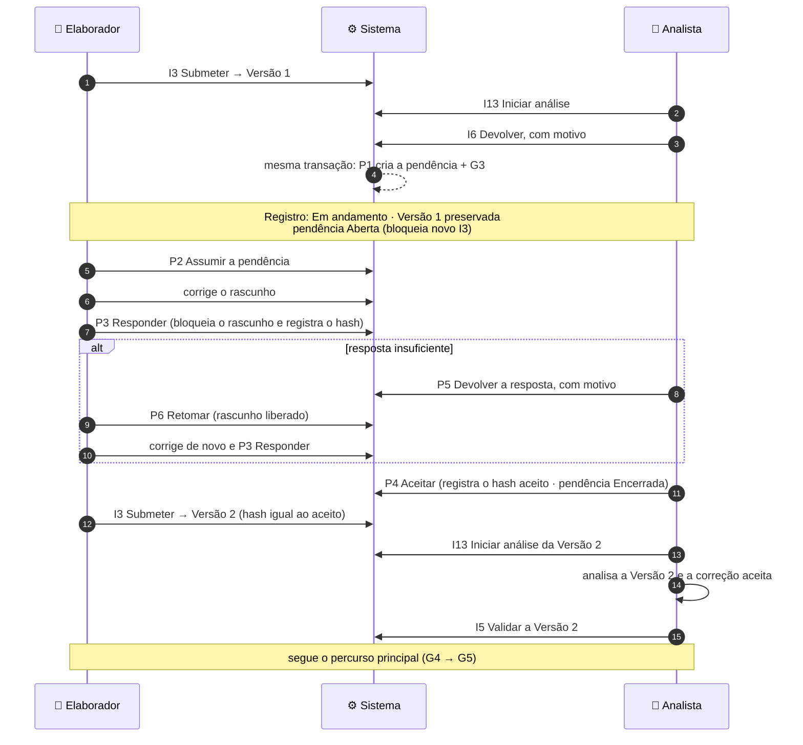
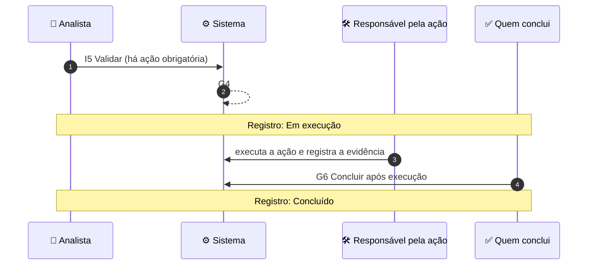
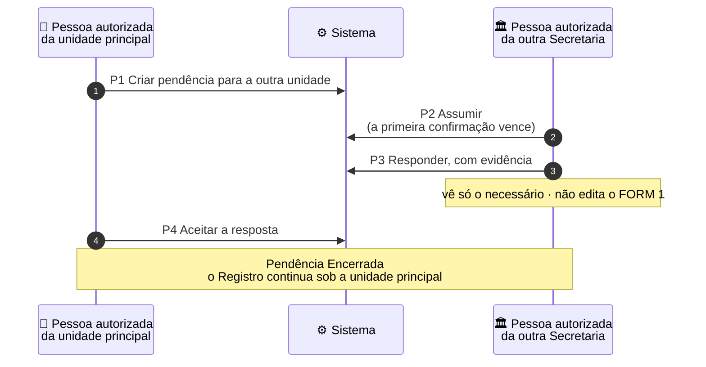

# Mapa do M1a — como um Registro anda na PoC nuclear

*Volta ao [README](../../README.md). Leitura em 5 minutos. Este mapa só ilustra: a regra vale como está no SAD 04 (REV12), no SAD 09 (4A.1 e 27.1) e no SAD 10 (DA-39). Em caso de divergência, prevalecem os SADs. Somente dados fictícios.*

> **Como ler.** Cada coluna é **quem age**. Cada seta é **um ato**, com o seu código. As faixas amarelas mostram **em que estado ficou o Registro** (ou a pendência).

## 1. Os estados do Registro no M1a

**Uma regra só decide o estado** (SAD 04, 6.3): há instrumento pronto para validação → *Em validação*; senão, há ação obrigatória aberta → *Em execução*; senão → *Em andamento*. Por isso G2, G3 e G4 não são pedidos de ninguém: o sistema os grava **na mesma transação** do ato que os causou.

## 2. Percurso principal: sem medidas

**Antes do I13**, o elaborador ainda pode retirar a submissão (I4, cenário A11). **Depois do I13**, não pode mais. Só existe **uma análise ativa por versão**, nunca feita por quem submeteu. Entre o I13 e o I5 pode ocorrer uma devolução (I6, seção 3) ou, se a análise precisar ser transferida, a reatribuição do responsável vigente (I14, cenário A14).

## 3. Percurso com devolução

**O P4 não valida a Versão 2.** Ele só reconhece que a correção pedida foi apresentada e registra o hash do conteúdo aceito. A validação continua sendo o I5. O I3 compara o hash atual do rascunho com o aceito: se forem diferentes, é negado. Aqui, o Elaborador age como pessoa autorizada da unidade destinatária (P2, P3, P6) e o Analista, como pessoa autorizada da unidade de origem (P4, P5). O ciclo P5 → P6 → P3 pode se repetir, sempre com **a mesma pendência**, e as respostas anteriores ficam no histórico.

## 4. Percurso com medidas

O **G6 é ato humano autorizado**: só ocorre com a ação obrigatória encerrada, nenhuma pendência bloqueante e as pendências não bloqueantes tratadas (encerradas, canceladas ou marcadas pós-conclusão). No M1a, a ação é **sintética e mínima**: estado, responsável, evidência e vínculo com o Registro, o ciclo e o Instrumento. O FORM 4 completo não faz parte do M1a. A mesma ação é reaproveitada no M1b.2.

## 5. Pendência para outra Secretaria

**Pendência e conclusão** (SAD 04, 13.5): pendência **bloqueante** aberta impede concluir. Pendência **não bloqueante** aberta precisa ser encerrada, cancelada ou marcada **pós-conclusão**, com prazo próprio. Só as marcadas continuam andando depois do Registro concluído.

## 6. Regras que valem para todos os percursos

| Regra | Em uma frase |
|---|---|
| Pedido único | Todo comando que altera dados recebe uma chave (comando_id). A repetição idêntica devolve o resultado original; a reutilização da chave com parâmetros diferentes é recusada. Eventos derivados (G2, G3, G4) ficam vinculados ao comando causador. |
| Tudo ou nada | O ato, os eventos automáticos e a pendência criada são gravados juntos, ou nada é gravado. |
| Segregação | Quem submeteu uma versão não analisa, não valida e não devolve essa versão, nem por outra conta. |
| Negar e registrar | Tentativas negadas por autorização, segregação, concorrência, estado ou reutilização indevida de chave geram evento no livro de auditoria do mês. |
| Livro de atos | Cada evento de domínio entra na cadeia do **objeto afetado** (Registro, Instrumento, Pendência…), com lacre (hash) e elo com o anterior. Eventos relacionados mantêm vínculo causal entre si; a cadeia do Registro não absorve as dos demais objetos. |

## 7. O que fica fora do M1a

**Exceção já no M1a:** P5 e P6 são implementados apenas no percurso restrito da pendência criada automaticamente por I6.

Suspender, retomar e cancelar (M1b.1) · reabrir e novos ciclos (M1b.2) · pendências completas, participação e continuidade (M1b.3) · backup e restauração (M1b.4) · FORM 1 real e ingestão (M2) · Dossiê (M3A).
