# Mapa do M1a — leitura funcional e técnica do fluxo da PoC nuclear

*Volta ao [README](../../README.md).*
*Leitura orientada para negócio e TI. Somente dados fictícios.*

## 1. Para que serve este mapa

Este documento explica, em uma única sequência, como um **Registro LGPD** percorre o M1a da Prova de Conceito (PoC) nuclear. Ele começa com a visão funcional do fluxo de trabalho, apresenta os nomes antes dos códigos e, em seguida, mostra as regras técnicas que a implementação deve obedecer.

O mapa não substitui os documentos de arquitetura. Em caso de divergência, prevalecem:

- **SAD 04 REV12**, para estados, transições, pendências e condições de conclusão;
- **SAD 09 REV12**, seções 4A.1 e 27.1, para o escopo e os testes da PoC nuclear;
- **SAD 10 REV16**, decisão DA-39, para as decisões de fechamento do M1a;
- **Cartilha LGPD REV30_10**, seção 3.1, para a denominação **Agente Público Autorizado**.

### 1.1 O que o M1a demonstra

O M1a demonstra o núcleo do workflow com dados fictícios:

1. criação do Registro;
2. preenchimento e versionamento de um FORM 1 sintético;
3. submissão, análise, devolução, ajuste e validação;
4. conclusão sem medidas ou após a execução de medidas;
5. pendência dirigida a outra Secretaria;
6. segregação de funções, idempotência, concorrência, auditoria e reconstrução do histórico.

O **FORM 1 real** não integra o M1a. Nesta etapa, o motor é exercitado com uma definição sintética e simplificada. O percurso com medidas usa uma ação obrigatória sintética mínima; o FORM 4 completo também não integra o M1a.

## 2. Vocabulário necessário antes dos diagramas

| Termo | Significado neste mapa |
|---|---|
| **Registro LGPD** | Pasta lógica do tratamento. Reúne contexto, objetos, Instrumentos, versões, pendências, ações, evidências e eventos. |
| **Instrumento** | Componente estruturado e versionado que integra o Registro LGPD e é utilizado para coletar, organizar ou validar informações do levantamento. Cada Instrumento possui estado e histórico próprios. No M1a, o único Instrumento utilizado é o FORM 1 sintético. |
| **Serviço** | Entrega oferecida pela Prefeitura a uma pessoa, empresa ou outra entidade. Pode ser o objeto PRINCIPAL ou um objeto ABRANGIDO pelo Registro. |
| **Processo** | Encadeamento de atividades que produz um resultado administrativo. Pode atravessar unidades e Secretarias sem que o Registro seja transferido. |
| **Atividade** | Parte executável de um processo, realizada por determinada unidade, com entrada, tratamento e saída identificáveis. |
| **Canal** | Meio institucional pelo qual o serviço ou processo se relaciona com o público ou recebe uma demanda. Na arquitetura, o canal é tratado como **processo transversal relacionado**, e não como um quarto tipo de objeto ao lado de serviço, processo e atividade. |
| **Estado do Registro** | Situação global da pasta — Em andamento, Em validação, Em execução ou Concluído — calculada a partir dos Instrumentos, pendências e ações existentes, independentemente de o objeto mapeado ser um serviço, processo ou atividade. |
| **Estado do Instrumento** | Situação própria do FORM: Não iniciado, Em preenchimento, Pronto para validação, Validado ou Devolvido para ajuste. |
| **Agente Público Autorizado** | Servidor ou empregado público que atua em razão de suas atribuições e de autorização institucional. Neste mapa, a forma curta **agente** sempre tem esse significado. |
| **Função no ato** | Papel exercido em uma ação específica: responsável pelo preenchimento, responsável pela análise, responsável por uma ação ou agente com competência para concluir. A autorização genérica não substitui essa competência. |
| **Versão N** | Cópia imutável (snapshot) criada quando o Instrumento é submetido. |
| **Pendência** | Providência específica, com origem, destino, responsável, estado e eventual efeito bloqueante. |
| **Medida** | Providência identificada durante a análise para adequar, corrigir ou proteger o tratamento de dados pessoais. |
| **Ação obrigatória** | Registro operacional que acompanha a implementação de uma medida. Possui estado, responsável, evidência e vínculo com o Registro, o ciclo e o Instrumento. Enquanto estiver aberta, mantém o Registro Em execução e impede o G6. No M1a, é uma estrutura sintética mínima. |
| **Lacre ou hash** | Resumo criptográfico usado para verificar que um conteúdo não foi alterado. |
| **comando_id** | Chave idempotente gerada pela aplicação para todo pedido que altera dados. Permite reconhecer uma repetição legítima e rejeitar a reutilização indevida da chave; não é digitada pelo agente. |
| **Idempotência** | Propriedade que permite repetir o mesmo pedido sem duplicar seus efeitos. Exemplo: se o pedido de criação for reenviado com a mesma `comando_id` e os mesmos dados, o sistema devolve o resultado original sem criar outro Registro nem novos eventos. |
| **Transação única** | Gravação indivisível: ou o ato e todos os seus efeitos são confirmados juntos, ou nada é confirmado. |
| **Evento derivado** | Evento criado automaticamente pelo sistema em consequência de outro ato, com vínculo para a sua causa. |

Um Registro pode conter mais de um Instrumento. Por isso, a expressão **“se algum Instrumento estiver Pronto para validação”** significa **“se ao menos um deles estiver nessa condição”**. No M1a existe somente um Instrumento, o FORM 1 sintético.

Uma ação obrigatória deixa de impedir o G6 somente quando for concluída ou formalmente encerrada com motivo e evidência. O encerramento formal não é um atalho para ignorar a medida.

### 2.1 De onde vêm os códigos

Os códigos identificam atos e eventos definidos pelo SAD 04. Eles não são nomes de telas nem precisam aparecer para o usuário final.

| Prefixo | Objeto afetado | Exemplos | Onde encontrar a definição completa |
|---|---|---|---|
| **G** | Registro LGPD | G1 cria; G5 e G6 concluem; G2, G3 e G4 recalculam o estado. | SAD 04 REV12, seção 7 |
| **I** | Instrumento | I1 inicia o preenchimento; I3 submete; I5 valida; I6 devolve. | SAD 04 REV12, seção 9; I13 e I14 também nas seções 8.3 e 17.2 |
| **P** | Pendência | P1 cria; P2 assume; P3 responde; P4 aceita. | SAD 04 REV12, seções 10 e 11 |

Nos diagramas técnicos, uma seta como **I3 + G2** significa: o agente submete o Instrumento e, na mesma transação, o sistema grava o evento automático que recalcula o estado do Registro. O evento automático não representa iniciativa administrativa do sistema; ele é consequência de um ato ou evento previamente definido.

## 3. Visão geral sem códigos

Leia primeiro este fluxo. Ele apresenta a história do Registro sem exigir conhecimento das siglas técnicas.

**Legenda visual:** seta azul contínua = avanço; seta laranja tracejada = retorno; seta verde = conclusão; contorno cinza tracejado = situação auxiliar ou processamento que não constitui estado do Registro. A cor nunca é o único indicador: todas as setas também possuem rótulo e estilo próprios.

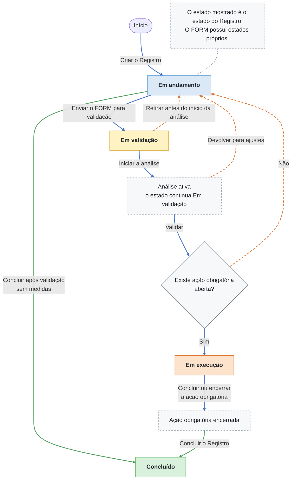

O retorno para **Em andamento** não significa que o trabalho foi perdido. Ele pode indicar três situações diferentes:

- o agente retirou a submissão antes do início da análise;
- a análise devolveu o FORM para ajustes;
- a validação terminou sem medidas, e o Registro aguarda uma decisão humana de conclusão.

O agente não escolhe entre dois comandos de validação. Existe somente a ação **Validar**. Depois dela, o sistema verifica a situação objetiva das ações obrigatórias: se houver alguma aberta, o Registro fica Em execução; se não houver, volta a Em andamento.

Por isso, **validar sem medidas não conclui automaticamente**. A conclusão é sempre um ato de agente com permissão e competência formal.

## 4. Como o estado global é decidido

O estado pertence ao Registro, mas é calculado a partir do que existe dentro dele. Enquanto o Registro não estiver Suspenso, Concluído ou Cancelado, o sistema aplica esta ordem:

1. se algum Instrumento estiver **Pronto para validação**, o Registro fica **Em validação**;
2. senão, se houver ação obrigatória aberta, o Registro fica **Em execução**;
3. nos demais casos ativos, o Registro fica **Em andamento**.

Essa ordem é importante: não se escolhe o estado manualmente e não se grava um estado diferente apenas porque uma tela o solicitou.

| Situação do FORM 1 no M1a | Estado do Registro |
|---|---|
| Não iniciado, Em preenchimento ou Devolvido para ajuste | Em andamento |
| Pronto para validação | Em validação |
| Validado, com ação obrigatória aberta | Em execução |
| Validado, sem ação obrigatória aberta | Em andamento, até G5 |

## 5. Estados e atos do FORM 1

O FORM 1 tem um ciclo próprio. **Salvar** modifica o rascunho; **submeter** cria uma versão imutável; **validar** sela a versão submetida; **devolver** preserva a versão analisada e abre o percurso de correção.

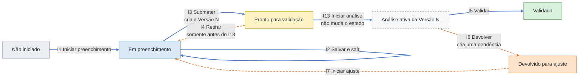

O I13 não cria novo estado. Ele atribui a análise da Versão N a um único responsável vigente, bloqueia a retirada I4 e se torna pré-condição para validar ou devolver. Quem submeteu a Versão N não pode iniciar sua análise, validá-la nem devolvê-la.

## 6. Quem faz o quê

Todos os atores humanos abaixo pertencem à mesma categoria institucional — **Agente Público Autorizado** —, mas exercem funções diferentes. As funções não representam necessariamente pessoas distintas: uma mesma pessoa pode exercer mais de uma quando possuir atribuição e autorização, respeitadas a competência formal e a segregação de funções. A coluna de função não pode ser ignorada na autorização do comando.

Ao criar o Registro ou praticar qualquer outro ato, o agente é identificado pela sessão autenticada. A matrícula poderá ser utilizada como identificador institucional, conforme as regras da Prefeitura, mas deverá ser obtida do cadastro corporativo associado à sessão, sem redigitação. Essa identificação registra **quem realizou o ato**; ela não torna a pessoa, por si só, responsável permanente pelo Registro ou pela etapa.

| Ação em linguagem comum | Função exigida | Código | Efeito automático na mesma transação |
|---|---|---:|---:|
| Criar o Registro | Responsável funcional ou gestor da área | G1 | — |
| Iniciar o preenchimento | Responsável pelo preenchimento | I1 | — |
| Salvar e sair | Responsável pelo preenchimento | I2 | — |
| Enviar para validação | Responsável pelo preenchimento | I3 | G2 |
| Retirar da validação | Responsável pelo preenchimento, antes do I13 | I4 | G3 |
| Iniciar a análise | Agente designado pela instância validadora | I13 | — |
| Reatribuir a análise | Responsável competente pela instância validadora | I14 | — |
| Validar | Responsável vigente pela análise | I5 | G4 |
| Devolver para ajustes | Responsável vigente pela análise | I6 | P1 e G3 |
| Iniciar o ajuste | Responsável pelo preenchimento | I7 | — |
| Concluir sem medidas | Papel com permissão Concluir e competência formal | G5 | — |
| Concluir após as medidas | Papel com permissão Concluir e competência formal | G6 | — |

Nos diagramas de sequência, cada raia humana indica a **função exercida no ato**, e não uma identidade pessoal fixa. A raia do sistema indica execução automática provocada por um comando ou evento; o sistema não toma iniciativa administrativa nem substitui a decisão do agente.

### 6.1 O que G2, G3 e G4 fazem

G2, G3 e G4 não são botões nem pedidos independentes. São eventos derivados gravados pelo sistema na mesma transação do ato humano que os causou.

| Evento automático | Causa | Resultado |
|---|---|---|
| **G2** | I3 submeteu um Instrumento | Recalcula o estado; no M1a, leva a Em validação. |
| **G3** | I4 retirou ou I6 devolveu o Instrumento | Recalcula o estado; no M1a, retorna a Em andamento. |
| **G4** | I5 validou a Versão N | Recalcula: Em validação se houver outro Instrumento pronto; Em execução se houver ação obrigatória aberta; Em andamento nos demais casos. |

### 6.2 Regras de entrada que a seta não pode esconder

**G1 — Criar Registro.** O pedido cria um Registro com exatamente um contexto de atuação, um objeto PRINCIPAL e zero ou mais objetos ABRANGIDOS. O código humano segue o formato `LGPD-AAAA-NNNNN`; o UUID permanece como identificador técnico. Antes de criar, o sistema verifica equivalência e sobreposição estrutural conforme a DA-39.

**I3 — Submeter.** O pedido cria uma Versão N imutável. Além das validações de campos e pendências bloqueantes, a submissão executa a comparação material de finalidade, categorias de titulares, categorias de dados e compartilhamentos. No FORM 1 sintético, as categorias vêm de catálogos fechados; nomes ou outros identificadores de titulares não integram o contrato. Uma semelhança gera alerta para exame na análise, sem bloqueio automático apenas por esse motivo.

Essas verificações pertencem ao ato indicado pela seta. Elas não devem ser implementadas como correções posteriores ou controles apenas de interface.

## 7. Quadro técnico do fluxo do Registro

Este é o mesmo percurso da visão geral, agora com os códigos necessários para implementação, teste e auditoria.

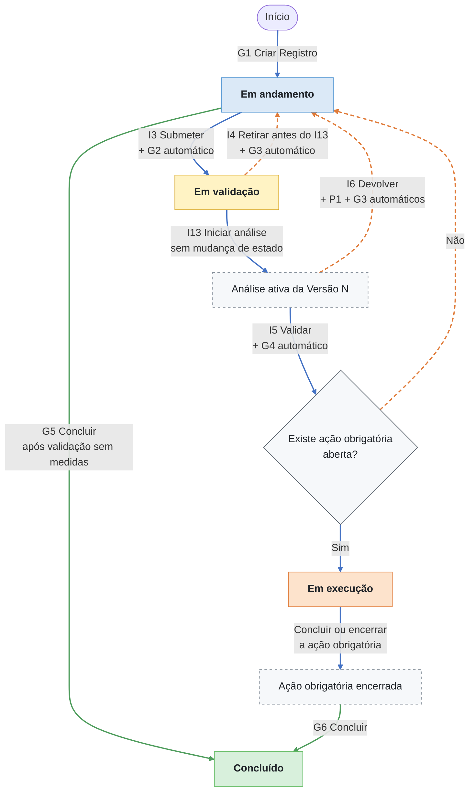

O desenho mostra o percurso do M1a, que possui somente um FORM 1 sintético. A regra geral do G4 continua sendo a da seção 6.3 do SAD 04: em uma etapa com vários Instrumentos, outro Instrumento Pronto para validação mantém o Registro Em validação.

## 8. Percurso principal sem medidas

O percurso abaixo explicita todos os atos necessários. O preenchimento não começa antes do I1, e a validação não ocorre antes do I13.

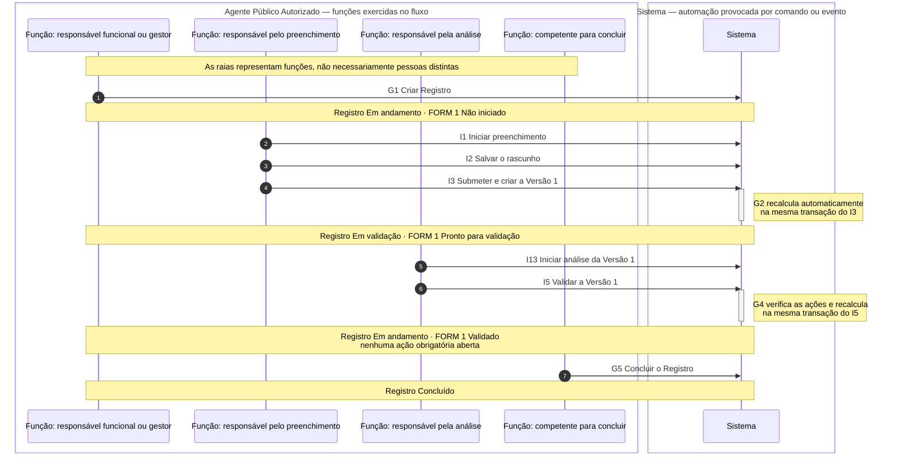

Antes do I13, o agente de preenchimento ainda pode executar I4 e retirar a submissão. Depois do I13, o I4 é bloqueado. A análise ativa pode ser transferida por I14, mas não pode existir mais de um responsável vigente para a mesma Versão N.

## 9. Percurso com devolução e correção

I6 preserva a versão analisada e, na mesma transação, cria a pendência de correção e recalcula o Registro. A pendência é dirigida à unidade responsável pelo preenchimento, não a uma pessoa específica.

O diagrama começa com o FORM 1 já Em preenchimento; G1, I1 e I2 ocorreram como no percurso da seção 8.

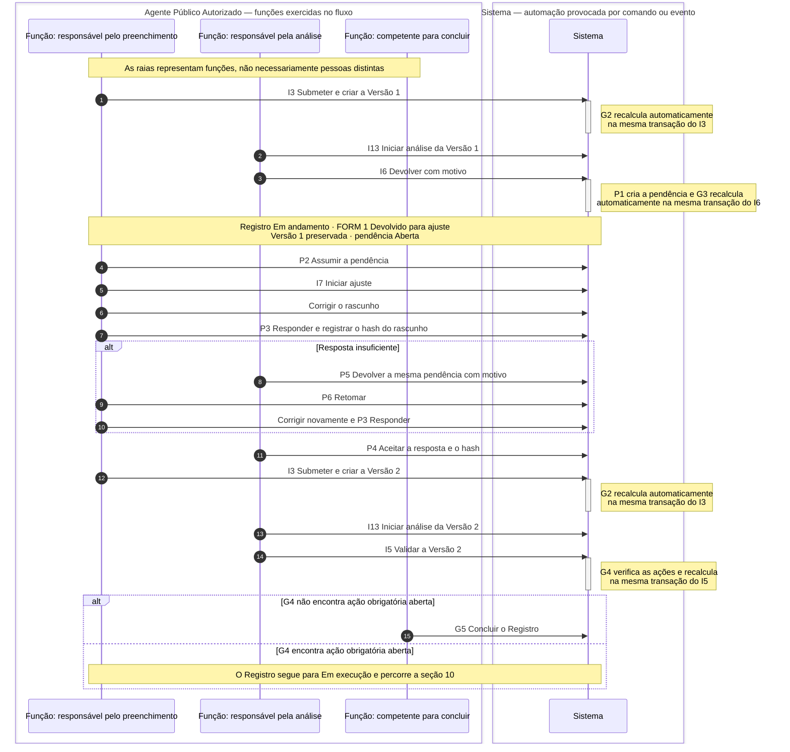

P4 não valida a Versão 2. Ele apenas reconhece que a correção solicitada foi apresentada e registra o hash aceito. O novo I3 só é permitido quando o hash do rascunho coincide com o hash aceito. A validação continua dependendo de I13 e I5.

Ao executar P3, o sistema registra o hash do rascunho corrigido e bloqueia novos I2 enquanto a pendência estiver Respondida. Assim, P4 ou P5 sempre examina exatamente o conteúdo apresentado, sem alteração silenciosa durante a conferência.

No M1a, P5 e P6 existem somente neste percurso restrito da pendência criada automaticamente por I6. A aplicação geral de P5 e P6 pertence à PoC ampliada.

## 10. Percurso com medidas

Executar a medida e concluir o Registro são fatos diferentes. Primeiro a ação obrigatória precisa ser concluída ou formalmente encerrada; depois um agente com competência executa G6.

O diagrama começa depois do I13, com uma análise ativa, um responsável vigente pela Versão N e uma ação obrigatória aberta já vinculada ao cenário de teste.

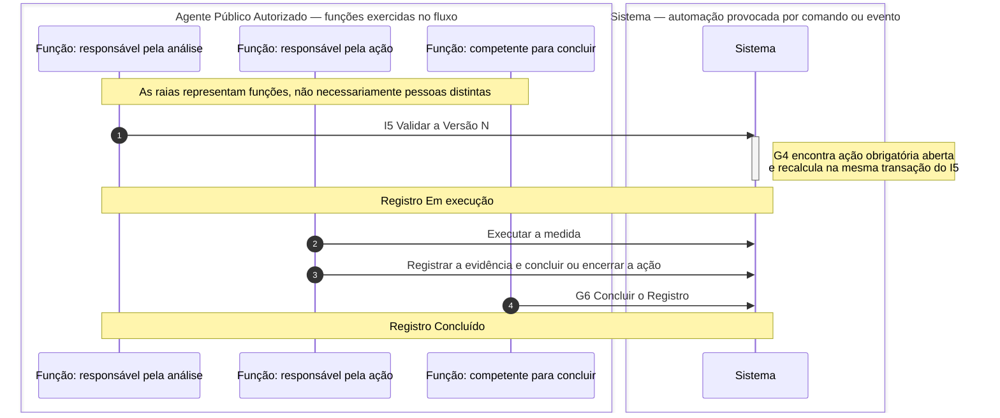

No M1a, a ação obrigatória contém somente o necessário para provar o percurso: estado, responsável, evidência e vínculo com Registro, ciclo e Instrumento.

## 11. Pendência dirigida a outra Secretaria

Uma pendência intersecretarial não transfere o Registro e não concede edição automática do FORM 1. A unidade de destino recebe apenas o contexto necessário para responder.

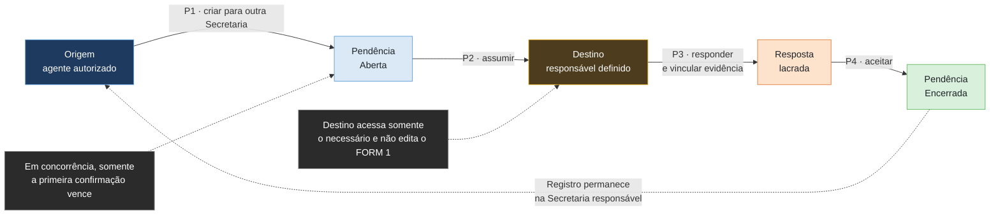

P1 admite duas origens no SAD 04:

- **humana**, quando um agente autorizado da unidade de origem cria uma pendência para outra unidade;
- **automática**, quando I6 devolve um Instrumento e o sistema cria a pendência de correção na mesma transação.

Na implementação do M1a, o papel técnico provisório `agente_pendencia` representa a designação prévia para atuar na fila institucional; ele não concede preenchimento, análise ou validação. A pendência de participação bloqueia o gate de conclusão até P4. O P3 registra e lacra um contrato fechado com etapa executada, entrada, operações, saída, interfaces e referências de evidência. O Instrumento não é alterado por esse percurso.

### 11.1 Percurso transversal por várias Secretarias

O Registro permanece vinculado à unidade principal. O que circula entre as Secretarias são pendências, participações e respostas necessárias à reconstrução do percurso. Cada unidade documenta somente a etapa que efetivamente executa, identificando a origem recebida, o tratamento realizado e o destino dado aos dados.

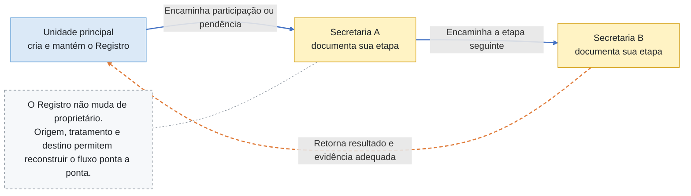

O M1a comprova uma pendência dirigida a outra Secretaria. O encadeamento completo **unidade principal → Secretaria A → Secretaria B → unidade principal** pertence à PoC ampliada, mas a arquitetura deve preservar os vínculos necessários para demonstrá-lo sem copiar ou reter dados pessoais além do necessário.

Quando o percurso utilizar um canal institucional, o canal permanece modelado como **processo transversal relacionado** ao serviço ou processo atendido. Ele não se torna um quarto tipo de objeto do Registro.

## 12. Estados da pendência usados no M1a

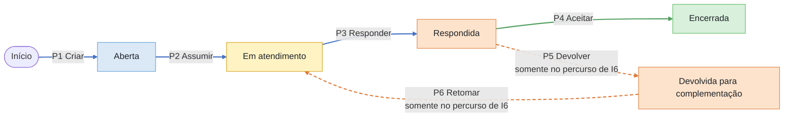

Uma pendência bloqueante aberta impede a passagem ou transição que ela identifica. Na conclusão, pendências não bloqueantes abertas devem ser encerradas, canceladas ou marcadas como pós-conclusão com prazo próprio. Somente as marcadas continuam operáveis depois que o Registro fica Concluído.

## 13. Como a TI deve interpretar um comando

O sistema não deve tratar uma seta do diagrama como simples troca de uma coluna de estado. Cada comando percorre uma sequência de validação e gravação.

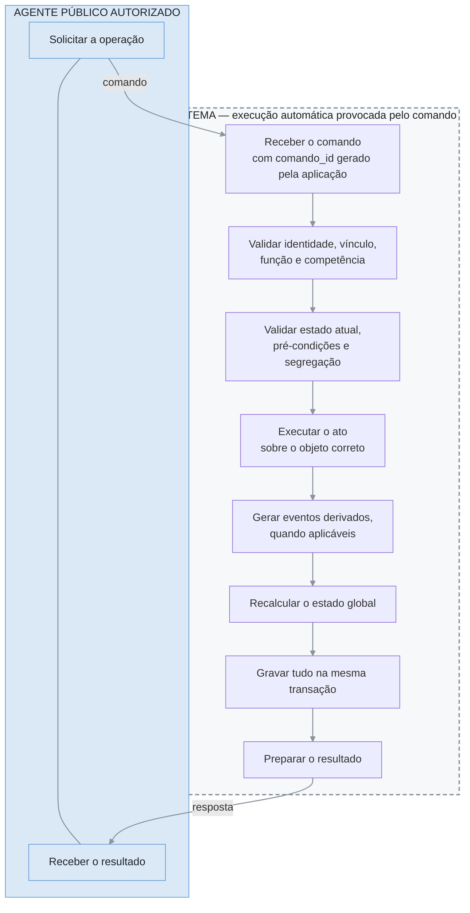

A linha entre as duas faixas representa o limite de responsabilidade: o agente solicita a operação; o sistema executa as validações e regras previamente definidas; ao final, devolve o resultado. O agente não digita a `comando_id`, e o sistema não toma a decisão administrativa em seu lugar.

Se qualquer validação falhar, o comando de negócio não é parcialmente executado. A tentativa negada deve gerar o evento de auditoria previsto, sem alterar o estado do objeto.

### 13.1 Idempotência

- a mesma `comando_id` com os mesmos parâmetros devolve o resultado original e não cria novos eventos;
- a mesma `comando_id` com parâmetros diferentes é recusada e registrada na auditoria;
- pedidos simultâneos com a mesma chave são resolvidos pelo banco: um vence e o outro recebe o resultado do primeiro.

Exemplo: se a aplicação reenviar **Criar Registro** com a mesma `comando_id` e os mesmos dados após uma falha de comunicação, o sistema devolve o Registro criado na primeira tentativa. Ele não cria outro Registro e não duplica os eventos.

### 13.2 Transação única

O ato humano, os eventos automáticos, a pendência automática e o recálculo do estado são gravados juntos ou não são gravados. Exemplos:

- I3 e G2;
- I4 e G3;
- I5 e G4;
- I6, P1 e G3.

### 13.3 Segregação e concorrência

- quem submeteu a Versão N não pode iniciar sua análise, validá-la nem devolvê-la;
- só pode existir uma análise ativa por versão;
- só um agente assume a mesma pendência; a segunda tentativa concorrente é negada e auditada;
- reatribuição não altera a autoria dos atos anteriores.

### 13.4 Histórico e evidência

Cada objeto mantém a própria cadeia de eventos: Registro, Instrumento e Pendência não compartilham artificialmente uma única sequência. Eventos relacionados conservam vínculo causal. Evidência comprova o ato sem reproduzir dados pessoais desnecessários.

## 14. Condições de conclusão

### 14.1 G5 — concluir sem medidas

Neste mapa, **sem medidas** significa que a análise e a validação não resultaram em providência que precise ser acompanhada por ação obrigatória aberta. Não é uma opção escolhida livremente pelo agente.

G5 parte de **Em andamento** e exige:

- Instrumentos obrigatórios em condição terminal válida;
- nenhuma pendência bloqueante aberta;
- nenhuma medida a executar;
- pendências não bloqueantes encerradas ou marcadas como pós-conclusão.

### 14.2 G6 — concluir após medidas

**Após medidas** significa que as providências identificadas foram acompanhadas pelas respectivas ações obrigatórias e que nenhuma delas permanece aberta.

G6 parte de **Em execução** e exige:

- todos os Instrumentos obrigatórios validados;
- ao menos uma ação obrigatória no ciclo;
- ações obrigatórias concluídas com evidência ou formalmente encerradas com motivo e evidência;
- todas as pendências encerradas ou canceladas;
- ciclo atual ativo.

O responsável pela ação registra primeiro o resultado no evento técnico AO1. O sistema pode informar que as condições foram satisfeitas, mas não conclui automaticamente. G5 e G6 são decisões institucionais praticadas por agente com permissão e competência formal.

## 15. O que pertence e o que não pertence ao M1a

| Integra o M1a | Fica para etapa posterior |
|---|---|
| Registro e primeiro ciclo | Suspender, retomar, cancelar e reabrir |
| FORM 1 sintético | FORM 1 real |
| Rascunho, versões, submissão e análise | FORM 4 completo |
| I1 a I7, I13 e I14 necessários ao percurso | Revisões e não aplicabilidade em toda a extensão |
| G1 a G6 necessários ao percurso | Demais fluxos de controle do Registro |
| P1 a P4 | P5 e P6 fora da devolução I6; P7 a P10 |
| P5 e P6 somente na pendência criada por I6 | Participação completa de várias unidades no FORM 1 |
| Pendência intersecretarial | Incidentes, comunicação à ANPD, demandas de titulares, fiscalizações, processos sancionadores, ações judiciais e RIPD |
| Ação obrigatória sintética mínima | Prazos, notificações e integrações reais |
| Dados exclusivamente fictícios | Uso com dados pessoais reais |

### 15.1 Jornadas associadas que não se confundem com o Registro

Um Registro LGPD pode ser relacionado posteriormente a outras jornadas administrativas ou jurídicas. Ele **não se transforma** em incidente, comunicação à ANPD, demanda de titular, fiscalização, processo sancionador ou ação judicial.

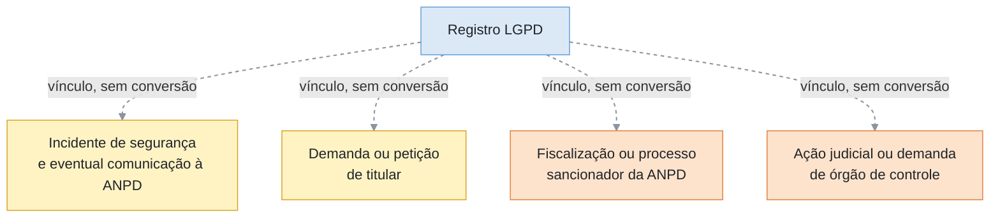

Cada jornada associada deve possuir identificador, estados, prazos, responsáveis, regras de acesso, evidências e cadeia de eventos próprios. A relação pode envolver um ou mais Registros e deve preservar os vínculos necessários à rastreabilidade. Essas jornadas não são implementadas no M1a; sua representação acima apenas evita que a arquitetura futura trate objetos diferentes como se fossem o mesmo processo.

## 16. Rastreabilidade das regras deste mapa

| Assunto | Fonte de autoridade |
|---|---|
| Serviço, processo e atividade como objetos da jornada | SAD 02 REV17 e SAD 03 REV11 |
| Canal como processo transversal relacionado, não como quarto tipo de objeto | SAD 05 REV11, relação `utiliza_processo_transversal`, e SAD 10 REV16 |
| Estados e derivação do Registro | SAD 04 REV12, seções 6.1 a 6.4 |
| Atos G1 a G6 | SAD 04 REV12, seção 7 |
| Estados e atos do Instrumento | SAD 04 REV12, seções 8 e 9 |
| Início e reatribuição da análise | SAD 04 REV12, seção 8.3 e eventos I13/I14 |
| Pendências P1 a P6 | SAD 04 REV12, seções 10 e 11 |
| Conclusão e pós-conclusão | SAD 04 REV12, seções 13.4 e 13.5 |
| Atuação intersecretarial | SAD 04 REV12, seção 14 |
| Jornadas externas associadas e cadeias próprias de eventos | SAD 02 REV17, SAD 04 REV12 e SAD 05 REV11 |
| Escopo e testes da PoC nuclear | SAD 09 REV12, seções 4A.1 e 27.1 |
| Fechamento do M1a | SAD 10 REV16, DA-39, especialmente itens 5 a 8 |
| Agente Público Autorizado | Cartilha LGPD REV30_10, seção 3.1 |

## 17. Regra de leitura final

Para cada seta, a implementação e o teste devem conseguir responder, sem inferência:

1. qual objeto foi afetado;
2. qual agente agiu e em qual função;
3. qual estado e qual versão eram vigentes;
4. qual pré-condição autorizou o ato;
5. qual evento foi gravado;
6. quais eventos automáticos foram derivados;
7. qual estado resultou do recálculo;
8. qual evidência e qual vínculo causal permitem reconstruir o ocorrido.

Se uma dessas respostas não puder ser obtida, o percurso ainda não está suficientemente implementado ou documentado.
