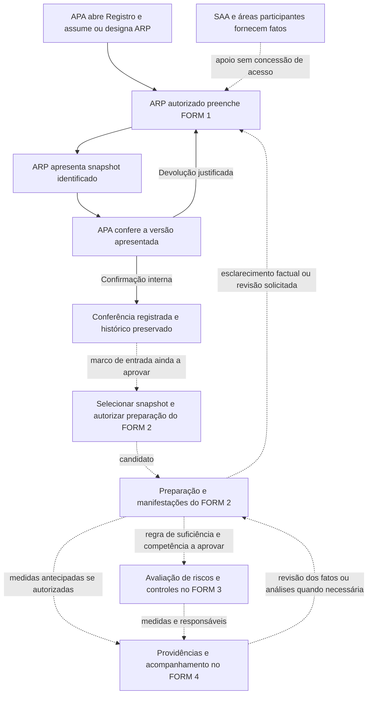

# GOV_FORMS_01 — Fluxo institucional candidato de encaminhamentos

**Produto B · versão documental 0.1 · 06/11/2026**  
**Proposta pendente de aprovação. Não implementa nem libera tramitação institucional.**

## 1. Base e limites

As fontes, seus limites normativos e as decisões GOV-01 a GOV-08 estão na [matriz de responsabilidades](GOV_FORMS_01_MATRIZ_RESPONSABILIDADES_CANDIDATA.md). A [estratégia de configuração](GOV_FORMS_01_CONFIGURACAO_VERSIONAMENTO_CANDIDATO.md) descreve como versionar as regras futuras.

Há três planos distintos: situação do **Registro**, situação de cada **instrumento/versão** e situação de cada **solicitação/providência** (SAD 02, RF-WFL; SAD 04; SAD 05). Uma devolução de conferência não cancela o Registro; uma ação atrasada não altera automaticamente a legitimidade do tratamento; confirmar a conferência do FORM 1 não aprova o FORM 2.

O fluxo implementado do FORM 1 termina, neste recorte, em atos preparatórios de conferência interna. As etapas posteriores abaixo são candidatas. Não se cria sequência obrigatória universal FORM 1 → FORM 2 → FORM 3 → FORM 4 por força deste desenho.

## 2. Visão do percurso

Linhas contínuas identificam o ciclo interno do FORM 1 documentado como implementado; linhas pontilhadas representam colaboração conceitual ou encaminhamento candidato. O desenho não confere acesso ao SAA nem afirma que toda confirmação interna já permita preparar o FORM 2. Cada operação futura dependerá de seu marco e de autorização próprios.

## 3. Percurso detalhado e próxima responsabilidade

| Passo | Gatilho/entrada e ato | Responsável pela próxima ação | Resultado e limite | Situação |
|---|---|---|---|---|
| 1 | APA autorizado identifica Secretaria, objeto e contexto; abre Registro e confirma canais. | APA assume preenchimento ou designa ARP por ato explícito. | Mesmo Registro; canal não cria outro inventário automaticamente. | Atual, conforme FORM 1. |
| 2 | ARP habilitado inicia/retoma rascunho; recebe apoio factual. | ARP enquanto preenche ou corrige. | Rascunho incompleto permitido; apoio do SAA não concede acesso. | Atual; colaboração futura por solicitações estruturadas é candidata. |
| 3 | ARP solicita conferência interna de uma versão. | APA vigente autorizado para aquela conferência. | Snapshot identificado, imutável, com autoria; versão de trabalho permanece distinta. | Atual. |
| 4a | APA devolve o snapshot com justificativa. | ARP vigente autorizado corrige o rascunho. | Decisão de devolução preservada; reapresentação gera nova apresentação/versionamento. | Atual. |
| 4b | APA confirma a conferência do snapshot apresentado. | ARP continua responsável pelo rascunho; não há nova tarefa de submissão criada automaticamente. | Conferência encerrada; preserva histórico e não homologa o tratamento. | Atual. |
| 5 | Marco de entrada do FORM 2 satisfeito segundo política ainda a aprovar; seleção explícita de snapshot elegível. | Preparador do FORM 2 designado e autorizado. APA acompanha administrativamente. | Referência à versão exata, seu contrato/extensões e lacre; não leitura móvel do rascunho. | Candidato — GOV-01/02/03. |
| 6 | Preparador consulta fatos e solicita esclarecimento delimitado à unidade competente. | Destinatário habilitado responde; preparador verifica suficiência da resposta. | Resposta factual ou manifestação anexada ao histórico da solicitação; não validação global implícita. | Candidato — GOV-03/05. |
| 7 | Identificada necessidade de corrigir fatos do FORM 1. | ARP altera rascunho; APA realiza os atos internos pertinentes; responsável pelo FORM 2 avalia nova base. | Snapshot original continua referenciado até adoção expressa da nova versão e exame do impacto. | Candidato — GOV-02/06. |
| 8 | Questão de legitimidade exige manifestação especializada. | Signatário da área competente, com escopo/versão identificados. | Parecer não encerra automaticamente FORM 2; decisão reservada à autoridade habilitada. | Candidato — GOV-03/08. |
| 9 | Insumos suficientes para análise de riscos, segundo regra aprovada. | Preparador/avaliador do FORM 3 conforme competência a definir. | Referências explícitas a fatos e análises; parâmetros técnicos e aceitação do risco separados. | Candidato — GOV-04/06. |
| 10 | FORM 2 ou FORM 3 identifica providência; exceção de antecipação quando autorizada. | Responsável por cada medida; APA acompanha encaminhamento. | FORM 4 registra origem, responsável, prazo, evidência e acompanhamento. | Candidato — GOV-06/07. |
| 11 | Execução ou atualização da providência. | Executor informa; verificador avalia evidência/eficácia; autoridade decide matéria reservada. | Conclusão de ação não aprova automaticamente todo o Registro nem todos os FORMs. | Candidato — GOV-03/04/07/08, conforme matéria. |
| 12 | Revisão por mudança relevante de fatos, análise, controles ou competência. | Responsável pelo instrumento/ato afetado. | Novo ato ou versão com relação ao anterior; preservar os não afetados. | Candidato; princípio de preservação já documentado nos SADs. |

APA=ARP mantém os atos explícitos separados no ciclo interno atual. Não generalizar essa possibilidade para autovalidação especializada ou institucional nos FORMs futuros.

## 4. Estados e mensagens: proposta sem novo estado de negócio

| Expressão de trabalho | Natureza | Como interpretar |
|---|---|---|
| Rascunho em preenchimento; apresentação aguardando conferência; devolvida; conferência interna confirmada | Situações já descritas na implementação do FORM 1. | Usar os estados e projeções existentes, sem renomear enums ou alterar transições nesta tarefa. |
| Não iniciado, Em preenchimento, Pronto para validação, Devolvido para ajuste, Validado, Em revisão, Não aplicável | Vocabulário arquitetural de instrumento no SAD 05. | Não prova que todos estejam implementados para o Integral ou para FORM 2. A adoção exige contrato e política próprios. |
| Aguardando esclarecimento da unidade; aguardando manifestação; aguardando decisão competente | Projeções candidatas de solicitações e atos. | Não inserir como novos estados globais do Registro. Identificar solicitação, destinatário, escopo e responsável. |
| Sem responsável habilitado para o próximo ato | Situação operacional a explicitar na futura projeção. | Não escolher substituto automaticamente nem ampliar permissão; solicitar regularização da atribuição à função competente. |

O painel futuro deve informar **qual Registro, instrumento/versão, ato pendente e responsável autorizado**. O contador de providências não deve somar campos incompletos como se fossem tarefas institucionais. A contagem de pendências de preenchimento continua separada.

## 5. Esclarecimentos, devoluções e revisão da base factual

Uma solicitação de esclarecimento deve identificar pergunta/matéria, unidade destinatária, versão analisada, autor e prazo quando previsto. O destinatário poderá responder somente no escopo autorizado. Aceitar a resposta, pedir complementação e concluir uma análise são atos diferentes, seguindo RF-WFL e SAD 03 §12A.

Quando a resposta indicar erro factual, a unidade analista **não edita o FORM 1**. O ARP autorizado corrige o rascunho pelos mecanismos atuais. A seleção de um novo snapshot pelo FORM 2 será um ato futuro explícito, com motivo, autor, versões anterior/nova e impacto nas análises. Não substituir referências históricas em lote, invalidar todos os pareceres automaticamente ou recalcular decisões silenciosamente.

Proposta conservadora: enquanto uma revisão relevante estiver sem análise de impacto, bloquear somente os atos que dependam daquela informação, se essa regra tiver sido aprovada. Preservar a possibilidade de trabalho independente. A lista de condições bloqueantes deve ser política versionada; esta proposta não cria bloqueios atuais.

## 6. Encaminhamentos e exceções de sequência

O SAD 04 §12.2 contém uma alternativa conservadora de passagem por instrumentos validados. O README admite preparação e encaminhamento de providências em condições específicas, inclusive FORM 4 antes da conclusão integral do FORM 3. As hipóteses devem ser conciliadas em GOV-02/06, sem converter uma delas em regra executável por conveniência.

Proposta: descrever **pré-condições por ato**, em vez de impor uma fila linear única:

- Preparar uma minuta pode exigir menos condições que emitir parecer ou decidir.
- Solicitar esclarecimento factual não deve equivaler à devolução institucional de uma versão.
- Encaminhar medida antecipada exige origem, justificativa, autoridade autorizadora quando aplicável e vínculo com a análise ainda em andamento.
- Revisão de um FORM afeta os dependentes identificados, não todos automaticamente.
- Reabrir, suspender, cancelar ou concluir o Registro continua matéria de competência própria. A DA-22 não habilita esses atos ao Comitê enquanto AB-05 estiver sem resolução.

Não se propõe envio obrigatório à TI. TI/segurança poderão receber questão técnica delimitada, e não acesso universal ao conteúdo. O mesmo princípio vale para Jurídico, DPO, Comitê, chefia e colaboradores de outra Secretaria.

## 7. Exemplo exclusivamente sintético

O APA da Secretaria A acompanha administrativamente um Registro fictício. O ARP apresenta **S1** do FORM 1; o APA devolve; o ARP corrige e apresenta **S2**; o APA confirma a conferência interna de S2. Até aqui, há ciclo preparatório, sem liberação institucional.

Se um marco de entrada for aprovado, o preparador autorizado do FORM 2 referencia S2. Uma área jurídica emite opinião sobre uma operação e solicita esclarecimento à Secretaria B sobre outra. A resposta de B não modifica S2 nem valida o FORM 2. Havendo correção factual, o ARP produz nova base **S3** pelo fluxo pertinente; a adoção de S3 na análise registra o impacto, preservando a análise anterior referenciada a S2.

Uma providência técnica pode ser encaminhada à unidade executora antes de terminar toda a avaliação de riscos somente se a exceção estiver autorizada. O executor informa evidências; a autoridade competente decide os atos reservados. O APA acompanha, sem se tornar automaticamente signatário do parecer, avaliador do risco ou executor da medida.

## 8. Critérios para futura implementação e autorização

Validar em ambiente isolado: destino e responsável de cada solicitação; negativa de acesso fora do escopo; indicação sem concessão de permissão; substituição e revogação de vínculo; devolução/reapresentação preservando S1/S2; alteração posterior do FORM 1 sem troca silenciosa da base do FORM 2; manifestação versus decisão; dependências e exceções de sequência; APA=ARP sem autovalidação institucional; idempotência, concorrência, atomicidade e rollback; nenhuma liberação institucional apenas por conferência interna.

Esses são **testes propostos**, não executados nesta entrega documental. A implementação depende da aprovação do recorte, das decisões da matriz e de nova instrução. Nenhum fluxo futuro descrito aqui foi habilitado.
